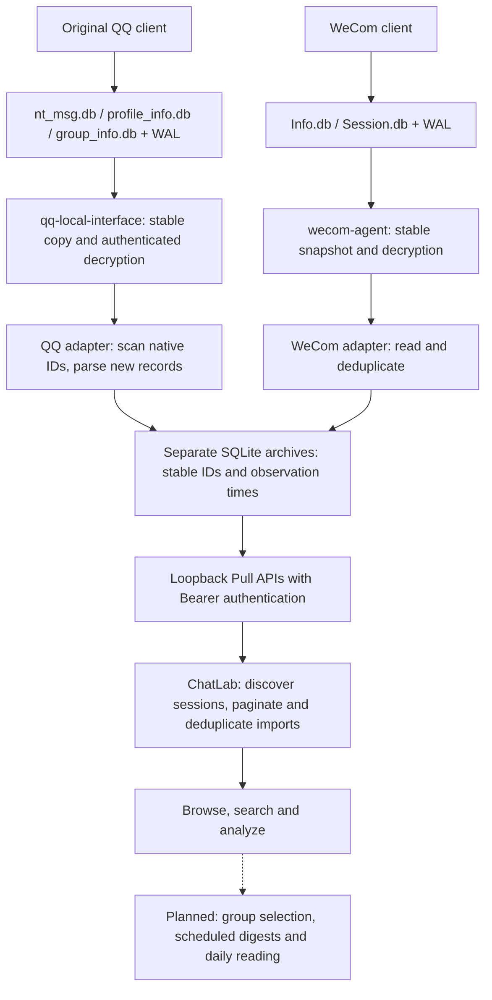

<div align="center">
  <picture>
    <source media="(prefers-color-scheme: light)" srcset="https://github.com/ChatLab/ChatLab/raw/main/public/images/banner-light.png">
    
  </picture>

Your chat history, finally yours.

English | [简体中文](./README.zh-CN.md)

[Official Website](https://chatlab.fun/) · [Docs](https://docs.chatlab.fun/) · [Quick Start](https://docs.chatlab.fun/usage/quick-start) · [Roadmap](https://chatlab.fun/roadmap/tasks) · [Releases](https://github.com/ChatLab/ChatLab/releases)

</div>

## Personal fork: a local automated message workspace

This is [bufferducky's personal fork](https://github.com/bufferducky/ChatLab) of [ChatLab](https://github.com/ChatLab/ChatLab). My goal is to keep using the normal chat clients while collecting QQ, WeCom (Enterprise WeChat), and eventually personal WeChat and Telegram messages into local ChatLab storage for browsing, search, AI analysis and daily digests. [完整中文方案](README.zh-CN.md).

**As of November 12, 2026, QQ and WeCom history imports, background collection and scheduled desktop sync have been verified on a local Mac.** The implementation is on [`feat/qq-local-source`](https://github.com/bufferducky/ChatLab/tree/feat/qq-local-source); `main` still contains the baseline preview, with this README documenting progress. The local build is named **ChatLab Personal** and uses this fork's GitHub update source. These integrations are not implied to be available in upstream installers.

### Collection design



QQ keys were captured once using an isolated debug copy; daily collection reuses the saved keys with the original client running, without a second QQ login. Initial history comes from an existing reader snapshot. Both adapters run independently of ChatLab and keep collecting while the desktop app is closed; ChatLab catches up when reopened. Stable source IDs identify accounts, conversations and messages. Observation times and pagination cursors allow newly discovered messages with old send times or smaller native IDs to be imported.

| Capability | Status |
| --- | --- |
| QQ groups and private chats | Verified: 36 nonempty conversations and 1,199,012 messages, zero field differences in reconciliation, zero additions on repeat pull, and successful scheduled desktop increments |
| WeCom | Local groups, private chats and existing application notifications connected through a separate archive and automatic session discovery |
| Personal WeChat and Telegram collection | Planned; upstream file-import support is separate from automated collection |
| Account and group selection | Currently one source account and all nonempty conversations; sync status, manual sync and pause are available, finer selection is planned |
| Scheduled AI digests | Planned: per-group and cross-group summaries, daily reading and links back to source evidence |

Setup and evidence: [QQ integration](https://github.com/bufferducky/ChatLab/blob/feat/qq-local-source/integrations/qq/README.md), [WeCom integration](https://github.com/bufferducky/ChatLab/blob/feat/qq-local-source/integrations/wecom/README.md), and [QQ research](https://github.com/bufferducky/ChatLab/blob/feat/qq-local-source/integrations/qq/RESEARCH.md). The QQ reader requires a local fix for preallocated zero pages that has not been published upstream; installing the unmodified reader alone does not reproduce this setup.

### Current cadence and resource costs

These are the **local deployment settings**, not script initialization defaults. Collector refresh and ChatLab pull are independent schedules:

| Source | Collector wait after each refresh | ChatLab pull interval | Measured write reference per changed refresh |
| ------ | --------------------------------- | --------------------- | -------------------------------------------- |
| QQ     | 3 hours (10,800 seconds)          | 180 minutes           | About 2 GB                                   |
| WeCom  | 10 minutes (600 seconds)          | 10 minutes            | About 61 MB                                  |

QQ parses only newly discovered messages, but still copies and decrypts the full changed database and scans all native IDs. With a roughly 1 GB main database, two foreground refreshes took 7.8–10.9 seconds with peak RSS around 175 MiB; historical background samples were usually 41–76 seconds, and a busy source also caused retry failure. WeCom also rewrites decrypted databases after source changes; unchanged sources skip the large operations.

Assuming continuous operation and a changed source on every cycle, roughly eight QQ and 144 WeCom refreshes imply about **25 GB/day or 9 TB/year** of collector writes. This is a conditional OS-accounted estimate, not permanent storage growth, NAND writes or an SSD lifespan prediction; retries can add writes. See [QQ performance measurements](https://github.com/bufferducky/ChatLab/blob/feat/qq-local-source/integrations/qq/PERFORMANCE.md). Visibility can approach the sum of the collection and pull intervals, plus processing time.

### Current limits

- Only locally available history is collected. Existing imported messages are not replaced after edits, recalls or conversation renames.
- Media retains types, readable text or placeholders; full attachments, voice transcription and forwarded-message expansion are not complete. The QQ acceptance dataset includes 378 unknown-time records with timestamp 1, which may appear in 1970.
- Pull APIs bind to loopback only (WeCom `5034`, QQ `5035`) and require Bearer authentication. Keys, tokens, plaintext snapshots and archives stay outside Git. AI analysis uses the configured model service; external model calls may send selected chat content to that service.

The upstream AGPL-3.0 license and attribution are retained. Never commit account credentials, API keys or real chat data to this repository. The upstream project overview follows below.

ChatLab is an open-source desktop app for understanding your social conversations. It combines a flexible SQL engine with AI agents so you can explore patterns, ask better questions, and extract insights from chat data, all on your own machine.

Currently supported: **WhatsApp, LINE, QQ, Discord, Instagram, Telegram, iMessage, and Google Chat**. Coming next: **Messenger and KakaoTalk**.

> New install? Start here: [Getting started](https://docs.chatlab.fun/usage/quick-start)

## Core Features

- 🚀 **Built for large histories**: Stream parsing and multi-worker processing keep imports and analysis responsive, even at million-message scale.
- 🔒 **Private by default**: Your chat data and settings stay local. No mandatory cloud upload of raw conversations.
- 🤖 **AI that can actually operate on data**: Agent + Function Calling workflows (24+ tools) can search, summarize, and analyze chat records with context.
- 📊 **Insight-rich visual views**: See trends, time patterns, interaction frequency, rankings, and more in one place.
- 🧩 **Cross-platform normalization**: Different export formats are mapped into a unified model so you can analyze them consistently.

## Installation

### Desktop App

Download the installer for your OS from the [official website](https://chatlab.fun/?type=download) or [GitHub Releases](https://github.com/ChatLab/ChatLab/releases), then double-click to install.

### CLI

Requires Node.js ≥ 20.

```bash
npm i chatlab-cli -g
```

Start ChatLab:

```bash
clb web            # Start API + Web UI, auto-open in browser
clb web --no-open  # Start API + Web UI, skip auto-open
clb web --headless # API only, no Web UI (for scripts / AI Agents)
```

Common options: `--port <port>` (default 3110), `--host <address>`, `--token <token>`.

To run as a persistent background service (auto-start on login + auto-restart on crash):

```bash
clb web --daemon   # Install as system service (macOS / Linux)
clb status           # Check service status
clb stop             # Stop and uninstall service
```

For a full walkthrough, see the [Quick Start guide](https://docs.chatlab.fun/usage/quick-start).

## Usage Guides

- [Download Guide](https://chatlab.fun/?type=download)
- [Chat Record Export Guide](https://docs.chatlab.fun/usage/how-to-export)
- [Standardized Format Specification](https://docs.chatlab.fun/standard/chatlab-format)
- [Troubleshooting Guide](https://docs.chatlab.fun/usage/troubleshooting)

## Preview

For more previews, please visit the official website: [chatlab.fun](https://chatlab.fun/)


## Architecture Overview

ChatLab is a pnpm monorepo built on Electron + Vue 3 + Nuxt UI + Tailwind CSS. Core business logic lives in shared packages (`@openchatlab/core`, `@openchatlab/node-runtime`, `@openchatlab/tools`), consumed by both the desktop app and the CLI service — so they stay in sync.

Data flows in five stages: **format detection → stream parsing → local persistence → SQL + AI query → visualization**.

For a deep dive, see the [architecture documentation](https://docs.chatlab.fun/intro).

### Architecture Principles

- **Local-first by default**: Raw chat data, indexes, and settings remain on-device unless you explicitly choose otherwise.
- **Streaming over buffering**: Stream-first parsing and incremental processing keep large imports stable and memory-efficient.
- **Composable intelligence**: AI features are assembled through Agent + Tool Calling, not hard-coded into one model path.
- **Schema-first evolution**: Import, query, analysis, and visualization share a consistent data model that scales with new features.

---

## Local Development

For complete contributor instructions, see the [Development Guide](https://docs.chatlab.fun/contributing/development).

### Requirements

- Node.js >= 24 < 25
- pnpm >= 11 < 12

### Setup

```bash
# Install dependencies
pnpm install

# Start dev mode — prompts you to choose which app to launch
pnpm dev
```

Or launch a specific target directly:

```bash
pnpm dev:desktop   # Electron desktop app
pnpm dev:cli-web   # CLI Web frontend + local server
pnpm dev:web-wasm  # Browser-only Web WASM
pnpm dev:serve     # CLI server only
pnpm docs:dev      # Docs site
```

If Electron encounters exceptions during startup, you can try using `electron-fix`:

```bash
npm install electron-fix -g
electron-fix start
```

## Privacy Policy & User Agreement

Before using this software, please read the [Privacy Policy & User Agreement](./src/assets/docs/agreement_en.md).

## Community

Please follow these principles before submitting a Pull Request:

- Obvious bug fixes can be submitted directly.
- For new features, please submit an Issue for discussion first; **PRs submitted without prior discussion will be closed**.
- Keep one PR focused on one task; if changes are extensive, consider splitting them into multiple independent PRs.
- For local setup, repository structure, checks, and AI collaboration notes, see the [Development Guide](https://docs.chatlab.fun/contributing/development).

Thanks to all contributors:

<a href="https://github.com/ChatLab/ChatLab/graphs/contributors">
  
</a>

## License

AGPL-3.0 License
