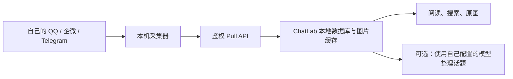

# ChatLab Personal

本地聊天记录工作台：把 QQ、企业微信和 Telegram 的消息汇入自己的电脑，用于阅读、搜索、图片查看和 AI 话题整理。

[下载最新版](https://github.com/bufferducky/ChatLab/releases/latest) · [版本说明](RELEASE_NOTES.md) · [English](README.en.md)

这是基于 [ChatLab](https://github.com/ChatLab/ChatLab) 继续开发的独立个人项目。这里的安装包、功能和发布节奏以本仓库为准。

## 当前功能

- **聊天阅读**：紧凑布局、稳定的发送者颜色、连续发言分组、引用跳转，以及同一发送者的前后发言定位。
- **图片阅读**：Telegram 预览与原图共用缓存，点击原图优先于后台补图；离屏取消和真实限流等待反馈。QQ 图片通过本人设备上已登录的客户端桥接获取。
- **自动话题**：按会话配置整理时段，持续增量整理最近 7 天内尚未处理的消息，接续跨日讨论，显示新进展、原文证据和未读版本。默认时段为北京时间 09:30–23:40，需应用保持运行并配置模型。重复拉取不会重复总结；更早的原始消息和历史按日阅读仍保留。
- **群聊热点**：阅读、收藏、略过与反馈，查看模型用量和预算状态，回溯来源消息。
- **本地同步**：QQ、企微、Telegram 使用独立采集器与 Pull API，稳定消息 ID 去重；中断后继续处理已提交断点之后的数据。设置 → 自动化可按群聊、私聊、全部或单会话立即采集并拉取；采集器不支持立即采集时直接拉取已有数据。

AI 功能需要自行配置模型服务。消息保存在本地；使用外部模型时，相关内容会发送到你选择的模型供应商。

**自动总结总开关**位于“设置 → 自动化 → 自动同步 → 自动话题”，默认开启，切换后立即保存并在重启后保留。关闭后停止所有会话的自动总结，并中止正在运行的自动请求；消息采集与同步、已有话题阅读、手动“立即更新”和批量总结仍可使用。各会话原有的开关、时段和处理断点保留，重新开启后按各会话设置增量整理。已经发出的模型请求可能仍产生用量。

自动话题与“立即更新”均限制在最近 7 天，近 7 天的补录消息仍可增量处理。模型上游断流、审核拒绝等失败会保留处理位置供后续重试；已有话题仍可阅读。按群聊或私聊选择的是拉取范围，QQ 底层采集仍按数据源整体执行。详见 [话题整理](packages/node-runtime/src/services/topics/README.md) 与 [Pull 协议](docs/cn/standard/chatlab-pull.md)。

## 安装桌面端

从 [GitHub Releases](https://github.com/bufferducky/ChatLab/releases/latest) 下载对应文件：

| 系统                | 安装包                                          | 验证范围                                |
| ------------------- | ----------------------------------------------- | --------------------------------------- |
| macOS Apple Silicon | `ChatLab-Personal-版本号-arm64.dmg`，另提供 ZIP | 本机阅读抽查及打包运行时检查            |
| Windows x64         | `ChatLab-版本号-setup.exe`                      | CI 构建、原生解析器及 SQLite 运行时检查 |

个人构建不使用 Apple 开发者签名、公证或 Windows 代码签名。Windows 的 CI 检查不等同于完整真机验收。macOS Intel 暂不提供安装包。

每次发布提供 `SHA256SUMS.txt` 和 `BUILD_INFO.json`，分别用于校验下载和确认源码版本。升级前退出旧程序，保留原有数据目录与采集器配置。当前推荐通过 Release 安装包手动升级。

## 接入消息

桌面安装包与采集器是两个部分。采集器仍需在自己的设备部署、授权和配置；不会随桌面包附带账号、凭据或聊天数据。三条采集链路目前主要在 macOS 验证，不能将 Windows 桌面支持等同于 Windows 采集器支持。

| 数据源                                      | 说明                                                                   |
| ------------------------------------------- | ---------------------------------------------------------------------- |
| [QQ](integrations/qq/README.md)             | 依赖本机读取器与已登录 QQ 客户端；部分读取兼容修复尚未发布至读取器上游 |
| [企业微信](integrations/wecom/README.md)    | 读取自己的本机消息副本，独立存档并提供 Pull API                        |
| [Telegram](integrations/telegram/README.md) | 使用本人 MTProto 授权；新会话按配置的起点采集，后续按 ID 增量          |

采集频率与 ChatLab 拉取频率分别配置。仓库不会自动套用维护者机器上的账号、群列表或定时设置。个人微信自动采集不在当前支持范围。



## 从源码运行

需要 Node.js 24、pnpm 11；构建原生解析器另需 Rust。首次部署参考 [开发指南](docs/cn/contributing/development.md)。

```bash
pnpm install --frozen-lockfile
pnpm dev:desktop
```

验证与构建：

```bash
pnpm run type-check:all
pnpm test
pnpm build:mac
```

本地 `build:mac` 用于开发验收。正式发布通过版本 tag 触发 [个人发布工作流](.github/workflows/personal-release.yml)，构建 macOS／Windows，校验全部产物，并重新下载草稿复核后再发布。具体步骤见 [发布指南](integrations/RELEASING.md)。

## 数据与隐私

配置、token、授权 session、数据库、解密副本、缓存、日志和真实聊天截图应放在源码目录之外。提交前检查全部待推送提交；不将本机采集结果作为公开示例。发布只包含程序、自动更新元数据、版本身份和校验文件。

## 许可证与致谢

保留 [LICENSE](LICENSE) 中的许可证和原作者版权声明。感谢 [ChatLab 上游项目](https://github.com/ChatLab/ChatLab) 及相关开源依赖。个人项目的改动、安装包和问题反馈统一在 [本仓库](https://github.com/bufferducky/ChatLab) 管理。
