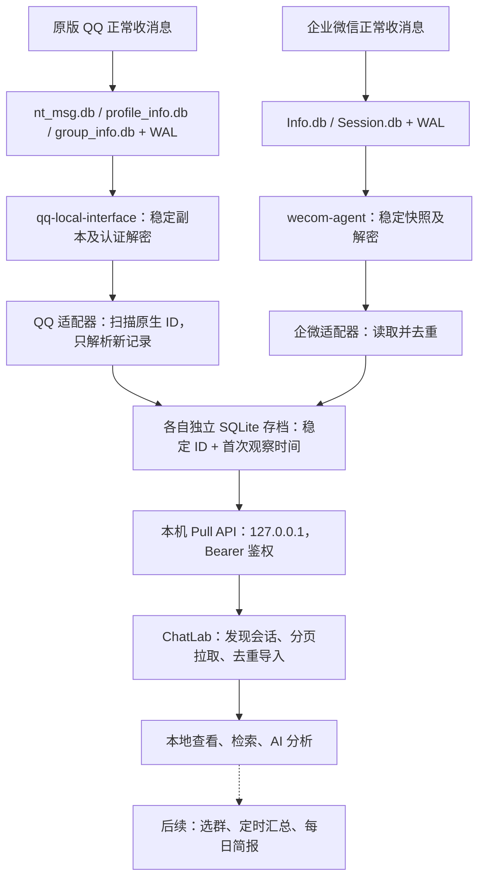

<div align="center">
  <picture>
    <source media="(prefers-color-scheme: light)" srcset="https://github.com/ChatLab/ChatLab/raw/main/public/images/banner-light.png">
    
  </picture>

聊天记忆驱动的 AI Agent

[English](README.md) | 简体中文

[官网](https://chatlab.fun/cn/) · [文档](https://docs.chatlab.fun/cn/) · [快速开始](https://docs.chatlab.fun/cn/usage/quick-start) · [路线图](https://chatlab.fun/cn/roadmap/tasks) · [Releases](https://github.com/ChatLab/ChatLab/releases)

</div>

## 个人二开方案：本地自动消息中心

这是 [bufferducky 的个人 Fork](https://github.com/bufferducky/ChatLab)，基于 [ChatLab 上游项目](https://github.com/ChatLab/ChatLab) 持续开发。我的目标是：日常照常使用聊天客户端，把 QQ、企业微信，以及后续的个人微信、Telegram 消息自动汇入本地 ChatLab，用于查看、搜索和 AI 分析，再逐步实现按群、跨群的每日简报。

**截至 2026-11-12，QQ 和企业微信已在本机 macOS 跑通历史导入、后台采集和桌面端定时增量同步。** 实现代码在 [`feat/qq-local-source`](https://github.com/bufferducky/ChatLab/tree/feat/qq-local-source)；`main` 目前保留基础试用版，本节同步展示方案和进展。个人试用包名为 **ChatLab Personal**，采用本 Fork 的 GitHub 更新源；此处的本机验收不代表上游安装包已经包含这些接入能力。

### 具体接入链路



QQ 首次取钥在隔离调试副本完成，恢复原版后，日常同步复用已保存的密钥，不再登录第二个 QQ 实例。首次历史复用读取器已有快照，后续读取原版 QQ 的本地数据库；企微复用已经安装并取钥成功的 `wecom-agent`。两个适配器独立于 ChatLab 常驻，桌面端关闭期间仍可采集，重新打开后补拉存档。

消息按账号、会话和稳定消息 ID 区分，不按群名、正文或发送时间去重。增量进度使用首次观察时间和分页游标，保留原始发送时间，因此旧时间、较小 ID 的新补录消息也能接入。当前自动发现数据源中的全部有消息会话，精细选群仍在后续计划中。

### 已完成与后续计划

| 能力 | 当前状态 |
| --- | --- |
| QQ 群聊、私聊 | 已接入；验收时导入 36 个有消息会话、1,199,012 条消息，逐条对账 0 差异，重复拉取新增 0 条，桌面自动增量通过 |
| 企业微信 | 已接入本机群聊、私聊和已有应用通知；独立存档、自动发现和定时拉取已跑通 |
| 个人微信、Telegram 自动采集 | 待实现；上游支持导入这些平台的导出文件，不等于本 Fork 已完成自动采集 |
| 账号与群选择、采集状态 | 当前按单个源账号和全部会话部署，可查看同步状态、立即同步及暂停；精细选择待完善 |
| 定时 AI 汇总、每日简报 | 待实现；计划支持按群与跨群汇总、按日期阅读，并回溯原消息证据 |

接入和验证步骤：[QQ 本地数据源](https://github.com/bufferducky/ChatLab/blob/feat/qq-local-source/integrations/qq/README.md) · [企业微信本地数据源](https://github.com/bufferducky/ChatLab/blob/feat/qq-local-source/integrations/wecom/README.md) · [QQ 调研与取钥记录](https://github.com/bufferducky/ChatLab/blob/feat/qq-local-source/integrations/qq/RESEARCH.md)。QQ 读取器依赖本机预分配零页兼容修复，该修复尚未发布到读取器上游，不能把安装原版读取器等同于完整复现。

### 采集频率与磁盘成本

采集器检查本地数据库与 ChatLab 拉取存档是两个独立周期。**当前本机配置**如下，不是脚本初始化默认值，也不会随克隆仓库自动生效：

| 数据源   | 后台采集等待间隔    | ChatLab 拉取间隔 | 本机每次有变化刷新的写入参考 |
| -------- | ------------------- | ---------------- | ---------------------------- |
| QQ       | 3 小时（10,800 秒） | 180 分钟         | 约 2 GB                      |
| 企业微信 | 10 分钟（600 秒）   | 10 分钟          | 约 61 MB                     |

QQ 已避免每轮重建百万条消息索引，但每次源库变化仍需整库复制、解密并扫描消息 ID，并未实现只解密变化页。约 1 GB 主库的两轮前台刷新为 7.8～10.9 秒、峰值内存约 175 MiB；后台历史样本通常约 41～76 秒，也出现过源库持续变化导致重试失败。企微同样会在源库变化后重新写出解密库；无变化时跳过大规模处理。

按全天运行、QQ 每天约 8 轮、企微约 144 轮且每轮源库都有变化粗算，两者合计约 **25 GB／天、9 TB／年**。这是采集器的系统记账写入条件估算，不是每天永久新增的占用空间，也不等于 SSD 闪存实际写入或寿命预测；失败重试可能额外增加写入。具体测量见 [QQ 性能实测](https://github.com/bufferducky/ChatLab/blob/feat/qq-local-source/integrations/qq/PERFORMANCE.md)。

采集等待从本轮结束后计算，ChatLab 还要等下一轮拉取，消息可见延迟可能接近两个周期之和，另加处理耗时。这套配置面向历史存档、检索和分析。

### 当前数据边界

- 只采集客户端已同步到本机的记录；无法恢复本机不存在的云端历史。当前为追加存档，编辑、撤回和会话改名不会覆盖 ChatLab 既有记录。
- 媒体保留类型、现有可读文字或占位；完整附件展示、语音转写和转发内层展开尚未完成。QQ 验收中的 378 条未知时间消息使用时间戳 1，可能显示在 1970 年。
- 本机 Pull 服务仅监听回环地址：企微 `5034`、QQ `5035`，接口使用 Bearer token；凭证、密钥、明文快照及存档留在仓库外私有目录。AI 功能使用配置的模型服务，调用外部模型时需自行决定发送哪些聊天内容。

保留上游 AGPL-3.0 许可证及署名。账号凭据、API Key、真实聊天数据不得提交到仓库。以下继续保留上游项目介绍。

ChatLab 是一个专注于聊天记录分析的本地化应用。通过 AI Agent和灵活的 SQL 引擎，你可以自由地分析你的聊天记录数据。

目前已支持：**WhatsApp、LINE、QQ、Discord、Instagram、Telegram、iMessage、Google Chat**。即将支持：Messenger、KakaoTalk。

> 首次安装？从这里开始：[快速开始](https://docs.chatlab.fun/cn/usage/quick-start)

## 核心特性

- 🚀 **极致性能**：使用流式计算与多线程并行架构，就算是百万条级别的聊天记录，依然拥有丝滑交互和响应。
- 🔒 **保护隐私**：聊天记录和配置都存在你的本地数据库，所有分析都在本地进行（AI 功能例外）。
- 🤖 **智能 AI Agent**：集成 24+ Function Calling 工具，支持动态调度，深度挖掘聊天记录中的更多有趣。
- 📊 **多维数据可视化**：提供活跃度趋势、时间规律分布、成员排行等多个维度的直观分析图表。
- 🧩 **格式标准化**：通过强大的数据抽象层，抹平不同聊天软件的格式差异，即使是再小众的聊天软件，也能分析。

## 安装

### 桌面端

前往[官网](https://chatlab.fun/cn/?type=download)或 [GitHub Releases](https://github.com/ChatLab/ChatLab/releases) 下载对应操作系统的安装包，双击安装即可。

### CLI

需要 Node.js ≥ 20。

```bash
npm i chatlab-cli -g
```

启动 ChatLab：

```bash
clb web            # 启动 API + Web UI，并在浏览器中打开
clb web --no-open  # 启动 API + Web UI，但不自动打开浏览器
clb web --headless # 仅启动 API，不挂载 Web UI（供脚本 / AI Agent 调用）
```

常用选项：`--port <端口>`（默认 3110）、`--host <地址>`、`--token <令牌>`。

如果希望服务常驻后台（开机自启 + 崩溃自动重启）：

```bash
clb web --daemon   # 注册为系统服务（macOS / Linux）
clb status           # 查看常驻状态
clb stop             # 停止并取消常驻
```

完整使用说明请见[快速开始指南](https://docs.chatlab.fun/cn/usage/quick-start)。

## 使用指南

- [下载 ChatLab 指南](https://chatlab.fun/cn/?type=download)
- [导出聊天记录指南](https://docs.chatlab.fun/cn/usage/how-to-export)
- [标准化格式规范](https://docs.chatlab.fun/cn/standard/chatlab-format)
- [故障排查指南](https://docs.chatlab.fun/cn/usage/troubleshooting)

## 预览界面

预览更多请前往官网 [chatlab.fun](https://chatlab.fun/cn/)


## 架构概览

ChatLab 是一个基于 pnpm monorepo 的工程，桌面端使用 Electron + Vue 3 + Nuxt UI + Tailwind CSS，核心业务逻辑沉淀在共享包（`@openchatlab/core`、`@openchatlab/node-runtime`、`@openchatlab/tools`），桌面端与 CLI 服务端复用同一份逻辑，保持功能同步。

数据流分五个阶段：**格式嗅探 → 流式解析 → 本地落盘 → SQL + AI 查询 → 可视化呈现**。

详细架构请参考[项目文档](https://docs.chatlab.fun/cn/intro)。

### 架构原则

- **Local-first by default**：原始聊天记录、索引与配置默认留在本地，优先保护隐私边界。
- **Streaming over buffering**：以流式解析和增量处理为核心，面向大体量导出文件保持稳定吞吐。
- **Composable intelligence**：AI 能力通过 Agent + Tool Calling 组合，避免将业务逻辑硬编码到单一模型。
- **Schema-first evolution**：围绕统一数据结构构建导入、查询、分析与可视化，降低演进成本。

---

## 本地开发

完整协作者说明见[开发指南](https://docs.chatlab.fun/cn/contributing/development)。

### 环境要求

- Node.js >= 24 < 25
- pnpm >= 11 < 12

### 启动步骤

```bash
# 安装依赖
pnpm install

# 启动开发模式 — 会提示选择要启动的目标
pnpm dev
```

也可以直接启动指定目标：

```bash
pnpm dev:desktop   # Electron 桌面端
pnpm dev:cli-web   # CLI Web 前端 + 本地服务
pnpm dev:web-wasm  # 纯浏览器 Web WASM
pnpm dev:serve     # 仅 CLI 服务端
pnpm docs:dev      # 文档站
```

若 Electron 在启动时异常，可尝试使用 `electron-fix`：

```bash
npm install electron-fix -g
electron-fix start
```

## 隐私政策与用户协议

使用本软件前，请阅读 [隐私政策与用户协议](src/assets/docs/agreement_zh.md)

## 社区

提交 Pull Request 前请遵循以下原则：

- 明显的 Bug 修复可直接提交
- 对于新功能，请先提交 Issue 进行讨论，**未经讨论直接提交的 PR 会被关闭**
- 一个 PR 尽量只做一件事，若改动较大，请考虑拆分为多个独立的 PR
- 本地运行、目录职责、测试检查和 AI 协作说明见[开发指南](https://docs.chatlab.fun/cn/contributing/development)

感谢所有为 ChatLab 做出贡献的人！

<a href="https://github.com/ChatLab/ChatLab/graphs/contributors">
  
</a>

## License

AGPL-3.0 License
