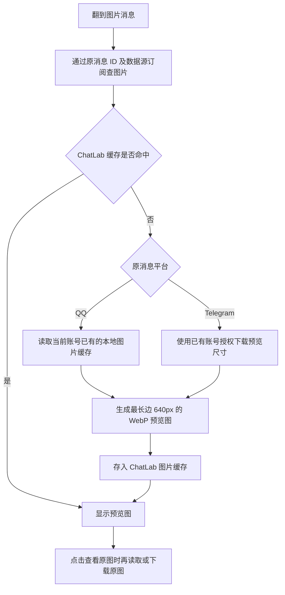

# QQ / Telegram 按需图片

普通图片已接入 Desktop 与 CLI Web 的消息气泡；Web WASM 暂不连接本机采集器。



## 磁盘与清理

- 缓存位置：`<systemDir>/cache/message-images/`，默认是 `~/.chatlab/cache/message-images/`。沿用现有缓存目录，设置中的缓存清理会一并删除它。
- 默认缓存上限 **3 GiB**，包含图片和附件清单的数据块。按文件内容 SHA-256 去重，达到上限清理最久未访问的数据块；引用文件另有少量开销。
- QQ 原图直接从 QQ 账号的 `nt_data` / `nt_temp` 读取，不另存一份；ChatLab 只保存小预览图。找不到、匹配不唯一或缓存被清理时显示“图片不可用”。不凭普通同名文件猜图。
- TG 首次查看时才下载预览图，点击后才下载原图；缓存受同一上限约束。不回填全部历史图片，不改变原有 7 天首次采集和后续增量策略。
- 浏览器带鉴权取得图片，再生成临时 Blob URL；凭证不会放进图片 URL。切换消息或关闭组件时释放临时 URL。
- 本版限制单张输入 50 MiB、解码 4000 万像素；支持 JPEG、PNG、WebP、GIF 等常见图片。预览图为静态图，TG 动态贴纸、视频和动画文件不在此次图片支持范围。

## 已有消息

不修改 ChatLab 聊天数据库 schema，不重建或重复导入消息。取图通过现有数据源订阅的 `targetSessionId` / `remoteSessionId` 和 `platform_message_id` 关联，已经导入的消息也可以取图。

QQ 桥接存档增加可选 `image_metadata` 表，只保存附件信息，不存图片字节。新采集消息直接保留信息；历史元数据会在常规解密刷新中单次扫描补齐，已有消息正文、稳定 ID、采集和消费进度保持原样。首次补齐会比通常刷新更慢；补齐前优先读取已有快照的附件信息。

TG 根据已存会话及消息 ID 重新取得媒体。原消息被删除、账号无权访问、网络中断或平台限流时可能无法取图；已缓存预览图仍可显示。停止采集器会阻止未缓存图片的获取。

## 接口与验证

采集器提供 Bearer 鉴权的 `GET /api/v1/sessions/:sid/messages/:mid/images` 及 `.../images/:index?size=preview|original`。ChatLab 使用 `GET /_web/sessions/:sid/messages/:localMessageId/images` 及同名图片子路由代理，浏览器无需知道原平台凭证或本机文件路径。

```bash
# 使用 Node 24，复用项目已有依赖。
pnpm test -- packages/node-runtime/src/services/message-images.test.ts packages/http-routes/src/routes/web/message-images.test.ts
pnpm run type-check:all
~/.local/share/chatlab-telegram/.venv/bin/python -m unittest discover -s integrations/telegram -p 'test_*.py' -q
~/openProjects/qq-local-interface/.venv/bin/python -m unittest discover -s integrations/qq -p 'test_*.py' -q
```

测试使用合成图片和临时数据库，覆盖已有消息关联、预览缩放、原图、缓存复用与去重、容量淘汰、QQ 图片路径约束和 TG 按需下载。真实账号验证只输出统计，图片、正文、路径和凭证不进入仓库。
