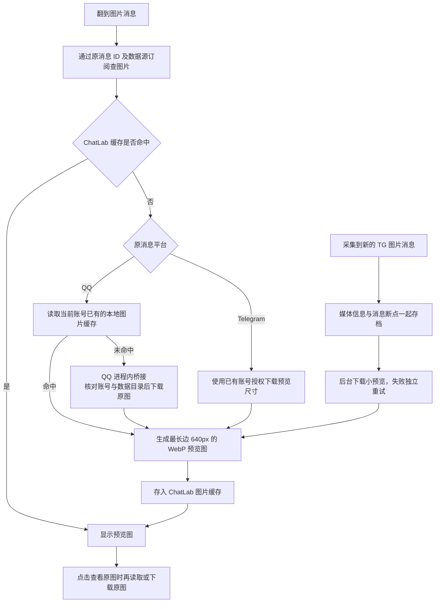

# QQ / Telegram 按需图片

普通图片已接入 Desktop 与 CLI Web 的消息气泡；Web WASM 暂不连接本机采集器。

QQ 本地缓存未命中时，可通过 QQ 进程内桥接在线补图：采集器发现桥接、核对账号与数据目录后调用 QQ 原生下载，ChatLab 继续复用现有预览与缓存。接口、错误码及鉴权约定见 [QQ 在线图片桥接接口设计](qq/IMAGE_BRIDGE_API.md)；桥接模块已实现并通过自动化测试，带桥接的日常客户端部署仍属实验，见 [桥接部署说明](qq/client-bridge/README.md)。



## 磁盘与清理

- 缓存位置：`<systemDir>/cache/message-images/`，默认是 `~/.chatlab/cache/message-images/`。沿用现有缓存目录，设置中的缓存清理会一并删除它。
- 默认缓存上限 **5 GiB**，包含图片和附件清单的数据块。按文件内容 SHA-256 去重，达到上限清理最久未访问的数据块；引用文件另有少量开销。
- QQ 原图直接从 QQ 账号的 `nt_data` / `nt_temp` 读取，不另存一份；ChatLab 只保存小预览图。同一原图存在多份时通过消息中的 MD5 校验内容后复用；只剩 `Thumb/<MD5>_<size>` 缩略图时可显示预览，但查看原图仍需原图缓存。找不到或缓存被清理时，QQ 会尝试在线补图；桥接未运行、QQ 未登录或账号不符时显示对应状态，不凭普通同名文件猜图。QQ 原图下载后的成功字节经原消息 MD5 校验，失败、超限或校验不符不进入缓存。
- TG 新采集的普通图片会保存媒体信息并后台预取小预览，点击后才下载原图；预取和按需取图复用同一份 5 GiB 缓存，不在采集目录保存另一份图片。旧消息按查看补图，缓存淘汰后也按需重取；不主动全量回填旧图片，不改变原有 7 天首次采集和后续增量策略。
- 浏览器带鉴权取得图片，再生成临时 Blob URL；凭证不会放进图片 URL。切换消息或关闭组件时释放临时 URL。
- 本版限制单张输入 50 MiB、解码 4000 万像素；支持 JPEG、PNG、WebP、GIF 等常见图片。预览图为静态图，TG 动态贴纸、视频和动画文件不在此次图片支持范围。

## 已有消息

不修改 ChatLab 聊天数据库 schema，不重建或重复导入消息。取图通过现有数据源订阅的 `targetSessionId` / `remoteSessionId` 和 `platform_message_id` 关联，已经导入的消息也可以取图。

QQ 桥接存档增加可选 `image_metadata` 表，只保存附件信息，不存图片字节。新采集消息直接保留信息；历史元数据会在常规解密刷新中单次扫描补齐，已有消息正文、稳定 ID、采集和消费进度保持原样。首次补齐会比通常刷新更慢；补齐前优先读取已有快照的附件信息。

TG 桥接存档新增可选 `image_metadata` 表，保存序列化媒体对象、配文和预取进度，与消息断点原子提交；图片文件由现有 Node 缓存服务校验、缩放并管理。新消息取图复用已保存的媒体信息，旧消息缺少信息或 Telegram 文件引用过期时，才按会话及消息 ID 查询更新。下载失败保留文字及待办，30 分钟后独立重试；重启后继续待办。预取仍受共享 3 秒请求间隔和官方限流约束，文字可先于预览出现。

原消息被删除、账号无权访问、网络中断或平台限流时可能无法取图；已缓存预览图仍可显示。停止采集器会阻止未缓存图片的获取。预取需要项目已有的 Node 24 环境，目录或数据源地址自定义配置见 [Telegram 本地数据源](telegram/README.md)。

采集器 `/health` 正常只代表本地服务和存档可用，不代表 Telegram 上游连接正常。若图片请求持续超时，且采集日志长时间停更、错误日志持续出现连接关闭，可重启采集服务恢复连接，再重试图片；无需删除存档或重新授权。

## 接口与验证

采集器提供 Bearer 鉴权的 `GET /api/v1/sessions/:sid/messages/:mid/images` 及 `.../images/:index?size=preview|original`。ChatLab 使用 `GET /_web/sessions/:sid/messages/:localMessageId/images` 及同名图片子路由代理，浏览器无需知道原平台凭证或本机文件路径。

```bash
# 使用 Node 24，复用项目已有依赖。
pnpm test -- packages/node-runtime/src/services/message-images.test.ts packages/http-routes/src/routes/web/message-images.test.ts
pnpm run type-check:all
~/.local/share/chatlab-telegram/.venv/bin/python -m unittest discover -s integrations/telegram -p 'test_*.py' -q
~/openProjects/qq-local-interface/.venv/bin/python -m unittest discover -s integrations/qq -p 'test_*.py' -q
```

QQ 桥接与采集器在线补图另有独立回归：

```bash
node --test integrations/qq/client-bridge/test_image_bridge.test.mjs
pnpm exec eslint integrations/qq/client-bridge/*.cjs integrations/qq/client-bridge/*.mjs
```

测试使用合成图片和临时数据库，覆盖已有消息关联、预览缩放、原图、缓存复用与去重、容量淘汰、QQ 图片路径约束、在线补图错误码透传和 TG 按需下载。真实账号验证只输出统计，图片、正文、路径和凭证不进入仓库。
