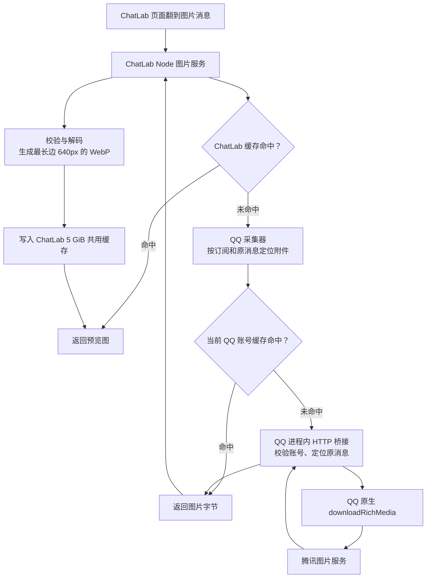
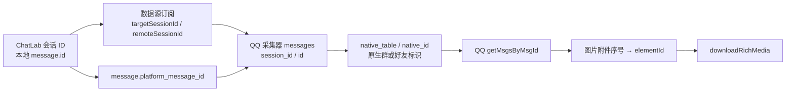
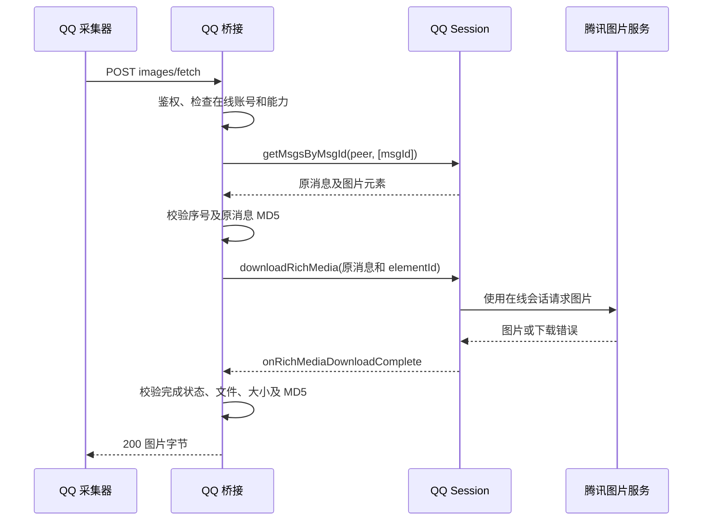

# QQ 在线图片桥接接口设计

> 状态：接口 v1 已实现并通过自动化测试；日期：2026-11-13。本文面向 ChatLab、QQ 采集器及 QQ 桥接程序的开发者，用于联调与验收。带桥接的日常客户端部署与实机验收尚未完成，见第 14 节。

目标：用户在 ChatLab 查看 QQ 图片时，先复用本机已有缓存；缺图时调用已登录 QQ 的原生下载服务，取得图片后生成预览，并复用现有 **5 GiB** 图片缓存。首版在线取图统一走 QQ 桥接，不加入腾讯旧图片接口兜底。

## 1. 已验证事实与实现范围

| 能力 | 当前状态 |
| --- | --- |
| Desktop / CLI Web 的消息图片清单、预览、原图接口 | 已有，路径及成功响应继续复用 |
| QQ 本地图片缓存读取、ChatLab 预览生成及 5 GiB 缓存 | 已有 |
| QQ 副本内加载桥接、取得 QQ 自己创建的 Session | 已实机验证；QQ 7.0.1-52892，QQNT / Electron 40.0.0 |
| 查询原消息并调用 `downloadRichMedia` | 4 张实测成功，MD5 与原消息一致，解码通过；包含旧图片接口 404 的图片 |
| 本文新增 HTTP 接口、账号核对、错误透传、并发控制 | 待实现 |
| 日常启动、版本适配、客户端更新及回退流程 | 待实现；独立副本实验成功不等于已完成日常部署 |

实验细节见 [QQ 在线图片可行性研究](../../research/qq-online-images-feasibility.md)。实验用的文件邮箱和任意表达式执行入口不进入产品；正式桥接仅提供本文定义的状态查询和图片获取操作。

首版只覆盖已导入消息中的普通图片附件；不新增聊天导入、批量历史图片归档、视频/文件下载、发消息或 QQ 登录管理接口。TG 继续使用原有下载链路，Web WASM 暂不接入本机桥接。

## 2. 调用链与职责



| 层 | 职责 | 不向页面暴露的内容 |
| --- | --- | --- |
| ChatLab 页面 | 请求清单、按可见范围取预览、点击取原图、显示错误及重试 | QQ 凭据、群原生 ID、下载地址、本机路径 |
| ChatLab Node 图片服务 | 将本地消息映射到数据源，校验图片、生成预览、管理共用缓存 | 数据源 Bearer token、桥接连接信息 |
| QQ 采集器 `integrations/qq` | 校验原消息归属、读取账号本地缓存，缓存未命中时调用桥接 | 原生消息、账号和附件映射 |
| QQ 进程内桥接 | 使用 QQ 创建的 Session 查询附件并下载，只返回对应图片字节 | Session、内部调用对象、临时文件路径 |
| QQ 客户端 | 管理在线会话、媒体下载权限及其自身文件缓存 | 登录凭据、`rkey` 等内部鉴权信息 |

QQ 桥接服务必须与用户正在使用的 QQ 位于同一进程/登录会话。不是另启动一个后台 QQ 与桌面 QQ 抢登录名额。实际启用需要运行加载桥接的客户端；未加载桥接的原版 QQ 仍可供采集器读取本地消息与图片缓存，但无法接受在线取图请求。

## 3. 消息与图片标识



| 字段 | 类型及规则 |
| --- | --- |
| `sessionId` | ChatLab 会话 ID 字符串，来自已有会话 |
| `localMessageId` | ChatLab 本地消息整数 ID，沿用现有安全整数校验 |
| `remoteSessionId` | 已配置订阅中的 QQ 远端会话 ID，作为不透明字符串处理 |
| `platformMessageId` | ChatLab 的 `message.platform_message_id`，对应采集器 `messages.id`；不可直接作为 QQ 原生消息 ID 使用 |
| `nativeMessageId` / `msgId` | QQ 原生 64 位消息 ID；从采集器 `native_id` 读出后转十进制字符串，JSON 与 JavaScript 全程不得转为 `Number` |
| `chatType` | QQ 原生会话类型：首版 `1` 私聊、`2` 群聊；其他类型返回不支持 |
| `peerUid` | QQ 原生会话对象标识，群聊为群标识；必须从已绑定会话解析，不能使用群名称推导 |
| `index` / `imageIndex` | 从 0 开始，仅对图片附件编号，与清单中的顺序一致；混合消息中的文字等元素不参与编号 |
| `elementId` | 桥接查询 QQ 原消息后，从选中图片元素获取；不要求前端提交或在聊天库新增持久字段 |
| `expectedMd5` | 采集器已有的原图片 MD5，32 位十六进制、小写规范化。校验原始下载字节，不用于校验缩放后的 WebP 或 QQ 缩略图 |

请求图片前必须证明：本地消息属于指定会话，平台为 QQ，数据源订阅唯一，采集器原消息属于对应远端会话。没有足够原生映射信息时返回明确错误，不通过同名群或普通同名文件猜图。

## 4. 接口分层总览

| 调用方向 | 方法及路径 | 状态 |
| --- | --- | --- |
| 页面 → ChatLab | `GET /_web/sessions/:sessionId/messages/:localMessageId/images` | 已有，复用 |
| 页面 → ChatLab | `GET /_web/sessions/:sessionId/messages/:localMessageId/images/:index?size=preview\|original` | 已有，扩展失败响应 |
| ChatLab → QQ 采集器 | `GET /api/v1/sessions/:remoteSessionId/messages/:platformMessageId/images` | 已有，复用 |
| ChatLab → QQ 采集器 | `GET /api/v1/sessions/:remoteSessionId/messages/:platformMessageId/images/:index?size=preview\|original` | 已有，内部增加在线补图 |
| QQ 采集器 → QQ 桥接 | `GET /v1/health` | 新增，待实现 |
| QQ 采集器 → QQ 桥接 | `POST /v1/images/fetch` | 新增，待实现 |

QQ 桥接绑定 `127.0.0.1` 的系统分配端口，通过私有运行时文件发现地址。示例端口只作说明，不与现有 QQ 采集器 `5035` 或 ChatLab 内部服务端口混用。

## 5. 页面侧图片接口

### 5.1 查询附件清单

```http
GET /_web/sessions/session-example/messages/42/images
Authorization: Bearer <CHATLAB_TOKEN>
Accept: application/json
```

Desktop 沿用内部服务 token；CLI Web 沿用现有 HTTP 鉴权策略。页面不持有 QQ 采集器或 QQ 桥接 token。

成功响应 `200 application/json`，沿用已有结构：

```json
{
  "images": [{ "index": 0 }, { "index": 1 }],
  "caption": "图片说明文字"
}
```

清单只读取已导入消息及附件元数据，**不触发图片下载，也不要求 QQ 在线**。`images: []` 表示消息没有受支持的图片附件；不得用空数组掩盖 QQ 离线、账号不符或下载失败。能够返回清单不代表图片文件一定可取到。

### 5.2 获取预览或原图

```http
GET /_web/sessions/session-example/messages/42/images/0?size=preview
Authorization: Bearer <CHATLAB_TOKEN>
```

`size` 默认为 `preview`，仅接受 `preview`、`original`。成功直接返回图片字节，不包 JSON，也不返回腾讯下载 URL。

| 响应项                   | 约定                                                                   |
| ------------------------ | ---------------------------------------------------------------------- |
| 预览 `Content-Type`      | `image/webp`；最长边 640px，不放大，沿用当前静态预览行为               |
| 原图 `Content-Type`      | 经内容解码确认的 JPEG / PNG / GIF / WebP / AVIF MIME，沿用当前支持格式 |
| `Cache-Control`          | `no-store`；磁盘缓存由 ChatLab 管理，不依赖浏览器 HTTP 缓存            |
| `X-Content-Type-Options` | `nosniff`                                                              |
| 文件内容                 | 单张输入最多 50 MiB，解码上限 4,000 万像素，沿用当前约束               |

本地只有 QQ 缩略图时，预览可直接显示；用户点击原图后仍应尝试 QQ 原生下载，不能把缩略图冒充原图。

## 6. QQ 采集器的图片接口

地址仍使用已有数据源 `baseUrl`，默认 `http://127.0.0.1:5035/api/v1`。路径中的远端会话 ID 和平台消息 ID 都必须分别 URL 编码。

```http
GET /api/v1/sessions/<REMOTE_SESSION_ID>/messages/<PLATFORM_MESSAGE_ID>/images/0?size=preview
Authorization: Bearer <DATA_SOURCE_TOKEN>
```

成功仍返回 `200 application/octet-stream` 图片字节，由 ChatLab Node 服务解码、判定 MIME 并生成预览。采集器按以下顺序处理：

1. 验证消息、会话、附件序号及账号归属。
2. 尝试读取当前账号已有的 QQ 缓存；已有图片继续沿用路径约束和身份匹配。
3. 未命中则发现 QQ 桥接，核对账号及数据目录，转换原生消息标识。
4. 调用 `POST /v1/images/fetch`，验证返回大小和原图 MD5，返回字节。

清单接口保持只读元数据；图片接口的成功结构不变。原有 `/health` 表示采集存档状态，不将其 `ready=true` 当成 QQ 桥接已在线。

## 7. QQ 桥接发现、鉴权与状态

### 7.1 发现文件

建议文件位置：`~/.local/share/chatlab-qq/runtime/image-bridge.json`，目录权限 `0700`，文件权限 `0600`。启动时原子写入，退出时仅删除属于当前 `instanceId` 的文件；崩溃遗留文件必须通过健康检查识别，不能仅凭 PID 存在判断可用。

```json
{
  "protocolVersion": "1",
  "baseUrl": "http://127.0.0.1:5040",
  "token": "<EPHEMERAL_BRIDGE_TOKEN>",
  "pid": 12345,
  "instanceId": "<RANDOM_INSTANCE_ID>"
}
```

桥接 token 启动时随机生成，至少 256 位随机量，与 ChatLab token、数据源 token 分开。采集器只接受本机回环地址；所有桥接 HTTP 请求都携带 `Authorization: Bearer <EPHEMERAL_BRIDGE_TOKEN>`。不将 token 放入 URL、日志、前端或 Git，不开放跨站 CORS。

### 7.2 查询状态：`GET /v1/health`

成功返回 `200 application/json`。该接口本身存活时，即使 QQ 尚未登录也返回 `200`，用状态字段表达就绪情况：

```json
{
  "protocolVersion": "1",
  "instanceId": "<RANDOM_INSTANCE_ID>",
  "ready": true,
  "sessionCaptured": true,
  "loggedIn": true,
  "accountUin": "100000000",
  "accountDataDir": "/private/example/qq-account",
  "qqVersion": "7.0.1-52892",
  "electronVersion": "40.0.0",
  "capabilities": ["fetch-image-original"]
}
```

| 字段              | 说明                                                                          |
| ----------------- | ----------------------------------------------------------------------------- |
| `ready`           | 已取得有效 Session、QQ 在线、当前版本适配成功且具备取图能力时为 `true`        |
| `sessionCaptured` | 是否取得 QQ 创建的会话；单独为真不代表在线                                    |
| `loggedIn`        | 当前活跃账号是否已在线，不能从“有历史登录账号”推断                            |
| `accountUin`      | 当前在线账号，十进制字符串；未登录时为 `null`                                 |
| `accountDataDir`  | 当前账号实际数据根目录，绝对规范路径；尚未确定时为 `null`，仅供本机采集器核对 |
| `qqVersion`       | 实际加载的运行资源版本，不能只读 `/Applications/QQ.app` 的基础版本            |
| `capabilities`    | 本版只声明已经验证可调用的能力；不隐含发送、批量导出或任意 IPC 能力           |

采集器先核对 `instanceId` 与协议版本，再判断在线状态；未登录时返回 `QQ_OFFLINE`，不把空账号误报为账号不符。在线后，核对当前账号与 `vault.config().account.uin` 一致，并核对实际账号目录与 `database_dir` 的父目录一致。目录先解析符号链接；副本数据与原始数据不是同一路径时拒绝在线取图。后续客户端启动/部署方案必须先保证采集器与桥接读取同一账号、同一运行数据来源，不能直接把实验副本当成日常连接地址。

## 8. QQ 桥接获取图片

### 8.1 请求：`POST /v1/images/fetch`

```http
POST /v1/images/fetch
Authorization: Bearer <EPHEMERAL_BRIDGE_TOKEN>
Content-Type: application/json
Accept: application/octet-stream
```

```json
{
  "chatType": 2,
  "peerUid": "200000000",
  "msgId": "9007199254740993",
  "imageIndex": 0,
  "expectedMd5": "0123456789abcdef0123456789abcdef"
}
```

| 参数          | 必填 | 规则                                                                                     |
| ------------- | ---- | ---------------------------------------------------------------------------------------- |
| `chatType`    | 是   | 整数 `1` 或 `2`；首版群聊、私聊需分别通过验收                                            |
| `peerUid`     | 是   | 当前账号可访问的原生会话标识，非空字符串                                                 |
| `msgId`       | 是   | 原生消息 ID 十进制字符串，不接受 JSON number                                             |
| `imageIndex`  | 是   | 非负整数；桥接按原消息图片元素顺序选取                                                   |
| `expectedMd5` | 是   | 从已采集附件信息取得的 32 位十六进制原图 MD5；缺失时先修复元数据，不跳过身份校验在线猜图 |

首版请求固定取原图，不提供任意 `elementId`、`filePath`、外部 URL 或原生方法名输入。桥接自行查询原消息、选择附件并生成下载临时路径。拒绝表格之外的请求字段；请求体超过 16 KiB 返回 `413`。

### 8.2 执行和成功响应



成功响应为 `200 application/octet-stream`，包含 `Content-Length`、`Cache-Control: no-store`、`X-Content-Type-Options: nosniff`，正文只有原图字节。

只有收到匹配 `msgId`、`elementId` 的下载完成事件，确认原生结果成功、文件可读且大小在上限内，并验证内容 MD5 一致后，才返回 `200`。不能把“已调用下载方法”或“Promise 已返回”当成下载成功。零字节、部分写入或校验不符的文件不得返回。

如当前账号 QQ 缓存里已有正确原图，桥接可直接读取；文件仍受当前账号路径和内容校验约束。首版实验验证的是原图下载，**预览未命中时可能需要先下载整张原图再缩放**；不能宣称已支持 QQ 原生小缩略图下载优化。

## 9. 错误响应和前端行为

新增桥接接口及 QQ 采集器在线取图分支采用以下错误结构；采集器保留已有字符串 `error`，增加可识别字段：

```json
{
  "error": "QQ is offline",
  "code": "QQ_OFFLINE",
  "retryable": true
}
```

ChatLab 图片接口映射为现有统一外层结构，并保留白名单内的业务错误码：

```json
{
  "success": false,
  "error": {
    "code": "QQ_OFFLINE",
    "message": "QQ is offline",
    "retryable": true
  }
}
```

以下为待实现的目标行为，不是当前已有完整错误契约：

| HTTP | `code` | 触发条件 | 页面建议行为 |
| --- | --- | --- | --- |
| `400` | `INVALID_IMAGE_REQUEST` | 参数类型、ID、尺寸或附件序号格式不合法 | 显示请求错误，不自动重试 |
| `401` | `UNAUTHORIZED` | 对应层 Bearer token 缺失或无效 | 沿用现有认证处理，不触发下载 |
| `404` | `MESSAGE_NOT_FOUND` | 指定会话内找不到原消息 | 提示原消息不可用 |
| `404` | `IMAGE_NOT_FOUND` | 消息存在，但图片序号不存在或不支持 | 提示该附件不可用 |
| `404` | `QQ_IMAGE_UNAVAILABLE` | QQ 明确报告媒体不存在、过期等不可获取结果 | 提示 QQ 无法获取；不由“本地没文件”推导此错误 |
| `409` | `QQ_ACCOUNT_MISMATCH` | 当前在线 QQ 账号与数据源账号不一致 | 提示切回正确账号，阻止下载 |
| `409` | `QQ_DATA_SOURCE_MISMATCH` | 采集器与 QQ 使用不同账号数据目录 | 提示修复运行来源，阻止下载 |
| `409` | `IMAGE_REFERENCE_MISMATCH` | 导入元数据与 QQ 当前附件 MD5 不一致 | 提示附件信息不一致，不显示图片 |
| `413` | `IMAGE_TOO_LARGE` | 图片超过 50 MiB；桥接请求体超限也用 413 | 提示超过限制 |
| `415` | `UNSUPPORTED_IMAGE` | Node 解码失败、格式不支持或超过像素限制 | 提示格式或大小不支持 |
| `429` | `QQ_IMAGE_BUSY` | 本机下载并发已满 | 显示稍后重试，响应 `Retry-After: 2` |
| `502` | `QQ_DOWNLOAD_FAILED` | QQ 下载失败，无法明确归类为媒体不存在 | 保留重试入口，不错误显示为永久过期 |
| `502` | `IMAGE_INTEGRITY_FAILED` | 下载内容 MD5 不符或完成文件无效 | 不显示、不缓存，保留重试入口 |
| `503` | `QQ_BRIDGE_UNAVAILABLE` | 未加载桥接、发现文件失效或服务已退出 | 提示启动带取图桥接的 QQ；已有缓存仍可读 |
| `503` | `QQ_OFFLINE` | 桥接存在，但 QQ 未登录或已离线 | 提示登录 QQ 后重试 |
| `503` | `QQ_BRIDGE_INCOMPATIBLE` | 协议或当前 QQ 原生接口适配不受支持 | 提示更新/修复桥接，不循环重试 |
| `504` | `QQ_DOWNLOAD_TIMEOUT` | 在限定时间内未完成 | 显示超时并提供重试 |

错误文案仅返回可控信息，不透传 QQ 原始对象、下载 URL、账号路径或凭据。前端按 `code` 映射现有多语言体系；`retryable=true` 表示状态改变或稍后重试可能成功，不代表页面应无限自动重试。

当前 `MessageImagesService.request()` 会将源端大部分非 404 错误压成 503；正式实现必须增加受控错误解析与透传，才能让表中账号、离线、忙碌和超时状态到达页面。参数错误和各层已有响应形状也应在同一次实现中统一，不仅修改桥接端。

## 10. 并发、超时和取消

- 同一账号、同一原消息及附件的并发在线请求合并为一个下载任务；桥接只获取原图，因此预览与原图请求也可复用同一次原图下载。任务结束后移除进行中记录。
- 首版最多同时进行 2 个不同附件的原生下载，不建立无上限等待队列；超出返回 `QQ_IMAGE_BUSY`。清单请求及缓存命中不占下载并发额度。
- 建议整条链路的下载期限为：桥接最多 **50 秒**，采集器调用桥接最多 **55 秒**，ChatLab 调用采集器沿用 **65 秒**。实现时以整体请求截止时间约束查询、等待和读取，不能给每个阶段分别再分配完整 50 秒。
- 客户端断开或超时后结束本次调用者的等待；其他调用者仍可继续等待共享任务。调用者结束与 QQ 实际下载结束分别管理。
- QQ 原生下载是否可可靠取消尚未验证。无法确认取消成功的原生任务仍计入 2 个实际下载额度，直到完成事件到达或所属 QQ 会话退出；保留仅用于收尾的监听器，避免超时后不断启动新的后台下载。
- 迟到的完成事件不得写入已结束响应；收尾时移除监听器、释放实际下载额度并清理临时文件，不能提前复用路径或把迟到结果归给新请求。若原生任务一直没有结果，可在用户重启 QQ 后清除所属旧会话任务，不能静默重启 QQ。
- 不为同一失败图片持续后台重试，不在启动、同步消息或打开会话时预下载全部历史图片。

## 11. 文件存放、缓存和容量边界

| 位置 | 内容 | 所有者与清理规则 |
| --- | --- | --- |
| QQ 账号 `nt_data` / `nt_temp` | QQ 自己的原图和缩略图 | QQ 管理；ChatLab 读取复用，不代删 QQ 缓存 |
| QQ 采集存档 `messages.sqlite3` | 消息、原生 ID、附件元数据 | 不存图片字节，不通过补图重建或重复导入消息 |
| `~/.local/share/chatlab-qq/runtime/image-downloads/` | 桥接自建的下载临时文件 | 使用随机文件名，完成读取或失败后清理；崩溃残留在下次启动清理，仅处理桥接自己创建的文件 |
| `<systemDir>/cache/message-images/` | ChatLab WebP 预览、清单数据块，以及既有 TG 图片缓存 | QQ / TG 共用 5 GiB 数据块上限，按内容去重、按访问时间淘汰；小量引用元数据另计 |
| 页面内存 | 当前图片 Blob URL | 切换消息、关闭原图或卸载组件时释放，沿用现有行为 |

QQ 原图若已进入 QQ 自身缓存，ChatLab 继续透传，不在共用缓存中再存一份 QQ 原图。首版桥接不新增永久原图归档；临时原图最多 50 MiB / 任务，2 个实际下载额度内最多占用 100 MiB 受控临时空间。超限文件应立即判失败；原生写入能否及时停止需在实现时验证，不能将输入上限直接声称为 QQ 所有磁盘写入的硬上限。

**5 GiB 仅约束 ChatLab 已提交的图片/清单数据块，不限制 QQ 自身缓存、桥接临时文件、采集消息库或账号备份的总大小。** 这不是永久保存全部历史图片的归档额度。

缓存清理只删除 ChatLab 自有缓存，保留聊天消息、QQ 登录和 QQ 自身文件。QQ 离线或桥接失效时，已命中的 ChatLab 图片缓存与 QQ 本地缓存继续可读；只有需要在线补图的请求失败。

## 12. 客户端运行与回退约束

本机实验已经证明“独立副本 + 入口桥接 + 独立账号数据”可查询消息并下载图片，但本文不把该实验自动等同于生产安装方案。

后续实现必须明确唯一日常运行客户端及数据来源：桥接使用当前 QQ 自己创建的 Session，不另创建并登录第二个账号实例；切回普通原版客户端时自动降级为本地缓存读取。安装、更新、回退不得同时运行两个 QQ，也不得在未确认来源时把副本数据覆盖回原始账号目录。

客户端更新后先验证实际资源版本、会话创建、消息查询、完成事件及图片校验；不受支持时返回 `QQ_BRIDGE_INCOMPATIBLE`。状态报告不暴露 Inspector、任意 JavaScript、任意 IPC 调用或本机文件读取入口。

## 13. 开发落点与验收

| 位置 | 后续改动 |
| --- | --- |
| QQ 客户端内的新桥接模块 | 本机 HTTP、临时 token、Session 捕获、原生消息查询、下载完成监听、文件校验与清理 |
| `integrations/qq/image_media.py` 及相关映射逻辑 | 本地未命中后发现桥接、校验账号/目录、按原消息映射调用取图 |
| `integrations/qq/bridge.py` | 维持成功契约，返回新增可控业务错误 |
| `packages/node-runtime/src/services/message-images.ts` | 保留共享缓存与解码，透传受控图片错误及重试信息 |
| `packages/http-routes/src/routes/web/message-images.ts` | 参数、状态码与 JSON 错误契约，Desktop / CLI Web 共用 |
| `src/components/common/ChatRecord/MessageImages.vue` | 离线、桥接不可用、原图失败等状态与重试，继续懒加载 |

验收必须覆盖：

1. 旧消息无需重新导入；命中 ChatLab 缓存或 QQ 本地缓存时不调用在线下载，QQ 离线也能显示已有缓存。
2. 群聊、私聊分别验证原生映射、超出 JavaScript 安全整数范围的消息 ID、多图消息序号、混合文本及图注。当前实机成功的 4 张仅为群聊样本，不替代私聊验收。
3. 本地无缓存、旧接口 404 的实测图片经正式接口取回，通过 MD5 和解码校验，并在真正安装运行的 Desktop 与 CLI Web 中显示预览、打开原图；不只验证私有实验脚本。
4. 账号/数据目录不符、token 错误、QQ 离线、版本不兼容时，下载未发生且页面收到对应错误；桥接不接受任意路径、URL、表达式或 IPC 方法。
5. 两个页面请求同一附件只触发一次下载；50/55/65 秒期限内返回响应，客户端断开及迟到回调不串图。确认未能取消的原生任务仍占实际下载额度，QQ 退出后清除所属任务，不产生无限后台下载。
6. 非图片、超限、部分文件、MD5 不符不进入缓存；5 GiB 容量限制与淘汰生效，清缓存不删消息或 QQ 自身文件。容量测试使用小上限合成数据，不创建 5 GiB 测试文件。
7. 更新/回退后核对实际 QQ / ChatLab 可执行文件、资源版本和数据目录，确认只运行一个 QQ；日志与测试产物不包含凭据、真实下载地址或聊天正文。

## 14. 实现状态

| 位置 | 状态 |
| --- | --- |
| QQ 桥接模块 `integrations/qq/client-bridge/` | 已实现：入口拦截、Session 捕获、回环 HTTP、发现文件、健康状态、账号/数据目录核对、请求白名单、并发合并与上限、超时、完成事件校验、临时文件清理 |
| QQ 采集器 `integrations/qq/image_media.py` | 已实现：本地缓存优先、桥接发现与健康核对、原生标识映射、在线取图、MD5 与解码校验、受控错误码 |
| QQ 采集器 `integrations/qq/bridge.py` | 已实现：可控错误透传（`code` / `retryable` / 状态码、`Retry-After`），保留原字符串 `error` |
| ChatLab Node 图片服务 | 已实现：源端错误解析与白名单透传、5 GiB 缓存、预览生成 |
| ChatLab Web 路由与组件 | 已实现：参数校验、统一 JSON 错误外壳、`Retry-After`、页面错误文案与重试入口（四种语言） |

自动化回归：`test_image_media.py`、`client-bridge/test_image_bridge.test.mjs`、`message-images.test.ts` 及路由测试；全部通过。

尚未完成的部分：

1. **日常客户端部署**：签名、更新/回退、与采集器共用同一 `CHATLAB_QQ_HOME` 的安装流程尚未定稿，当前步骤见 [client-bridge/README.md](client-bridge/README.md)。实验副本不等于正式安装。
2. **实机验收**：按第 13 节在真正安装运行的 Desktop 与 CLI Web 中验证群聊、私聊、超出安全整数范围的消息 ID、多图与混合消息；自动化测试使用合成数据，不替代实机。
3. **并发与取消边界**：原生下载能否可靠取消仍需在本机实测；当前仅保证超时后任务继续占用实际下载额度直到完成事件或 QQ 退出。
4. **覆盖率**：不在产品内加入腾讯旧图接口兜底；在线补图的长期成功率仍需分时段样本观察，不能由实验的 4 张样本外推。
