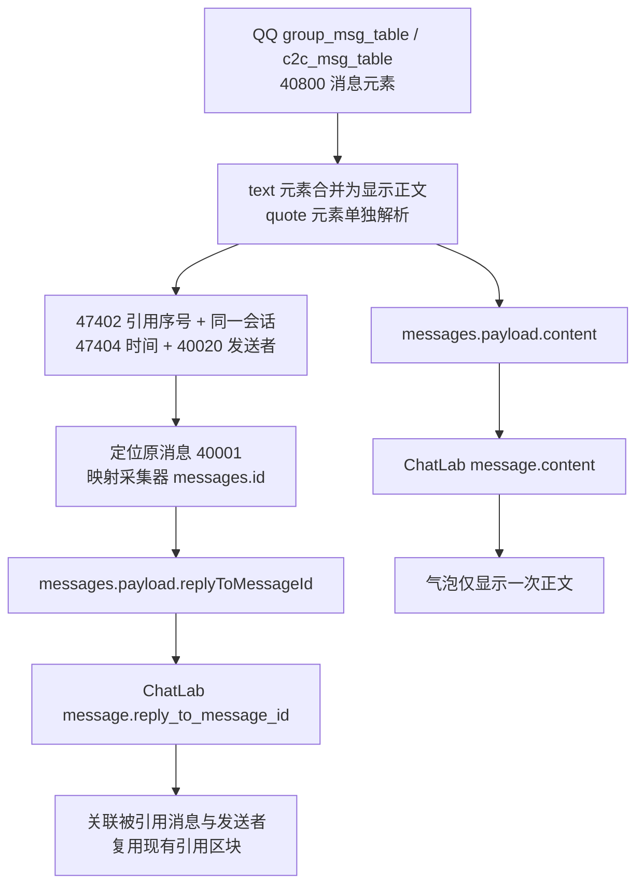

# QQ 本地数据源

读取已安装的 `qq-local-interface` 和已有密钥，将本机 QQ 群聊、私聊接入 ChatLab。原版 QQ 正常运行，无需日常启动第二个 QQ 实例。

```text
首次：已有 records.db → QQ 独立存档 → 本机 Pull API → ChatLab
后续：原版 QQ DB/WAL → 稳定克隆副本 → 复用可信快照，仅认证解密变化页
                     → 比对全部原生消息 ID，只解析新记录 → 同一存档
```

在线补图已实现：本地缓存未命中时，采集器发现并调用 QQ 进程内桥接下载原图，接口与错误码见 [QQ 在线图片桥接接口设计](IMAGE_BRIDGE_API.md)。桥接模块与采集器链路已通过自动化测试；带桥接的日常客户端部署仍属实验，见 [桥接部署说明](client-bridge/README.md)。不加载桥接的原版 QQ 仍可读取本地缓存。

## 本机运行

- 使用已安装 `qq-local-interface` 的 Python 虚拟环境；下例假设读取器位于 `~/openProjects/qq-local-interface`。本机读取器包含尚未发布到上游的预分配零页兼容修复，具体条件见 [调研记录](RESEARCH.md#解密与解析)，不能把原版读取器视为已经包含此修复。
- 默认读取 `~/Library/Application Support/qq-local-interface/sources/personal-qq/`。需先有有效配置、三个核心库密钥和成功快照。
- ChatLab 工程使用 Node 24 和已有 pnpm 依赖。

从仓库根目录运行：

```bash
~/openProjects/qq-local-interface/.venv/bin/python integrations/qq/bridge.py init --interval 1800
~/openProjects/qq-local-interface/.venv/bin/python integrations/qq/bridge.py bootstrap
~/openProjects/qq-local-interface/.venv/bin/python integrations/qq/bridge.py serve
```

退出 ChatLab 后执行首次导入，完成后重新打开桌面端：

```bash
pnpm exec tsx integrations/qq/connect.mts sync
pnpm exec tsx integrations/qq/connect.mts verify
python3 integrations/qq/audit.py --database-dir ~/.chatlab/data/databases
```

`connect.mts` 使用已有 ChatLab 导入器，不直接写消息表。`audit.py` 逐条核对原消息 ID、时间、正文、类型及发送者，并检查会话名称和类型，只输出统计。

## 自动同步与暂停

本机部署使用 LaunchAgent `io.github.bufferducky.chatlab-qq`，登录后启动。**2026-11-12 最新配置：采集服务每轮结束后等待 30 分钟（1,800 秒），ChatLab 每 30 分钟拉取一次。** 无变化直接跳过，有变化优先克隆稳定副本、复用可信页面，只解密变化页；仍扫描全部原生 ID，仅解析新消息。设置 → 自动化 → 自动同步中可查看 `QQ（本机全部会话）`、调整拉取间隔、立即同步或暂停，并自动发现新会话。

上面的 `init --interval 1800` 只设置新建采集配置；已有配置不会被 `init` 覆盖。已有部署应在停止服务后，将 `~/.local/share/chatlab-qq/config.json` 的 `interval` 改为 `1800`，再启动服务。ChatLab 的拉取间隔需另外设置为 30 分钟；脚本初始化默认仍是采集 300 秒、注册拉取 5 分钟，运行示例不会自动改写拉取周期。

```bash
launchctl bootout gui/$(id -u) ~/Library/LaunchAgents/io.github.bufferducky.chatlab-qq.plist
launchctl bootstrap gui/$(id -u) ~/Library/LaunchAgents/io.github.bufferducky.chatlab-qq.plist
```

服务绑定 `127.0.0.1:5035`，Pull 接口需要 Bearer token。`/health` 只返回就绪状态、计数、刷新时间及错误类别。凭证、独立存档和统计报告保存在 `~/.local/share/chatlab-qq/`，不放进 Git。移动代码仓库或读取器后需要更新 LaunchAgent 路径。

### 手动立即采集

采集服务除定时刷新外，还暴露两个需要同一 Bearer token 的端点，供 ChatLab 的「采集并拉取」按钮使用：

```bash
curl -s -X POST -H "Authorization: Bearer $TOKEN" http://127.0.0.1:5035/api/v1/collect
curl -s -H "Authorization: Bearer $TOKEN" http://127.0.0.1:5035/api/v1/collect
```

- 正在采集时再次触发会复用当前轮，不会并发解密；响应中的 `alreadyRunning` 表示复用了进行中的一轮。
- 采集是整库操作，无法只采某个群；「仅群聊」「仅私聊」「单个会话」筛选的是 ChatLab 之后的拉取阶段。
- 定时采集、手动采集和命令行 `bridge.py refresh` 共用同一把采集锁；冲突时返回 `busy`，稍后重试即可。

## 在线补图（实验）

本地缓存未命中且桥接可用时，图片接口按原消息查询 QQ 附件并调用 `downloadRichMedia`，校验原图 MD5 后返回字节；ChatLab 继续生成预览并写入共用缓存。桥接不可用、QQ 离线或账号/数据目录不符时返回明确错误码，不静默降级成旧数据。

- 桥接与 QQ 采集器共用 `~/.local/share/chatlab-qq/`，通过 `runtime/image-bridge.json` 发现回环地址和临时 token。
- 桥接必须运行在用户已登录的同一个 QQ 会话内；预览未命中时会先下载整张原图。
- 日常安装、签名与更新/回退方案尚未定稿；实验步骤、限制与回退方法见 [client-bridge/README.md](client-bridge/README.md)。

## 数据边界

- 消息 ID 包含固定账号 origin 和读取器稳定标识，不按姓名、正文或时间去重。原生 64 位 ID 使用 SQLite 整数和 Python 整数，绝不转成 JavaScript 数值。
- 首次导入保留已有快照的全部消息；没有可导入消息的会话不创建空消息库。后续通过 `(原生表名, 原生消息 ID)` 比对所有记录，不依赖 ID 大小或发送时间。因此较早时间、较小 ID 的新补录仍可导入。只解析新记录，不重建读取器的百万条完整索引。
- 增量游标使用本地观察时间，分页 `nextOffset` 是不透明的递增记录序号，客户端原样传回即可。首次历史置于重叠窗口之外，避免紧接着再次拉取百万条旧消息。
- 378 条首轮消息没有有效原始时间，使用正数占位时间戳 1，兼容 ChatLab 增量导入；界面可能显示在 1970 年。这个值只表示时间未知，不是推定的发送日期。
- 文本使用读取器解码后的 `text`，保留正文和换行；`search_text` 包含搜索用 UID、文件标识及分段索引，不作为已有正文的替代。普通图片现支持按需读取本机 QQ 缓存、预览和点击查看原图，详见 [图片说明](../IMAGE_MEDIA.md)；其他媒体仍保留文字及类型，不代表可播放或转发内层已展开。
- 首版只追加消息；已采集消息的编辑、撤回、后续完善及会话改名不覆盖 ChatLab 既有记录。源库缺失的历史不会删除本地存档。联系人和群信息用于新消息的名称与身份解析。
- 刷新失败保留上次成功存档，`/health.error` 显示错误类别，稍后重试；`lastRefresh` 用于判断新鲜度。就绪并不代表所有辅助库齐全，当前只读取三个核心库。
- 页面缓存保存在采集目录的 `snapshots/`，与消息存档、读取器已有快照相互独立。首次建立或缓存失效时仍需全量解密；后续按有效主库和已提交 WAL 的页面指纹复用。支持 APFS 时采用文件克隆，其他文件系统回退到普通复制，写入收益会不同。仍会读取全部有效页面并扫描原生 ID，优化目标是减少写入，而非保证刷新更快。
- 缓存保存原子发布的当前代与上一代；变化页、页指纹和完整性摘要验证成功，且消息入库成功后才发布。失败保留旧代；重启可复用，缺失或损坏时重建。增量提取在独立副本上进行，不覆盖持久完整快照。密钥、盐或页面布局变化时重新建立基线，WAL checkpoint、清空、重建及数据库增删页按当前已提交内容处理。
- 每轮仍会构建联系人等元数据索引。日志记录匿名页面计数和可用时的 `processWriteMiB` 系统记账写入，测量口径见 [性能说明](PERFORMANCE.md)。
- 刷新耗时受数据规模、变化页和系统负载影响；轮询从刷新结束后等待，ChatLab 还有独立的拉取周期。
- 读取器已有完整快照不会由本适配器自动更新；QQ 调试副本、备份和已有快照均保留。密钥失效时需在读取器侧处理，不会自动调试或重签 QQ。

## 引用与显示正文

QQ 引用元素、@昵称和正文分别解码，不能把搜索索引中的 UID 和各段文本追加到气泡正文。引用目标通过 QQ 的会话、消息序号、原发送时间和发送者定位，再映射为采集器已有的稳定消息 ID；不将引用元素 ID 或消息序号当作原消息 ID。



`backfill_message_content()` 在每轮新消息入库后补齐正文与引用，并以 `state.messageContentV1ThroughSeq` 记录已处理范围。旧版存档中的混合消息及夹带 UID 的文本在首次升级时回填；源消息 ID、记录序号、发送时间和拉取游标保持不变。无法唯一定位、跨会话或缺失的引用目标不会猜测关联；真实用户正文里的换行及 UID 文本不会通过正则删除。引用附带图片时保留图片类型，继续沿用图片加载链路。

已有 ChatLab 导入记录仍遵守追加去重规则，不会因再次拉取同一消息而自动覆盖。升级前已导入的脏正文需要备份后按 `platform_message_id` 原位修复 `content`、`type` 与 `reply_to_message_id`；保留 ChatLab 消息行 ID、成员和图片缓存，并同步核对引用目标。仅更新仍与修复前/后源正文一致的行，避免覆盖用户自行修改的内容。

引用关联使用带明确文本类型的临时会话／序号复合索引，原生消息表只扫描一次，再按稳定原生 ID 查采集器，避免逐引用全表查找。公开记录不包含用户会话统计或原消息样本。

## 检查

刷新耗时、CPU、内存、磁盘读写及轮询频率判断见 [性能实测](PERFORMANCE.md)。

```bash
python3 -m unittest discover -s integrations/qq -p 'test_*.py' -v
pnpm exec eslint integrations/qq/connect.mts
pnpm exec prettier --check integrations/qq/connect.mts integrations/qq/README.md
pnpm run type-check:node
```

回归覆盖同正文不同消息、64 位 ID、较小 ID 的历史补录、时间缺失、事务回滚、重启去重、媒体类型和 HTTP 鉴权分页。共享 Pull 引擎和增量导入器沿用其既有回归测试。
