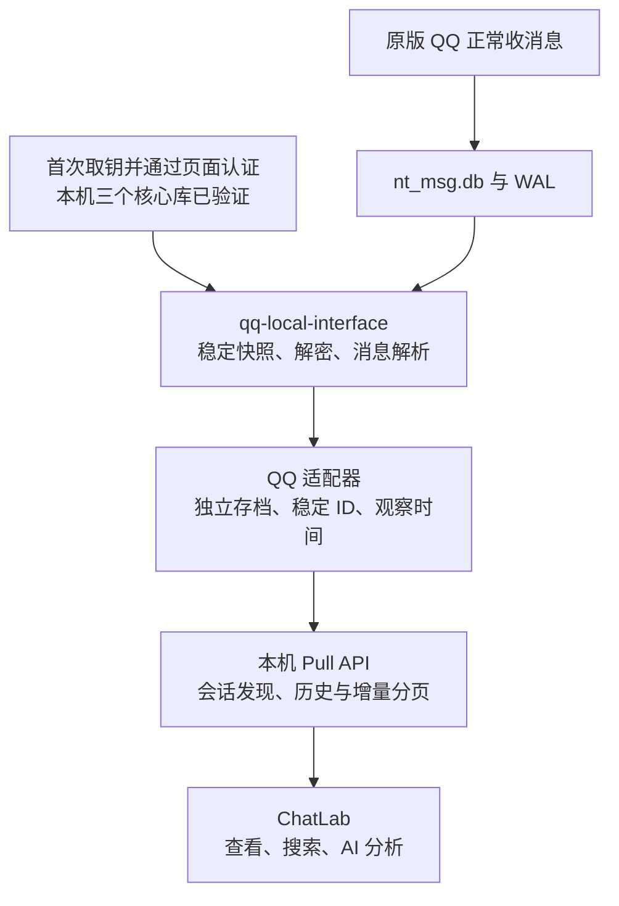

# QQ 接入 ChatLab 调研

核验日期：2026-11-12。状态：已完成 Apple Silicon 取钥、真实解密、QQ Pull 适配器、ChatLab 全量导入及桌面端定时增量验收。运行方式及当前数据边界见 [本地数据源说明](README.md)。

## 结论

采用 **原版 QQ 本地数据库 → qq-local-interface → QQ 专用 Pull 适配器 → ChatLab**。本机已完成三个核心数据库的取钥、实际解密与消息查询，原版 QQ 正常运行。接入阶段复用已有快照生成独立存档，后续只解析新出现的原生消息 ID，并通过本机 Pull 协议交给现有 ChatLab 导入器。

增量实测：初始 1,198,617 条消息基础上，从原版 QQ 增补 345 条，共 1,198,962 条，刷新约 11.83 秒。53 个已知会话中，实际有本地消息的是 36 个（22 群、14 私聊），另 17 个群为空。读取器的完整索引不再每轮重建；仍需复制及解密主库、扫描全部原生 ID，默认 5 分钟轮询。

首次接入对账定位到 ChatLab 增量导入器拒绝时间戳 0：378 条原始时间缺失消息中，有 279 条在后续分页被过滤。适配器改用正数占位时间戳 1 表示未知时间，并重新生成本次新增的 QQ 会话库；初次生成的库移到私有目录保留，其他已有平台会话不改动。

### 部署验收

- 全量导入后逐条核对：36 个会话、1,198,962 条消息，消息 ID、正文、时间、类型、发送者和会话名称/类型的差异均为 0。
- 重复拉取：36 个会话全部成功，新增消息全部为 0；378 条未知时间记录完整保留。
- LaunchAgent 后续又采集到 50 条真实消息；重新启动的 ChatLab Personal 在下一轮 5 分钟定时拉取中自动导入，36 个会话均为成功，消息增至 1,199,012 条。
- 适配器 6 项回归、共享同步/增量导入 33 项回归、Node 类型检查、含接入脚本的独立类型检查、脚本 lint、Markdown/TypeScript 格式检查通过。
- 原版 QQ、调试副本、原始备份和已有平台数据源全部保留。代码未提交或推送。
- ChatLab 已重新启动；电脑锁屏，无法完成目视界面检查。桌面自动增量由配置状态及实际消息库验证。
- 统计报告：私有目录中的 `verification.json`、`content-verification.json`、`repeat-verification.log`；不含聊天正文或凭证。

## 本机安装与首次试用结果

- 仓库：`/Users/ys/openProjects/qq-local-interface`，提交 `587b63e880070849240dde3f2bc447d7a7e8b35a`，版本 0.2.1。
- 安装：仓库内独立 `.venv`，通过 `pip install -e '.[mcp]'` 安装；未修改全局 Python 环境或配置 Codex MCP。
- 验证：`doctor` 正常识别 arm64、QQ 6.9.89（36373）和 LLDB；`pip check` 通过；原项目 56 项合成数据测试通过，包括 MCP stdio 入口。这不代表真实 QQ 数据读取成功。
- 账号选择：通过当前 QQ 进程打开的主消息库定位当前使用账号，再以本地登录索引核对；使用私有 source `personal-qq`，排除两个频道库。未输出账号编号、聊天正文或密钥。
- 首次 `capture-key` 返回 `debug_access_required`；LLDB 原始错误为 `Not allowed to attach to process`。debugserver 日志显示 `task_for_pid` 被拒绝，尚未进入密钥扫描。
- `DevToolsSecurity -status` 显示 Developer mode disabled。后续已在内核日志取得明确拒绝原因：`macOSTaskPolicy ... (QQ) is hardened, (QQ) doesn't have get-task-allow ... debugger ... is not a declared read-only debugger`。因此已确认目标进程保护构成阻碍，单独开启开发者模式不足以消除该限制；不再把此次失败仅归因于普通开发工具授权。
- 首次未重签试用时没有生成密钥或快照。随后用户明确授权重签试验，结果见下一节；首次失败不再代表当前状态。

安装后的只读检查命令：

```bash
cd /Users/ys/openProjects/qq-local-interface
.venv/bin/qq-local-interface doctor
```

私有配置和取钥诊断在 `~/Library/Application Support/qq-local-interface/sources/personal-qq/`，不放进 Git。已保存密钥的日常读取不需要再次附加 QQ 进程；密钥变化后需重新认证与取钥。

## 已授权的重签试验与本机兼容修复

- 原版 `/Applications/QQ.app` 保持腾讯签名。仅在 `~/.local/share/qq-local-interface-debug/trial-20261112-d7adb70d/` 制作、重签和运行调试副本。
- QQ 退出后，为约 9.9 GB 的应用数据完成离线备份，并用 APFS clone 建立独立运行数据副本。试验不让调试 QQ 写入原始账号目录。
- 调试副本需要为主程序和内置子进程移除沙盒/App Group entitlement，增加调试及所需 JIT entitlement。仅重签主程序时，原签名子进程会在沙盒初始化退出；单进程模式也出现真实崩溃，最终使用完成重签的正常多进程副本。
- 隔离副本里的更新缓存暂存到试验目录，使用安装包自带运行时；原版的更新缓存未改动。安装包 Info.plist 为 6.9.89，原有数据目录还存在下载的 7.0.x 运行时，不能把安装包版本简单等同于所有实际加载组件的版本。
- 重签解决了调试权限，但上游按地址顺序扫描约 434 MB 后未找到密钥。仅扫描系统 malloc 区也未找到；根据本机 `vmmap` 定位 QQ 的 `Memory Tag 253/255` 分配区后，定向扫描约 124 MB、约 11 秒取得并认证主库密钥；随后约 11 秒取得群信息与联系人库密钥。
- 保存的三个核心密钥均已在原始 `nt_msg.db`、`group_info.db`、`profile_info.db` 页面上通过 HMAC 认证。密钥文件权限为 `0600`，未在聊天或 Git 输出密钥值。
- 定向取钥的临时 LLDB 模块保存在上述私有试验目录，未改上游通用 `capture-key` 命令。再次取钥需要针对新进程重新获取内存范围，不能直接重放旧进程地址。
- 调试副本已退出，隔离运行数据已移回试验目录存档，原版 QQ 已重新启动。重新启动前核对主消息库的大小、修改时间、前段哈希均未变化，原版应用 CDHash 也未变化。未关闭 SIP 或修改全局开发者授权。

真实解密发现 QQ 的数据库存在预分配零页：稳定快照的主文件容量为 245,760 页，但通过认证的 SQLite 头只有 239,162 个逻辑页；尾部全为零，WAL 的物理提交大小仍可能包含这些预分配页。上游逐物理页认证会在空白尾部报错。

本地分支 `fix/macos-qq-preallocated-pages` 已修改 `src/qq_local_interface/crypto.py`：只有在认证头的页数有效、尾部完全为零且无已提交 WAL 页引用尾部时，才裁掉预分配容量；实际页面仍必须通过 HMAC。解密按最终提交的 WAL 页图像优先取数，避免新消息使用预分配页时先认证旧的零页。

新增 3 项回归覆盖零页与非零损坏尾部、WAL 物理提交大小及 WAL 新增页；共 59 项测试通过，编译检查与 `git diff --check` 通过。修改仅在本地，未提交或推送。

对此前失败的真实保留快照复放，修复后的解密约 3.83 秒完成，SQLite `quick_check` 通过，可读取 259 条私聊、1,198,341 条群消息。随后生成索引使用的另一份快照已增长至 1,198,358 条群消息，属于不同采集时刻。按当前查询顺序抽读的 100 条群消息解析得到 72 条完整文本、28 条元数据消息，无解析错误；这不等于完整图片、语音或转发内层已验证。

### 首轮完整索引与接口验收

| 项目 | 本机结果 |
| --- | --- |
| 总消息 | 1,198,617；与同代原始私聊、群聊表的计数之和完全一致 |
| 会话 | 53 个：39 个群、14 个私聊 |
| 原始消息表 | `group_msg_table` 1,198,358 行；`c2c_msg_table` 259 行 |
| 解析质量 | `complete` 789,117 条；`metadata_only` 409,500 条；本代无 `unsupported` / `decode_error` |
| API | Python 群消息分页实际返回 5 条；安装后的 CLI `messages.read` 返回 3 条，`ok=true` |
| 首轮耗时 | 704.71 秒，约 11 分 45 秒；主要成本在标准化索引及完整变化日志生成 |
| 逻辑体积 | `records.db` 10,060,582,912 字节；整代快照 15,158,388,241 字节。媒体 APFS clone 可能共享底层数据块，逻辑体积不等于新增物理占用 |
| 其他统计 | 37,460 个联系人/观察发言人、39,871 条成员关联、30,357 个本地缓存文件；不等于完整在线好友/群成员名单或媒体内容已全部验证 |
| 覆盖边界 | 所选 19 个库：3 个核心库就绪、3 个未初始化、13 个辅助库缺密钥；频道 2 库明确排除，`coverage.complete=false` |
| 恢复与检查 | 原版 `/Applications/QQ.app` 正在运行；临时非沙盒数据目录已移回私有存档；依赖检查、59 项测试和差异空白检查通过 |

验证报告只保留统计，位于 `~/Library/Application Support/qq-local-interface/sources/personal-qq/trial-verification.json` 与 `trial-final-checks.json`。密钥和明文快照也只存在仓库外私有目录。没有配置 Codex MCP、后台 watch、定时任务或 ChatLab 导入。

本次证明了本机的核心消息读取能力，不等于已完成所有辅助库、全量逐字段对账或真实增量验收。首轮约 12 分钟且索引较大，不能直接启用每 30 秒重建全部索引的 watch；正式接入前应优先优化增量索引和变化日志保留，再确定轮询频率。

## 本机事实与已知约束

本节来自只读环境检查，不包含聊天正文、账号编号或密钥。

| 项目 | 核验结果 |
| --- | --- |
| 系统 | Apple Silicon arm64，macOS 15.7.9 |
| QQ | `/Applications/QQ.app`，6.9.89，build 36373 |
| 数据 | 找到两个本地账号目录的 `nt_msg.db`；其中一份约 1.01 GB（0.94 GiB），存在 WAL。目录存在不代表该账号当前登录 |
| 工具 | Python 3.12.13、LLDB 可用；SQLCipher CLI 未在 PATH 中找到，候选读取器日常同步不依赖它 |
| 签名 | 日常 QQ 保持腾讯签名；取钥使用隔离调试副本，试验后已恢复日常 QQ |
| 既有决策 | 用户此前实测独立 NapCat 实例与原版主号登录冲突；旧 QQ 接入代码已回退 |
| ChatLab | 当前 `feat/wecom-local-source` 有企微接入未提交改动；本次只更新此调研与试用记录，未修改消息库 |

## 推荐链路



该链路的适配器已实现，并由本机 LaunchAgent 托管。首次取钥与日常同步分开；日常读取已保存密钥，不需要另起 QQ 登录实例。原版 QQ 仍需把消息同步到本机；本地没有的历史和附件不会自动出现。下文保留前期调研证据和原始试用时点的约束，当前部署方式以 README 为准。

## qq-local-interface 的源码证据

审阅版本固定为 [`587b63e`](https://github.com/Ethan-Wang-dev/qq-local-interface/tree/587b63e880070849240dde3f2bc447d7a7e8b35a)，避免将未来更新与本次结论混淆。

1. **上游实机兼容性有明确边界。** [README](https://github.com/Ethan-Wang-dev/qq-local-interface/blob/587b63e880070849240dde3f2bc447d7a7e8b35a/README.md) 和[覆盖报告](https://github.com/Ethan-Wang-dev/qq-local-interface/blob/587b63e880070849240dde3f2bc447d7a7e8b35a/docs/coverage.md)只报告 Intel macOS 12.7.4 + QQ 6.9.85（36362）的真实验证，样本为 3,694 条标准消息。本次 Apple Silicon 的实际取钥和解密额外使用了前述定向扫描与本地兼容修复，不能归为上游原版开箱即用。
2. **取钥会附加 QQ 进程。** [`capture.py`](https://github.com/Ethan-Wang-dev/qq-local-interface/blob/587b63e880070849240dde3f2bc447d7a7e8b35a/src/qq_local_interface/capture.py)调用 LLDB；[`lldb_capture.py`](https://github.com/Ethan-Wang-dev/qq-local-interface/blob/587b63e880070849240dde3f2bc447d7a7e8b35a/src/qq_local_interface/lldb_capture.py)扫描内存并以数据库页面 HMAC 认证候选密钥，正常路径最后 detach。调试附加可能短暂停住客户端；它不自动重签 QQ，也不关闭系统保护。没有硬编码 Intel 寄存器不等于已验证 arm64。
3. **具备快照与失败回退。** [`vault.py`](https://github.com/Ethan-Wang-dev/qq-local-interface/blob/587b63e880070849240dde3f2bc447d7a7e8b35a/src/qq_local_interface/vault.py)复制 DB/WAL，检查源文件变化；成功后原子发布新代，失败保留上一代。[`crypto.py`](https://github.com/Ethan-Wang-dev/qq-local-interface/blob/587b63e880070849240dde3f2bc447d7a7e8b35a/src/qq_local_interface/crypto.py)负责 QQ 扩展头、页面认证解密和已提交 WAL 帧。
4. **消息字段绑定 QQ schema。** [`index.py`](https://github.com/Ethan-Wang-dev/qq-local-interface/blob/587b63e880070849240dde3f2bc447d7a7e8b35a/src/qq_local_interface/index.py)从 `c2c_msg_table` / `group_msg_table` 建消息索引，使用原生消息 ID 与会话生成稳定标识。当前版本仍需核对名称、发送者、时间、正文与消息类型。
5. **有变化流，但不能直接当 ChatLab Pull 服务。** [`source.py`](https://github.com/Ethan-Wang-dev/qq-local-interface/blob/587b63e880070849240dde3f2bc447d7a7e8b35a/src/qq_local_interface/source.py)提供消息分页和跨代 changes；README 的外部入口是 Python、JSON/NDJSON、MCP stdio。接现有 ChatLab 自动同步仍需 HTTP 格式适配。
6. **大库成本必须先测。** `vault.py` 在判断内容指纹未变化之前已复制并哈希选中 DB/WAL；变化库重新解密，`index.py` 再扫描消息表重建索引并复制既有 changes。它不是按新增消息或变化页面直接更新。不能从小样本推定本机每 30 秒刷新可行。
7. **快照保留会占空间。** README 明确当前版本不自动清理旧代；每代保留解密库和标准索引。约 1 GB 主库持续生成代次时，需要先测每代实际磁盘增量，再制定保留策略；不能任意删除仍被查询引用的代次。

## 适配 ChatLab 的具体边界

参考现有 `integrations/wecom/bridge.py`、`docs/cn/standard/chatlab-pull.md` 和当前 `packages/sync/src/pull-engine.ts`，复用协议与验收方法，不共用企微账号配置、密钥或存档。

- 首版覆盖本机可读群聊、私聊、文本、名称及非文本类型占位；完整媒体展示另行验证。
- 使用 QQ 账号隔离、会话标识和原生消息标识生成稳定 `platformMessageId`，大整数保留为字符串；不用名称或正文推导身份。
- 将上游 changes 已消费游标和本地消息归档放在同一事务边界。ChatLab 的 `since` 使用适配器首次观察时间，消息 `timestamp` 保持原发送时间，避免晚补历史被跳过。
- 分页采用当前已实现的 `offset` / `nextOffset` 行为并固定本轮数据边界；不能只依赖秒级时间戳。公开 Pull 文档仍有将 `nextOffset` 称为预留字段的旧描述，接入时以实际实现和测试为准。
- 明确处理上游 `updated` / `missing`；`missing` 不代表 QQ 已删除，不能据此删 ChatLab 历史。现有导入的去重不等于支持同 ID 的正文覆盖更新，这部分须单独确定契约。
- 服务监听回环地址并要求鉴权；源数据、快照、密钥存放在仓库外私有目录。

## 其他路线比较

| 路线 | 已核验能力 | 对本次目标的判断 |
| --- | --- | --- |
| 官方 QQ 机器人 | 开启“接收所有消息”后，有不限 @ 的 `GROUP_MESSAGE_CREATE` 新消息事件 | 适合可添加机器人的指定群后续采集；没有证据证明能读取个人主号全部好友及既有群历史 |
| qqflow-server | 提供 `aarch64-apple-darwin` 原生包、QQ NT 数据库读取与 ChatLab Pull 路由 | 取钥成功后的另一候选；不负责取钥，现有时间游标需评估晚补历史 |
| QQ Chat Exporter / QCE | 基于 NapCat；已有 macOS arm64 预览和历史导出能力 | 维护者要求完全退出桌面 QQ；适合接受停用桌面 QQ 的导出备选，不满足当前首选使用方式 |
| LiteLoaderQQNT + 插件 | 框架有 macOS 安装方式，需要修改 QQ 启动入口 | 还需适配具体插件与 QQ 版本；主仓库及常用安装器当前已归档，本次不优先 |

官方[全量群事件](https://bot.q.qq.com/wiki/develop/api-v2/autogen/event/group_message_create.html)原文为：“当机器人开启了\"接收所有消息\"功能后，群里的每一条消息（不限于@机器人）都会推送此事件。”因此不能沿用“官方只能收 @”的旧判断。官方[单聊事件](https://bot.q.qq.com/wiki/develop/api-v2/autogen/event/c2c_message_create.html)对应用户给机器人发消息，不是用户与个人主号的私聊。开启全量功能的具体资格、设置和历史回补能力尚未核验；[群内状态查询接口](https://bot.q.qq.com/wiki/develop/api-v2/autogen/api/v2_groups_group_openid_bot_state.get.html)本身的白名单限制不能外推为全部接收功能的统一资格规则。

qqflow 的 [v0.10.0 发布资产](https://github.com/ren-yc/qqflow-server/releases/tag/v0.10.0)证明已有 arm64 Mac 原生包，不代表用户本机实测成功。[README](https://github.com/ren-yc/qqflow-server/blob/master/README.md)说明需要外部取得密钥；固定提交的 [chatlab_pull.rs](https://github.com/ren-yc/qqflow-server/blob/8e7f0fd5bfc66893977b31be8130600542d738e9/src/server/handlers/chatlab_pull.rs)按发送时间 `m.ts > since` 过滤，终页/空页推进至 watermark，不能直接视作已覆盖晚补历史。此处是源码推导的待验证风险，不是本机已发生漏消息。

QCE 的[项目说明](https://github.com/shuakami/qq-chat-exporter/blob/master/README.md)与 [macOS 部署说明](https://shuakami.github.io/qq-chat-exporter/docs/macos-deploy.html)描述预览版、独立 QQNapCatRuntime 副本与桌面登录冲突边界。LiteLoader 的[安装文档](https://liteloaderqqnt.github.io/guide/install.html)、[主仓库](https://github.com/LiteLoaderQQNT/LiteLoaderQQNT)和[常用安装器](https://github.com/Mzdyl/LiteLoaderQQNT_Install)用于核对客户端改动与维护状态。官方页面此次通过 Agent Reach 获取正文，不只依据搜索摘要。

## QCE 自动化联动与可选改造

补充核验：QCE 固定提交 [`134f670`](https://github.com/shuakami/qq-chat-exporter/tree/134f6703b735053d2289788776afd26e16450e22)。本节为方案，没有启动 QCE、创建定时任务或修改它的代码。

### 最小方案：定时导出后自动导入

QCE 已有每日、每周、每月和自定义五段 cron 的定时导出，以及查询、触发、历史记录 API；历史记录有 `success` / `partial` / `failed`、`messageCount`、`filePath`。证据：[前端 API 调用](https://github.com/shuakami/qq-chat-exporter/blob/134f6703b735053d2289788776afd26e16450e22/qce-v4-tool/hooks/use-scheduled-exports.ts)、[调度实现](https://github.com/shuakami/qq-chat-exporter/blob/134f6703b735053d2289788776afd26e16450e22/qq-chat-export-server/src/scheduler/manager.rs)、[导出执行器](https://github.com/shuakami/qq-chat-exporter/blob/134f6703b735053d2289788776afd26e16450e22/qq-chat-export-server/src/scheduled_executor.rs)。现有计划按昨天、近七日或自定义时间区间取数，不等同于持久消息增量游标；Mac 休眠错过时间后的补跑能力还需验证。

ChatLab 当前已有 `shuakami-qq-exporter.ts` 与 `shuakami-qq-exporter-chunked.ts`，支持对应 QCE JSON / chunked JSONL；CLI 的 `import` 支持 `--session-id`、`--dry-run`、`--json`。无需默认另加 QCE2ChatLab 转换器，但当前 QCE 导出样本仍要实际验证格式与消息 ID。


建议小范围先用一个群、JSON、近七日重叠回补，依赖真实消息 ID 去重；不把这种时间窗口回补宣称为无限历史完整性保障。联动程序轮询成功历史并维护消费台账，避免监视到尚未写完的文件。资源部分失败需要明确记录，不能把 `partial` 当作完整媒体成功。失败批次保留并重试，成功后才更新台账；导入必须固定到同一会话，避免每个导出文件生成新会话。与运行中的桌面 ChatLab 共用数据目录时，要遵循现有导入锁和运行时协调；优先通过运行中应用的服务入口，不能默认另起 CLI 并发写库。

### 值得 Fork 的改造顺序

| 改造 | 价值与落点 |
| --- | --- |
| 导出成功后的持久交付任务 | 在成功导出后创建待交付记录，由 worker 导入 ChatLab；重启后能重试。首版可由外部联动程序实现，不必先改 QCE |
| 账号、会话、消息的稳定标识 | 跨导出文件指向同一会话，保留 `id` / `seq` 字符串，验证重复导入与引用关联 |
| 独立消息归档和 Pull 接口 | 在消息解析后写入归档与观察时间，再暴露 `/sessions` 和 `/sessions/:id/messages`；ChatLab 使用已有数据源管理与增量同步 |
| 采集来源接口 | 若原版 QQ 常开是硬要求，将 QQ 读取来源从 NapCat bridge 中独立出来，再接本地数据库读取器；这是较大改造，仍依赖取钥与解析验证 |

长期方案不要为每次 ChatLab 拉取重新跑完整历史导出。应让采集/补历史更新独立存档，ChatLab 只分页读取；来源获取进度与下游消费进度分开保存。持续采集失败后仍需历史回补，单靠实时事件不能补齐停机期间记录。

### Mac 登录冲突仍是单独的技术门槛

维护者 [macOS 部署说明](https://github.com/shuakami/qq-chat-exporter/blob/134f6703b735053d2289788776afd26e16450e22/docs/macos-deploy.md)要求启动前退出桌面 QQ，运行期间也不开桌面 QQ；Mac 没有 Linux `--legacy` 同时在线功能。给 QCE 加定时导出、webhook 或 ChatLab 接口，都不会改变这个登录模型。

该文档还提到：原版 QQ 把 QCE 顶下线后，因为共用数据库，QCE 有时仍可读取本地新增。这是有价值的实验线索，但不能直接当稳定功能。若要研究“离线读取运行副本”，需验证登录失效后的 bridge、重启恢复、账号切换、并发读取与媒体访问，不仅仅删除启动器的进程检查。

因此，若接受手机 QQ 日常使用、QCE 常驻电脑，先做文件联动成本最低；若仍需原版桌面 QQ 持续使用，优先验证本地数据库路线，再决定是否保留 QCE 的界面和导出能力。两者不应混成一个已经解决的方案。

## 按可验证结果推进

| 阶段 | 通过条件 | 未通过时 |
| --- | --- | --- |
| 1. 取数验证 | 明确选择当前目标账号；密钥通过主消息库认证；原版 QQ 可恢复正常使用 | 区分调试权限、未找到密钥、算法不兼容；保留错误类别，另行评估调试环境变更 |
| 2. 一个群的小闭环 | 选定群的消息 ID、正文、时间、发送者逐项一致；新消息出现后可再次读取 | 查 schema、protobuf 与名称映射，暂不扩展全量导入 |
| 3. 大库性能 | 测首次同步、无变化检查、一条新消息后的刷新耗时、内存峰值和磁盘增量 | 先评估更低刷新频率是否满足目标；若需优化，再决定是否维护读取器分支 |
| 4. ChatLab 接入 | 历史与新消息均可导入；重复运行不重复；晚补历史与同秒多消息不漏；失败不推进进度 | 修正归档、游标、分页和去重，不直接清空已有库 |
| 5. 后台运行 | 恢复、重启、新会话发现和快照保留经过验证 | 沿用手工刷新，暂不宣称持续采集完成 |

整体难度为**中等偏高**：主要不确定性在取钥及大库刷新；取数稳定后，ChatLab 的转换与同步集成属于已有设计的复用。当前证据不足以承诺固定工期。
