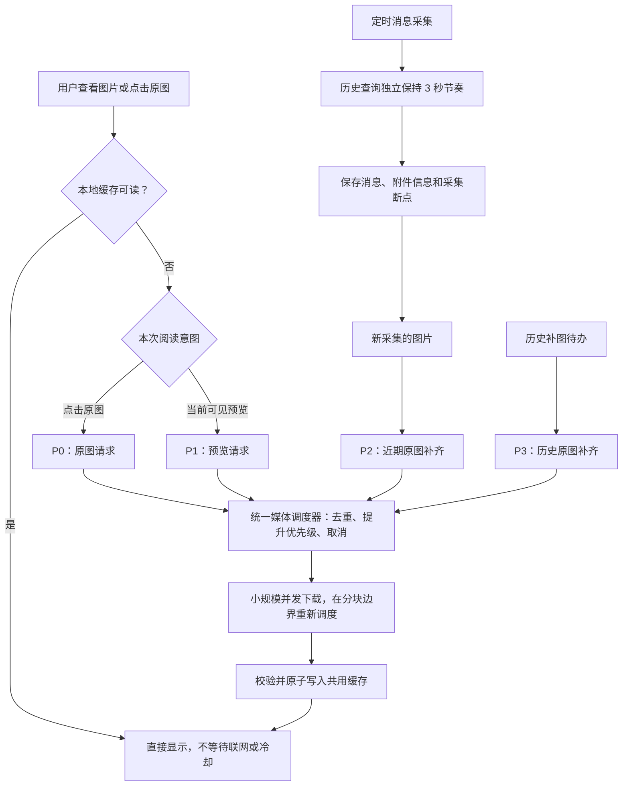
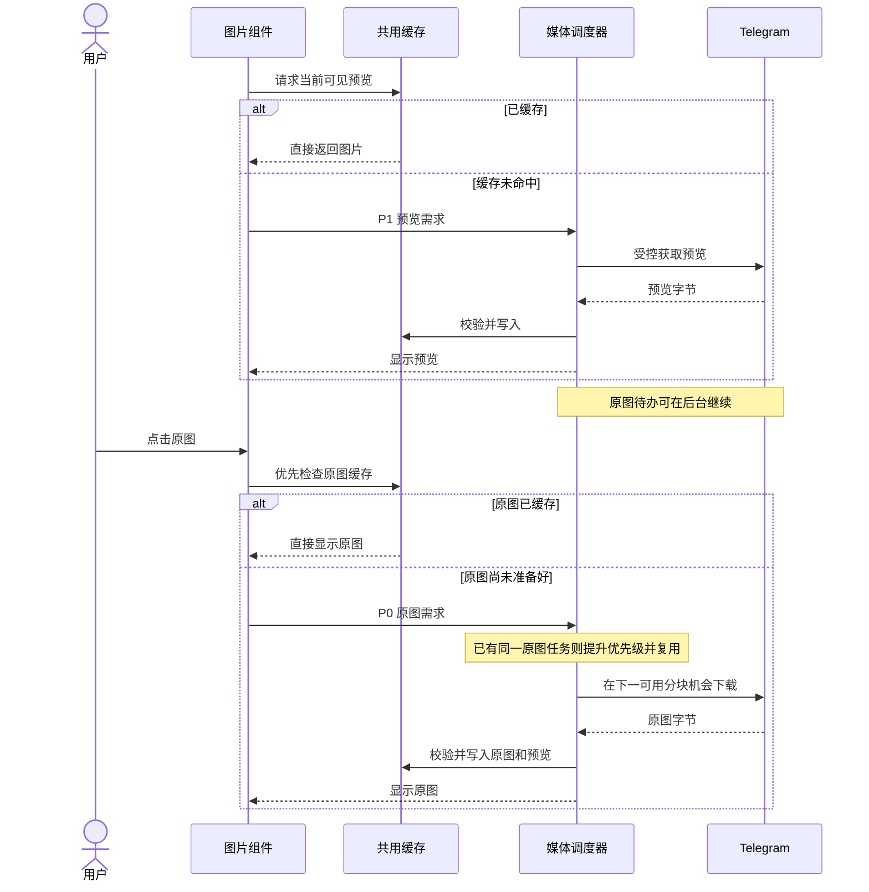
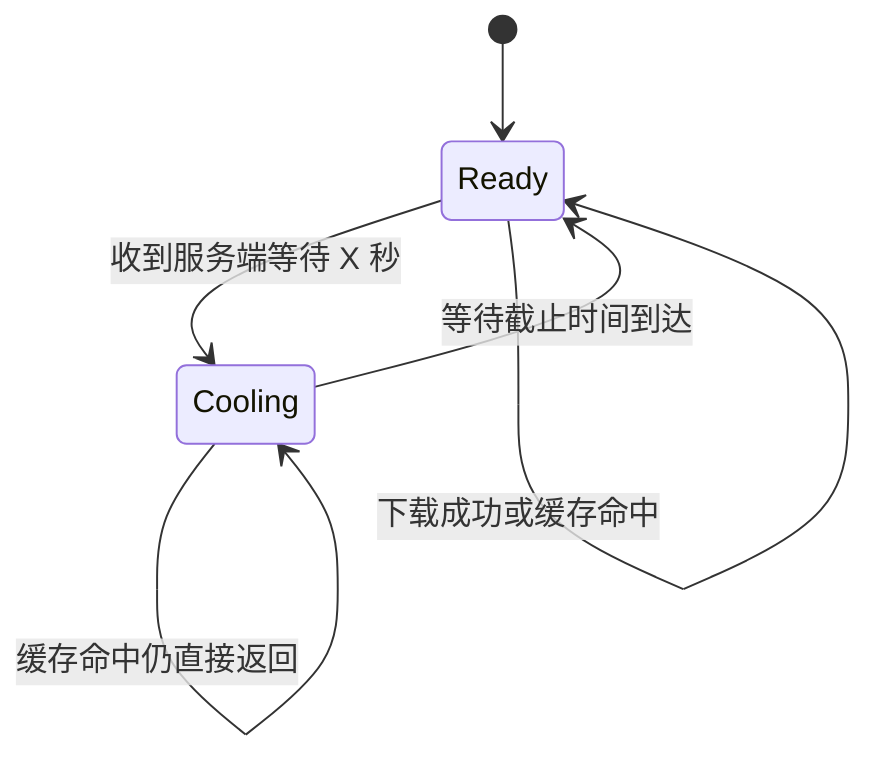

# Telegram 图片阅读与下载调度设计

状态：2026-11-14 已实现并完成定向回归及有界真实网络抽样。桌面安装与运行结果、样本范围见 [验收记录](MEDIA_SCHEDULER_VALIDATION.md)。本文中的 P95 数字仍为目标，少量抽样不构成稳定 P95 结论。

目标是让正在阅读的图片及时显示、点击原图及时响应，同时继续自动补齐原图。消息采集轮次耗时与图片阅读延迟分别验收。

## 1. 已核实的问题

| 现状 | 用户影响 | 对应代码 |
| --- | --- | --- |
| `PacedClient._call()` 对所有 RPC 共用 3 秒起始间隔，并在锁内等待 | 历史查询、图片分块、文件引用更新会互相排队 | `bridge.py` |
| 下载使用整张文件的 `Semaphore(2)`，没有前台／后台优先级 | 当前可见图片和点击原图可能等后台文件完成 | `image_media.py` |
| 同一图片请求会合并，但合并后不能提升任务优先级 | 点击正在补齐的原图，仍沿用原来的调度位置 | `TelegramImages.resolve()` |
| 图片的 60 秒等待包含信号量排队 | 排队可能耗尽下载预算，最终表现为图片超时 | `TelegramImages.resolve()`、`download()` |
| 离开视口不会撤销加载；切群和卸载时才取消 HTTP 请求；共享下载由 shield 继续执行 | 用户已不看的图片仍可能占用下载机会 | `MessageImages.vue`、`TelegramImages.resolve()` |
| 图片路由把所有 429 的 `Retry-After` 固定为 2 秒 | 无法准确表达 Telegram 要求等待的秒数 | `packages/http-routes/src/routes/web/message-images.ts` |
| 当前只专门捕获 `FloodWaitError`，SDK 的 `FloodPremiumWaitError` 是另一种异常 | Premium 下载等待不能准确进入统一冷却流程 | `bridge.py`、Telethon 错误类型 |

已有本机样本：已缓存预览的采集器接口约 19 毫秒，未缓存预览约 2.6 秒。这是单次样本，不能当作 P95，也不能证明解除人为间隔后的速度或限流概率。

## 2. 总体选择

缓存读取直接返回；历史查询、附件元信息和文件下载分别调度。保留同一个 `TelegramWorker` 对账号与事件循环的管理。

原图和预览继续使用现有缓存键及 5 GiB 共用容量。普通图片原图保持 Telegram 提供的字节；贴纸沿用已实现的展示能力：静态 WebP 原文件、TGS／WebM 官方静态预览。

## 3. 请求类别与并发

| 请求类别                         | 第一版策略                                                                       |
| -------------------------------- | -------------------------------------------------------------------------------- |
| `messages.getHistory` 等历史扫描 | 单独的历史查询通道，保留当前 3 秒节奏和扫描水位优化                              |
| 获取附件元信息、刷新文件引用     | 小规模受控处理，当前可见图片优先；同会话的缺失信息合并批量查询，不逐张重复查消息 |
| `upload.getFile`、CDN 文件分块   | 移除人为的全局 3 秒间隔，遵守下载并发和真实冷却                                  |
| 连接初始化、服务端配置查询       | 由 Worker 统一管理并复用连接，避免每张图片重新连接或多个任务同时初始化           |
| 读取已有缓存                     | 不占下载槽，不要求上游在线，不受下载冷却阻塞                                     |

启动连接建立后，异步读取 `help.getAppConfig`，保存服务器给出的 `small_queue_max_active_operations_count` 和 `large_queue_max_active_operations_count`，后续按配置更新。配置获取不阻塞缓存读取。

初始工程参数：全账号媒体网络并发最多 2；小文件按服务器软上限进一步收敛，大文件最多 1；后台在途媒体请求最多 1。文件大小分类使用官方 20 MB 分界，大小不明时按大文件处理。未取得有效服务器配置时先按单并发下载。

以上是本机试验初值，不是官方保证不会限流的数字。不同 DC 也不能用来突破本机总并发上限。SDK 派生的媒体／CDN 客户端必须接入同一调度和冷却策略，不能出现下载旁路。

## 4. 前台优先的准确含义

| 优先级 | 任务                                    | 调度规则                                           |
| ------ | --------------------------------------- | -------------------------------------------------- |
| P0     | 用户点击的原图                          | 最高优先级；同一原图已经排队或下载时，提升现有任务 |
| P1     | 当前视口及现有 100px 预加载范围内的预览 | 优先保障首屏；离开范围后撤销该前台订阅             |
| P2     | 新增图片的后台原图                      | 前台空闲时进行，完成后在本机生成预览               |
| P3     | 旧图片、旧贴纸的补齐                    | 前台空闲时按新到旧补齐                             |

优先级作用到媒体请求／分块边界。已发出的一个分块允许返回；有前台任务等待时，后台不能连续发起下一块，直到前台需求得到调度。不能仅在开始整张文件之前检查优先级，否则大原图仍可能长时间占用机会。

历史查询不持有媒体下载锁。采集期间只压低或暂停后台补图，P0／P1 仍可读取缓存和下载。

文件下载复用 Telethon 的取图、分块及媒体发送器能力，由共享准入策略控制媒体 RPC。保留一个账号客户端管理者；独立媒体连接属于传输适配内部能力，不新建一套使用相同 SQLite session 的登录客户端。

## 5. 预览与原图的配合

后台通常下载原图一次，再本地生成预览。用户正在看一张未准备好的图片时，以先显示为目标：原图已准备好就立即生成或读取预览；原图尚未准备好时，允许先取官方小预览，之后继续补原图。

同一种资源只允许一个下载任务；一份预览和一份原图可以分别存在。不会因前台点击与后台补齐同时下载两份原图。

## 6. 去重、取消和任务所有权

- 任务键包含账号、远端会话、消息、附件索引和资源尺寸；不同群的同号消息不能合并。
- 一个任务有多个订阅者时，任何单个 HTTP 请求取消都不能终止其他订阅者的下载。
- P0 加入已有后台原图任务时直接提升其优先级，新的任务不能插入 FIFO 队尾。
- 图片离开加载范围、切换会话或关闭原图弹窗时撤销相应前台订阅。组件重新进入范围时可再次请求；已完成的缓存继续复用。
- 最后一个前台订阅者离开时，未开始的任务按持久化待办降为后台或移出队列。正在执行的任务在下一分块边界降级；若继续执行会占住前台资源且后台容量已满，则取消该次传输，保留待办以后重试。
- 取消和失败不能把 `preview_done` 或 `original_done` 提前置为成功。只有缓存原子写入成功后更新对应进度。

这一版不新增部分文件持久化格式。取消后尚未完成的图片可以重新下载，已完成的缓存和消息断点保留。

### 跨进程取消协议

当前 Python 标准库 HTTP 服务阻塞等待 Future，仅取消浏览器的 fetch 不能可靠、及时地让采集器知道该订阅已经离开。因此取消必须有明确的源端协议，不能把一个前端 `AbortController` 当作整条链路已经取消。

Node 为一次真正发往采集器的图片请求生成不含消息内容的 `requestId`，通过 `X-Image-Request-Id` 发送。多个前端等待者仍共享这个源请求。最后一个等待者离开时，Node 取消源 HTTP 请求，并向本机采集器的 `DELETE /api/v1/image-requests/:requestId` 撤销该订阅；它只撤销内存订阅，不删除消息、文件或持久化补图待办。

取消接口与图片接口使用同一 Bearer 鉴权，必须幂等。取消先于 GET 登记到达时，也不能随后启动无订阅者的下载；保留取消记录至该请求截止时间。取消通知失败时由总截止时间兜底，不无限重发。

该能力由本机采集器显式声明后启用。旧版或其他数据源不支持时，Node 保持 HTTP 取消与有限截止时间，不盲目对不支持的数据源发送取消指令。

## 7. 真实限流和失败反馈

第一版继续保留真实限流的账号级冷却，避免凭猜测把服务端限制拆成互不影响的范围；先分开的是人为调度间隔。后续有请求归因证据再评估缩小冷却范围。

普通 `FLOOD_WAIT_X` 与 `FLOOD_PREMIUM_WAIT_X` 均记录类型、触发方法、DC 和等待秒数，持久化不早于服务端要求的截止时间。新任务在冷却中不发往 Telegram；已有缓存照常服务。

| 情况 | 服务端与阅读端行为 |
| --- | --- |
| 冷却中，图片未缓存 | 返回准确的 429、`Retry-After` 和 `retryAfterSeconds`；界面显示等待秒数，到期后仅重试仍有前台订阅的图片 |
| 临时网络失败 | 保留可重试状态，前台最多自动重试一次；再失败显示重试按钮，不宣称附件永久失效 |
| 文件引用过期 | 合并刷新该文件引用并重试一次，避免多个订阅者重复刷新 |
| 已确认原消息或附件不存在 | 返回明确的永久不可用信息 |
| 附件类型不支持 | 显示类型不支持，不伪装成群不存在或网络超时 |

`retryAfterSeconds` 必须从采集器经过 Node 服务和 HTTP 路由传递到前端。移除图片路由固定写死的 2 秒响应；添加通用限流错误码，不借用 QQ 专用错误码表达 Telegram 状态。新增文案覆盖现有四种语言。

复用既有 GET 图片接口及错误信封扩展字段，内部仅增加上述取消订阅能力，不为排队状态另建持续轮询协议。界面显示获取中、限流等待、可重试错误和永久不可用；详细排队／传输阶段由指标区分。

## 8. 超时分层

分别统计排队、连接／联网、图片转换和缓存提交耗时。保持端到端有限截止时间，内部预算要早于外层 HTTP 的 65 秒上限结束。

排队超时返回排队原因，网络超时返回网络原因，不能继续把信号量等待全部记成文件下载超时。取消信号和截止时间应穿过 HTTP 路由、Node 合并请求和采集器订阅；无人需要的前台传输要及时让出资源。

源端没有订阅者的后台文件继续使用后台自己的重试策略。前台读取可以越过该文件的后台重试排期，但不能越过真实的账号冷却。

## 9. 数据和缓存兼容

继续使用 `image_metadata` 中的媒体对象和原图／预览进度，消息正文、消息 ID、`last_id`、`last_scanned_id` 的语义保持现有实现。

任务队列与优先级在内存管理；后台待办和重试截止时间仍持久化。服务重启后从待办恢复，已有缓存优先复用。

完成标记代表曾经准备成功，不代表文件永远不会被 5 GiB 容量策略淘汰。每次读取都确认实际缓存可读；淘汰后按阅读需求优先补取，不能循环全量重下已淘汰历史。

## 10. 实现边界

| 文件／模块 | 负责的变化 |
| --- | --- |
| 新增 `integrations/telegram/media_scheduler.py` | 集中管理任务优先级、合并与提升、订阅者取消、媒体准入、真实冷却和运行时并发配置；避免再叠加彼此独立的 FIFO 队列 |
| `integrations/telegram/bridge.py` | RPC 分类；历史查询节奏与媒体策略分离；配置获取、SDK 派生客户端接入、取消订阅接口和错误秒数传递 |
| `integrations/telegram/image_media.py` | 缓存优先；前台与后台意图传入调度器；下载、取图格式和缓存提交保持在本模块 |
| `packages/node-runtime/src/services/message-images.ts` | 复用缓存和请求合并；正确传递取消订阅及服务端限流信息 |
| `packages/http-routes/src/routes/web/message-images.ts` | 传递真实重试时间和稳定错误码，处理客户端断开 |
| `src/components/common/ChatRecord/MessageImages.vue` | 视口内加载、离屏撤销、点击原图优先需求、冷却等待与有限重试 |

避免在前端组件、Node 服务和 Python 下载器各自再做一套没有协调的下载限速。Telegram 媒体调度策略以采集器为准；Node 保持跨平台缓存和阅读代理职责。

## 11. 验收

以下是待验证的体验目标，不是已经测得的结果。条件：Worker 已连接、正常网络、未处于服务端冷却，普通图片不超过 2 MiB；首次连接与大文件另行统计。

| 场景                     | 初始目标／必须满足的行为                                                 |
| ------------------------ | ------------------------------------------------------------------------ |
| 已缓存图片／原图         | 阅读端 P95 不超过 200ms；采集器或上游离线仍能显示                        |
| 未缓存首张预览           | 阅读端 P95 不超过 2 秒                                                   |
| 同时出现 6 张未缓存预览  | 首屏全部可见 P95 不超过 5 秒                                             |
| 点击未缓存的小原图       | 阅读端 P95 不超过 3 秒                                                   |
| 正在补大量历史原图时阅读 | P0／P1 不排在历史待办后面，后台最多完成已发出的分块后让出机会            |
| 点击后台同一原图         | 提升并复用原任务，网络上不出现两份相同原图传输                           |
| 快速滚动、切群、关闭原图 | 无前台订阅的任务取消或降级，其他订阅者继续正常读取                       |
| 两种服务端限流           | 等待不早于服务端截止时间；缓存仍可读；重启保留截止时间；界面倒计时准确   |
| 数据与格式               | 旧消息和采集断点完整；普通原图字节不变；静态／TGS／WebM 贴纸均能正确显示 |

单元测试用虚拟时间和受控网络替身验证调度顺序、分块让行、取消、并发上限和冷却，测试失败应体现用户行为或数据错误，不锁定日志文案或内部调用顺序。

真实验收选择未缓存图片，使用独立临时缓存建立可复现的冷缓存场景；不清空用户日常缓存。至少覆盖：6 张首屏、点击后台原图、快速切群、已有缓存、模拟服务端等待。报告样本数、P50／P95、文件大小和网络条件；样本不足时仅报告观测值，不宣称稳定 P95。

核心指标：缓存命中率、前台排队时间、实际传输时间、点击原图时间、首屏完成时间、任务提升次数、取消后仍消耗的网络请求、真实 FloodWait 的请求类别与等待秒数。日志不记录聊天正文、凭证或完整媒体 URL。

## 12. 落地与回退

实现时一起交付调度器、阅读端取消／限流反馈与上述回归，不以单纯改小一个间隔值作为完成。先用小并发参数验收，保存采集器配置和存档快照；真实账号只进行有界的正常阅读验证。

如果出现数据或调度回归，恢复已验证的上一版程序和运行参数。因为缓存键及已有数据语义保持兼容，不需要删除消息或重新登录。

## 依据

- [Telegram 文件下载](https://core.telegram.org/api/files#downloading-files)：并发软上限、文件分块及下载等待错误。
- [Telegram 客户端配置](https://core.telegram.org/api/config#small-queue-max-active-operations-count)：小／大文件并发配置。示例值不是本机账号实际配置。
- [Telegram 客户端优化](https://core.telegram.org/api/optimisation#downloading-files-and-uploading-data-to-the-server)：媒体传输与其他请求的协调。
- [Telethon 文件下载 FAQ](https://docs.telethon.dev/en/stable/quick-references/faq.html#file-download-is-slow-or-sending-files-takes-too-long)：并发收益及长期 FloodWait 的限制。
