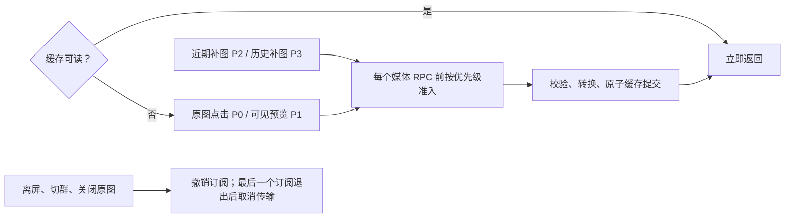

# Telegram 图片调度验收

2026-11-14：调度器和阅读端链路已实现，基于 `main@cdff22c1` 及当前工作区构建。沿用现有消息表、采集断点、媒体引用和共用图片缓存，无新增依赖。

## 已实现的阅读行为

历史查询继续使用 3 秒间隔。媒体并发最多 2、后台最多 1，大文件最多 1；启动异步读取服务器软上限，无有效配置时单并发。后台下载在分块边界让行，点击同一原图直接提升并复用任务。文件引用按同会话合并刷新。

取消使用 Node → 采集器的显式订阅协议，保持旧数据源可用。两种 Telegram 等待错误均持久化账号冷却，准确的等待秒数经 API 返回界面；缓存读取不受冷却影响。排队、网络、转换和缓存提交分开记录。

## 定向回归

- Python：42 项通过，覆盖历史采集与升级、分块让行、任务提升与合并、共享订阅取消、先取消后 GET、运行时上限、CDN 策略复用、元信息批量查询、普通及 Premium 等待、HTTP 鉴权与秒数传递、缓存完成状态及贴纸。
- Node／HTTP／重试：12 项通过，覆盖共用缓存、原图字节、取消订阅、429 秒数、倒计时与离开后停止重试、临时失败最多重试一次。
- 前端与 Node 类型检查、定向 ESLint／Prettier、Python Ruff 格式与 lint 通过。
- macOS arm64 包通过项目原生运行时检查：SQLite 查询及本地 embedding 运行时正常。安装副本的 `app.asar` 与本次构建一致；新包内含取消协议、实际重试秒数及界面倒计时逻辑。

## 真实网络抽样

链路为 Node 阅读服务 → 本机 HTTP 采集器 → Telegram，使用原账号及原连接配置、独立临时缓存。没有清空日常缓存，没有额外登录或压力测试。6 张样本的原图大小为 6,105–226,784 字节。

| 场景                             | 样本和观测结果                                                             |
| -------------------------------- | -------------------------------------------------------------------------- |
| 全新媒体 DC 连接，6 张冷缓存预览 | 首屏约 7.2 秒；主要额外耗时在首次媒体连接准备，缓存转换每张约 0.12–0.13 秒 |
| 复用媒体连接，再次使用空缓存     | 6 张预览各约 1.34–1.80 秒，全部显示 1.80 秒                                |
| 缓存读取                         | 6 次每次不足 1 毫秒（毫秒取整为 0）                                        |
| 未缓存原图                       | 3 张，约 0.59、0.59、0.76 秒                                               |
| 点击正在后台下载的同一原图       | 约 1.0 秒；原任务提升一次，两订阅返回相同字节                              |
| 离开未缓存图片                   | 取消完成不足 1 毫秒，随后活动媒体请求为 0                                  |
| 新增的异步启动连接准备           | 本机重启日志记录 2.353 秒，主 HTTP 服务可先启动并读取缓存                  |

以上是有界样本，**不构成稳定 P95 或网络速度保证**。不同 DC、重连和大文件需单独观察。普通／Premium 限流通过替身测试验证，未主动诱发账号真实限流。桌面真机核对使用已有图片；冷缓存数字来自上述真实阅读服务链路。

## 数据与交付

与实施前的一致性快照比较：原有样本消息缺失 0 条、断点回退 0 个，后续增量正常。升级没有重置采集周期或账号会话。

本地 DMG、ZIP、安装路径、SHA256 和源码来源记录在本次构建目录的 `handoff.json`。旧应用保存在库外备份目录，消息库及配置另有实施前快照。未提交或推送代码，未发布远端版本。
