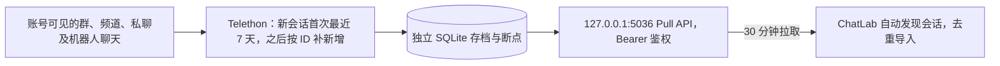

# Telegram 本地数据源

通过 Telethon 读取本人账号的云端会话，将独立存档通过本机 Pull API 接入 ChatLab，沿用 QQ 本地数据源的运行方式。本机已开启全部会话模式：群、频道、私聊及机器人聊天均会发现；每个新会话首次只取最近 7 天，之后每 30 分钟补充新增消息，不回填更早历史。



## 本机配置

- 采集目录：`~/.local/share/chatlab-telegram/`，目录权限 700，配置及数据库权限 600。
- 配置：`config.json`，包含 `apiId`、`apiHash`、`token`、`selectedPeers`、`allDialogs`、`port`、`interval`、`historySince`。`allDialogs=true` 时每轮自动发现全部会话，包括后续新增会话；每个会话的 7 天起点首次记录后固定保存，因此停机超过 7 天也能按 ID 补回缺口。`allDialogs=false` 时只处理 `selectedPeers`。凭证和 `.session` 不进入仓库。
- Telegram 授权：首次在本机终端输入手机号、验证码及启用时的两步验证密码；后续复用 `telegram.session`。不从桌面客户端提取会话或密钥。
- 采集间隔：每轮完成后等待 **1,800 秒（30 分钟）**；服务重启会参考上次采集或失败时间，避免立即重复扫描。`requestWaitSeconds` 默认 3 秒，统一约束共享连接上的 API 请求起始间隔，包括跨会话查询和图片请求；消息分页也沿用这个间隔。若 Telegram 返回 `FloodWaitError`，保存官方要求的等待截止时间，暂停请求，等待后自动重试原请求并继续本轮采集，不固定写死为 6 秒。日志仅记录等待秒数与请求类型。等待期间可停止服务，已提交的消息与断点保留；恢复后仍遵守等待截止时间和原采集周期。
- ChatLab 拉取：**30 分钟**，独立于采集周期；两端错位时消息显示可能延迟接近 1 小时，另加采集与导入耗时。
- API：仅绑定 `127.0.0.1:5036`，数据端点需要 Bearer token。`/health` 仅返回计数、时间和错误类别。
- LaunchAgent：`~/Library/LaunchAgents/io.github.bufferducky.chatlab-telegram.plist`，登录后启动，启动参数不包含凭证。
- 图片预取：采集普通图片消息时，将 Telegram 媒体对象、配文及待下载状态与消息断点一起写入 `messages.sqlite3` 的 `image_metadata` 表；后台单独下载预览，失败 30 分钟后重试，重启后续办，不回滚文字消息。文件引用过期时才重新查询原消息。下载仍遵守共享请求间隔和 Telegram 官方限流，因此预览可能晚于文字准备完成。
- 图片存储：后台调用仓库内 `image-cache.mts`，复用已有 Node 图片校验、640px WebP 转换和 **5 GiB 共用缓存**，默认写入 `~/.chatlab/cache/message-images/`，采集器不建立另一份图片目录。原图仍按点击下载；旧消息仅按查看补充媒体信息，不主动全量回填历史图片。预览被容量淘汰后按查看重新获取。
- 预取运行环境：除 Python 外需项目已有的 Node 24、tsx 和 sharp，无新增依赖。LaunchAgent 找不到正确 Node 时，在私有配置中设置 `nodeExecutable` 为 Node 24 的绝对路径。自定义 ChatLab 数据目录时设置 `imageCacheDir` 为同一数据目录的 `cache/message-images/`；数据源地址与默认 `http://127.0.0.1:<port>/api/v1` 不同时，设置 `imageBaseUrl` 为已注册的数据源地址，使预取与阅读使用相同缓存键。预取不要求 ChatLab 桌面端保持运行。

本机 Python 3.12 环境位于上述目录的 `.venv/`。在另一台机器部署时，从仓库根目录安装采集依赖：

```bash
umask 077
mkdir -p "$HOME/.local/share/chatlab-telegram"
chmod 700 "$HOME/.local/share/chatlab-telegram"
uv venv --python 3.12 "$HOME/.local/share/chatlab-telegram/.venv"
uv pip install --python "$HOME/.local/share/chatlab-telegram/.venv/bin/python" -r integrations/telegram/requirements.txt
```

在私有目录创建权限为 600 的 `config.json`，填写本人申请的 Telegram 应用凭证和自行生成的随机 Pull token。下面只展示配置结构，替换占位值后再运行；全部会话模式不需要填写 `selectedPeers`：

```json
{
  "apiId": 0,
  "apiHash": "YOUR_TELEGRAM_API_HASH",
  "token": "YOUR_RANDOM_PULL_TOKEN",
  "allDialogs": true,
  "selectedPeers": [],
  "port": 5036,
  "interval": 1800,
  "requestWaitSeconds": 3
}
```

然后从仓库根目录执行：

```bash
PYTHON="$HOME/.local/share/chatlab-telegram/.venv/bin/python"

# 首次授权完成后获取会话列表；列表只保存到本机 dialogs.json。
"$PYTHON" integrations/telegram/bridge.py login
"$PYTHON" integrations/telegram/bridge.py discover

# 停止采集服务后，通过发现列表中的真实 peer ID 添加会话。
# 负数参数应写成 --peer=-100...，以免被解析为选项。
"$PYTHON" integrations/telegram/bridge.py select --peer=PEER_ID

# 前台采集与状态查询；refresh 与后台服务互斥。
"$PYTHON" integrations/telegram/bridge.py refresh
"$PYTHON" integrations/telegram/bridge.py status
```

手动添加会话采用并集，不自动取消原订阅或删除旧存档；全部会话模式无需逐个添加。

首次离线导入前退出 ChatLab Desktop，QQ 和企微采集服务可以继续运行。使用工程要求的 Node 24 环境：

```bash
pnpm exec tsx integrations/telegram/connect.mts register
pnpm exec tsx integrations/telegram/connect.mts sync
pnpm exec tsx integrations/telegram/connect.mts verify
python3 integrations/telegram/audit.py --database-dir ~/.chatlab/data/databases
```

注册到现有自动同步配置，发现本桥接中最近一周有消息或后续出现新消息的会话。打开 ChatLab，在设置 → 自动化 → 自动同步中查看 `Telegram（本机全部会话）`、立即拉取或暂停。没有消息的会话不会创建空聊天库。暂停 ChatLab 拉取不会停止独立采集；停止采集需操作 LaunchAgent。

```bash
launchctl bootout gui/$(id -u) ~/Library/LaunchAgents/io.github.bufferducky.chatlab-telegram.plist
launchctl bootstrap gui/$(id -u) ~/Library/LaunchAgents/io.github.bufferducky.chatlab-telegram.plist
```

## 数据与恢复边界

- 首次通过 Telegram 日期偏移直接从 `historySince` 开始按消息 ID 从旧到新遍历，并过滤日期边界；后续从已提交 ID 继续。`limit=None` 只表示所选时间范围内不截断条数，不代表拉取全历史。每 500 条原子保存消息及 Telegram 断点，中断后从最后一个成功批次继续。
- 本地消息按 `(session_id, native_id)` 唯一；远端会话 ID 包含登录账号及 Telethon marked peer ID，避免群、频道和私聊的 ID 混淆。消息 ID、回复 ID 以字符串传递到 ChatLab。
- 已提交的记录可供 Pull 导入；`ready` 表示存档可读。`historyComplete` 表示会话在配置时间范围内完成首次采集，不表示完整账号历史。官方限流等待后在本轮继续，不丢弃当前尚未提交的批次；断网、授权等错误仍记录类别并结束本轮，不删除已采集数据，下次从已提交断点继续。
- Pull 使用本地观察时间与 `seq` 键集分页，不把旧消息原始发送时间当采集游标。因此历史补齐和同一秒多条消息都可续拉。返回的水位不会超过已提交观察时间。
- 首版只追加新增消息。已采集消息的编辑、撤回、删除不镜像，群改名和历史成员姓名也不承诺覆盖已有 ChatLab 消息。
- 保留正文、发送者、日期、平台消息及同会话回复 ID。新采集普通图片会后台预取预览，点击时下载原图，缓存上限默认 5 GiB，详见 [图片说明](../IMAGE_MEDIA.md)。其他媒体仍保留类型及说明。跨会话回复不错误关联到本会话。
- Secret Chat、已删除或账号不可见的历史不在此链路范围；旧群迁移形成的独立历史不自动合并到新群。存档随新增消息增长。
- 本桥接拥有独立的 ChatLab source/session 映射。若此前已通过官方 JSON 导入同一个聊天，需要另行明确复用目标，避免两份会话；脚本不会按群名自动合并。
- 若迁移机器或更改端口，必须保留配置、授权、消息存档和 ChatLab 数据源配置，并明确处理 base URL 对目标 ID 的影响；不能仅重新注册一个 URL 后假定会追加到旧会话。

## 验证

```bash
~/.local/share/chatlab-telegram/.venv/bin/python -m unittest discover -s integrations/telegram -p 'test_*.py' -v
~/.local/share/chatlab-telegram/.venv/bin/ruff check integrations/telegram
~/.local/share/chatlab-telegram/.venv/bin/ruff format --check integrations/telegram
pnpm exec eslint integrations/telegram/connect.mts
pnpm exec prettier --check integrations/telegram/connect.mts integrations/telegram/README.md
pnpm run type-check:node
# Node 24 + Python 3，临时库集成验证，不访问真实 Telegram。
node scripts/run-tests.mjs integrations/telegram/bridge.smoke.test.mts
node scripts/run-tests.mjs integrations/telegram/image-cache.test.mts
```

单元测试验证事务回滚、重启续传、跨会话 ID 隔离、同秒与历史分页、文字和回复转换、媒体说明及 HTTP 鉴权；还验证跨会话请求限速、Telethon 原请求等待后重试、批次遇到限流后完整续采及停止等待后保留截止时间。真实导入通过现有导入器完成，审计逐条比较消息 ID、正文、时间、类型、发送者和回复目标，仅输出统计。

2026-11-12 本机手动增量验证：在原存档和配置上完整采集 85 个会话，新增 23 条消息，耗时 298.407 秒，macOS 进程记账写入 13.672 MiB；本轮未出现新的限流，完成后错误状态清空，后台服务已恢复。按同等样本、每半小时一轮粗算约 656 MiB／天；这不是全天实测或 SSD 实际擦写量，也不包含 ChatLab 导入。该次测量时采集周期为 3 小时；随后已将采集与 ChatLab 拉取统一调整为 30 分钟。官方限流等待后继续、取消和重启恢复由可控异常回归验证；包括图片功能在内共 16 项 Python 测试通过。汇总报告保存在本机私有目录 `~/.local/share/chatlab-telegram/performance/rate-limit-rollout/live-validation.json`，不含聊天正文或凭证。
