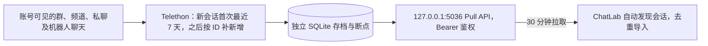
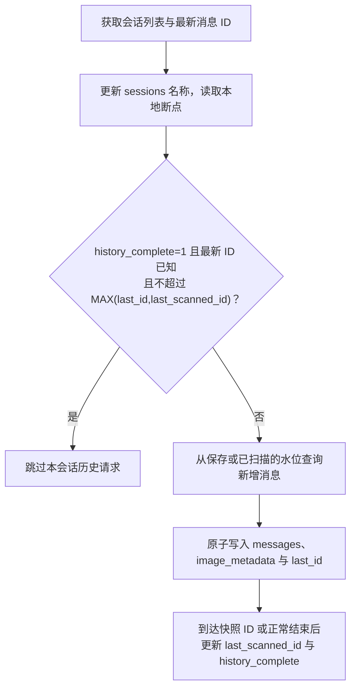
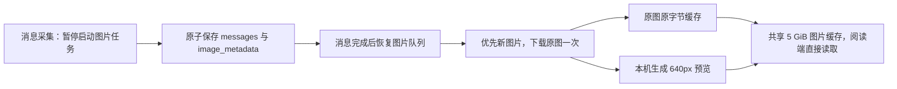

# Telegram 本地数据源

图片阅读与下载使用分级调度，规则见 [图片加载设计](IMAGE_LOADING_DESIGN.md)，实现与实测结果见 [验收记录](MEDIA_SCHEDULER_VALIDATION.md)。

通过 Telethon 读取本人账号的云端会话，将独立存档通过本机 Pull API 接入 ChatLab，沿用 QQ 本地数据源的运行方式。本机已开启全部会话模式：群、频道、私聊及机器人聊天均会发现；每个新会话首次只取最近 7 天，之后每 30 分钟补充新增消息，不回填更早历史。



## 本机配置

- 采集目录：`~/.local/share/chatlab-telegram/`，目录权限 700，配置及数据库权限 600。
- 配置：`config.json`，包含 `apiId`、`apiHash`、`token`、`selectedPeers`、`allDialogs`、`port`、`interval`、`historySince`。`allDialogs=true` 时每轮自动发现全部会话，包括后续新增会话；每个会话的 7 天起点首次记录后固定保存，因此停机超过 7 天也能按 ID 补回缺口。`allDialogs=false` 时只处理 `selectedPeers`。凭证和 `.session` 不进入仓库。
- Telegram 授权：首次在本机终端输入手机号、验证码及启用时的两步验证密码；后续复用 `telegram.session`。不从桌面客户端提取会话或密钥。
- 采集间隔：每轮完成后等待 **1,800 秒（30 分钟）**；重启参考上次采集或失败时间，避免立即重复扫描。`requestWaitSeconds` 默认 3 秒，仅用于历史扫描与非媒体请求；文件下载、元信息补取与连接准备独立调度。普通 `FloodWaitError` 和 `FloodPremiumWaitError` 都保存账号级截止时间；历史扫描等待后重试当前请求，未缓存图片返回准确的 429、`Retry-After` 与 `retryAfterSeconds`，缓存仍可读。恢复服务继续遵守已有冷却与采集断点。
- 跳过无更新会话：复用本轮会话列表中的 `dialog.message.id`（或原始会话的 `top_message`），在 `sessions.history_complete=1` 且 `MAX(last_id,last_scanned_id) >= 最新消息 ID` 时跳过历史查询；会话名称仍更新。`last_id` 仅表示已保存消息，`last_scanned_id` 仅在成功遍历后更新，因此没有近期消息的会话也能跳过重复查询。明确的空会话 `top_message=0` 可跳过，缺少可靠最新 ID 时照常查询。新会话及首次补采中断时继续采集。
- 快照边界：消息按 ID 从旧到新处理，采到本轮会话列表中的最新 ID 后立即结束，避免再请求空的末页；列表获取后才到达的新消息留到下一轮。快照消息已删除时，正常遍历或遇到更大 ID 后结束；消息和扫描水位均不会越过本轮边界。缺少可靠快照 ID 时仍遍历到末页。
- 采集启动直接通过 `get_me()` 获取并校验当前账号，避免先发一次 `GetStateRequest` 再查询同一个账号；获取不到当前账号时中断并保留原有存档。
- 性能统计：每轮在 `service.log` 输出一条 `telegramCollection`，包含发现、查询和跳过的会话数、按类型汇总的 RPC 调用次数、连接认证／会话发现／历史处理／消息批次写库耗时，以及请求节流等待、官方限流事件数和要求等待秒数。`pacingWaitSeconds` 包含共享请求队列等待及官方限流后的实际等待；`cacheWriteSeconds` 是 `historySeconds` 的子集，各项不能直接相加。RPC 次数包含重试及嵌套解析调用，并非网络包数。后台图片任务独立于采集上下文，不计入采集 RPC 次数，也不再占用历史查询的人为间隔。前台媒体任务输出 `telegramMediaTask`，区分排队、网络、转换和缓存提交耗时；`telegramMediaTransport` 单独记录启动连接准备，日志不包含完整媒体 URL 或消息标识。失败或取消也输出已收集的指标与错误类别，不记录会话 ID、名称、正文或凭证。
- ChatLab 拉取：**30 分钟**，独立于采集周期；两端错位时消息显示可能延迟接近 1 小时，另加采集与导入耗时。
- API：仅绑定 `127.0.0.1:5036`，数据端点需要 Bearer token。`/health` 仅返回计数、时间和错误类别。
- LaunchAgent：`~/Library/LaunchAgents/io.github.bufferducky.chatlab-telegram.plist`，登录后启动，启动参数不包含凭证。
- 图片预取：采集普通图片消息时，将 Telegram 媒体对象、配文及待下载状态与消息断点一起写入 `messages.sqlite3` 的 `image_metadata` 表。后台下载 Telegram 可获取的最大尺寸原图，并在本机生成预览，只需一次媒体下载。优先处理还没有预览的图片，其次按新到旧补齐原图；升级前已登记的图片也会自动加入原图队列。原图失败时可单独补预览，`original_done/original_next_retry/original_error` 与预览状态独立，失败 30 分钟后重试，重启后续办，不回滚文字消息。文件引用过期时才重新查询原消息。
- 贴纸：静态 WebP 贴纸按图片取原文件；TGS／WebM 动态贴纸使用 Telegram 提供的可显示静态缩略图，阅读端可以直接显示，暂不播放这两类动效。贴纸也进入同一后台队列，动态贴纸的 `original` 接口返回可显示的静态图，不将 TGS／WebM 文件当作 JPEG／WebP 交给图片解码器。`[sticker]` 保留在存档中用于类型识别，成功加载后由附件清单配文替代，不额外显示原始标记。
- 阅读优先：P0 点击原图、P1 可见预览、P2 无预览的新图、P3 历史补齐。同一资源合并下载，点击可提升已有后台任务；优先级在每次媒体 RPC／分块前重新判断。总媒体并发最多 2、后台最多 1、大文件最多 1，并按服务器小／大文件软上限收敛；未取得有效配置时单并发。采集期间后台在下一分块边界暂停，前台仍可下载。启动时异步准备连接、运行时并发配置和最近媒体所在 DC，复用 Telethon 派生发送器与 CDN 客户端。
- 阅读订阅：Node 为实际源请求发送 `X-Image-Request-Id`。采集器通过 `X-Image-Cancel-Protocol: 1` 及鉴权的 `GET /api/v1/image-capabilities` 声明支持；`DELETE /api/v1/image-requests/:requestId` 只撤销内存订阅、幂等且使用同一 Bearer 鉴权。最后一个等待者取消时停止传输；其他等待者或后台持久化待办继续保留。先收到取消再收到 GET 时也不会启动下载。旧数据源不支持此协议时保留 HTTP 取消与有限超时。
- 超时与重试：媒体准入排队 20 秒、单次 RPC 30 秒、准备任务总截止 60 秒、采集器 HTTP 等待 62 秒，均早于 Node 65 秒外层截止。超时返回可重试的 `IMAGE_TIMEOUT`。界面离屏／切群／关闭原图时撤销对应订阅；真实限流显示剩余秒数，到期仅为仍在阅读的图片重试；普通临时失败最多自动重试一次。
- 图片存储：后台调用仓库内 `image-cache.mts`，复用已有 Node 图片校验、640px WebP 预览转换和 **5 GiB 共用缓存**，默认写入 `~/.chatlab/cache/message-images/`。原图保留下载字节及原始尺寸，不再次有损压缩；原图与预览使用阅读端相同缓存键，准备后可离线打开。沿用单张 50 MiB、解码 4,000 万像素限制。更早仅有消息正文、尚未登记媒体的历史图片仍按查看补充信息；不会扫描全部旧聊天回填。缓存容量淘汰后按查看重新获取，已完成项不会反复全量下载导致缓存抖动。
- 预取运行环境：除 Python 外需项目已有的 Node 24、tsx 和 sharp，无新增依赖。LaunchAgent 找不到正确 Node 时，在私有配置中设置 `nodeExecutable` 为 Node 24 的绝对路径。自定义 ChatLab 数据目录时设置 `imageCacheDir` 为同一数据目录的 `cache/message-images/`；数据源地址与默认 `http://127.0.0.1:<port>/api/v1` 不同时，设置 `imageBaseUrl` 为已注册的数据源地址，使预取与阅读使用相同缓存键。预取不要求 ChatLab 桌面端保持运行。

本机 Python 3.12 环境位于上述目录的 `.venv/`。在另一台机器部署时，从仓库根目录安装采集依赖：

```bash
umask 077
mkdir -p "$HOME/.local/share/chatlab-telegram"
chmod 700 "$HOME/.local/share/chatlab-telegram"
uv venv --python 3.12 "$HOME/.local/share/chatlab-telegram/.venv"
uv pip install --python "$HOME/.local/share/chatlab-telegram/.venv/bin/python" -r integrations/telegram/requirements.txt
```

在私有目录创建权限为 600 的 `config.json`，填写本人申请的 Telegram 应用凭证和自行生成的随机 Pull token。下面只展示配置结构，替换占位值后再运行；全部会话模式不需要填写 `selectedPeers`：

```json
{
  "apiId": 0,
  "apiHash": "YOUR_TELEGRAM_API_HASH",
  "token": "YOUR_RANDOM_PULL_TOKEN",
  "allDialogs": true,
  "selectedPeers": [],
  "port": 5036,
  "interval": 1800,
  "requestWaitSeconds": 3
}
```

然后从仓库根目录执行：

```bash
PYTHON="$HOME/.local/share/chatlab-telegram/.venv/bin/python"

# 首次授权完成后获取会话列表；列表只保存到本机 dialogs.json。
"$PYTHON" integrations/telegram/bridge.py login
"$PYTHON" integrations/telegram/bridge.py discover

# 停止采集服务后，通过发现列表中的真实 peer ID 添加会话。
# 负数参数应写成 --peer=-100...，以免被解析为选项。
"$PYTHON" integrations/telegram/bridge.py select --peer=PEER_ID

# 前台采集与状态查询；refresh 与后台服务互斥。
"$PYTHON" integrations/telegram/bridge.py refresh
"$PYTHON" integrations/telegram/bridge.py status
```

手动添加会话采用并集，不自动取消原订阅或删除旧存档；全部会话模式无需逐个添加。

首次离线导入前退出 ChatLab Desktop，QQ 和企微采集服务可以继续运行。使用工程要求的 Node 24 环境：

```bash
pnpm exec tsx integrations/telegram/connect.mts register
pnpm exec tsx integrations/telegram/connect.mts sync
pnpm exec tsx integrations/telegram/connect.mts verify
python3 integrations/telegram/audit.py --database-dir ~/.chatlab/data/databases
```

注册到现有自动同步配置，发现本桥接中最近一周有消息或后续出现新消息的会话。打开 ChatLab，在设置 → 自动化 → 自动同步中查看 `Telegram（本机全部会话）`、立即拉取或暂停。没有消息的会话不会创建空聊天库。暂停 ChatLab 拉取不会停止独立采集；停止采集需操作 LaunchAgent。

```bash
launchctl bootout gui/$(id -u) ~/Library/LaunchAgents/io.github.bufferducky.chatlab-telegram.plist
launchctl bootstrap gui/$(id -u) ~/Library/LaunchAgents/io.github.bufferducky.chatlab-telegram.plist
```

## 数据与恢复边界



每轮仍会发现新会话；只有确认已补齐且没有新增的会话减少请求。中断后保留已提交断点，尚未完成的首次补采不会被跳过。



原图任务的成败不会改变已保存消息及消息游标；原图暂时失败时，预览可独立完成。

- 首次通过 Telegram 日期偏移直接从 `historySince` 开始按消息 ID 从旧到新遍历，并过滤日期边界；后续从已提交 ID 继续。`limit=None` 只表示所选时间范围内不截断条数，不代表拉取全历史。每 500 条原子保存消息及 Telegram 断点，中断后从最后一个成功批次继续。
- 本地消息按 `(session_id, native_id)` 唯一；远端会话 ID 包含登录账号及 Telethon marked peer ID，避免群、频道和私聊的 ID 混淆。消息 ID、回复 ID 以字符串传递到 ChatLab。
- 已提交的记录可供 Pull 导入；`ready` 表示存档可读。`historyComplete` 表示会话在配置时间范围内完成首次采集，不表示完整账号历史。官方限流等待后在本轮继续，不丢弃当前尚未提交的批次；断网、授权等错误仍记录类别并结束本轮，不删除已采集数据，下次从已提交断点继续。
- Pull 使用本地观察时间与 `seq` 键集分页，不把旧消息原始发送时间当采集游标。因此历史补齐和同一秒多条消息都可续拉。返回的水位不会超过已提交观察时间。
- 首版只追加新增消息。已采集消息的编辑、撤回、删除不镜像，群改名和历史成员姓名也不承诺覆盖已有 ChatLab 消息。
- 保留正文、发送者、日期、平台消息及同会话回复 ID。已登记和新采集的普通图片会后台预取原图并生成预览，缓存上限默认 5 GiB；共用缓存机制详见 [图片说明](../IMAGE_MEDIA.md)，本文的 Telegram 原图预取策略优先。其他媒体仍保留类型及说明。跨会话回复不错误关联到本会话。
- Secret Chat、已删除或账号不可见的历史不在此链路范围；旧群迁移形成的独立历史不自动合并到新群。存档随新增消息增长。
- 本桥接拥有独立的 ChatLab source/session 映射。若此前已通过官方 JSON 导入同一个聊天，需要另行明确复用目标，避免两份会话；脚本不会按群名自动合并。
- 若迁移机器或更改端口，必须保留配置、授权、消息存档和 ChatLab 数据源配置，并明确处理 base URL 对目标 ID 的影响；不能仅重新注册一个 URL 后假定会追加到旧会话。

## 验证

```bash
~/.local/share/chatlab-telegram/.venv/bin/python -m unittest discover -s integrations/telegram -p 'test_*.py' -v
~/.local/share/chatlab-telegram/.venv/bin/ruff check integrations/telegram
~/.local/share/chatlab-telegram/.venv/bin/ruff format --check integrations/telegram
pnpm exec eslint integrations/telegram/connect.mts
pnpm exec prettier --check integrations/telegram/connect.mts integrations/telegram/README.md
pnpm run type-check:node
# Node 24 + Python 3，临时库集成验证，不访问真实 Telegram。
node scripts/run-tests.mjs integrations/telegram/bridge.smoke.test.mts
node scripts/run-tests.mjs integrations/telegram/image-cache.test.mts
```

单元测试验证事务回滚、重启续传、跨会话 ID 隔离、同秒与历史分页、文字和回复转换、媒体说明及 HTTP 鉴权；还验证跨会话请求限速、Telethon 原请求等待后重试、批次遇到限流后完整续采及停止等待后保留截止时间。真实导入通过现有导入器完成，审计逐条比较消息 ID、正文、时间、类型、发送者和回复目标，仅输出统计。

真实账号的逐轮统计与运行明细保留在本机私有目录。公开测试只使用临时库与合成消息；网络抽样结论见脱敏后的 [调度验收](MEDIA_SCHEDULER_VALIDATION.md)。
