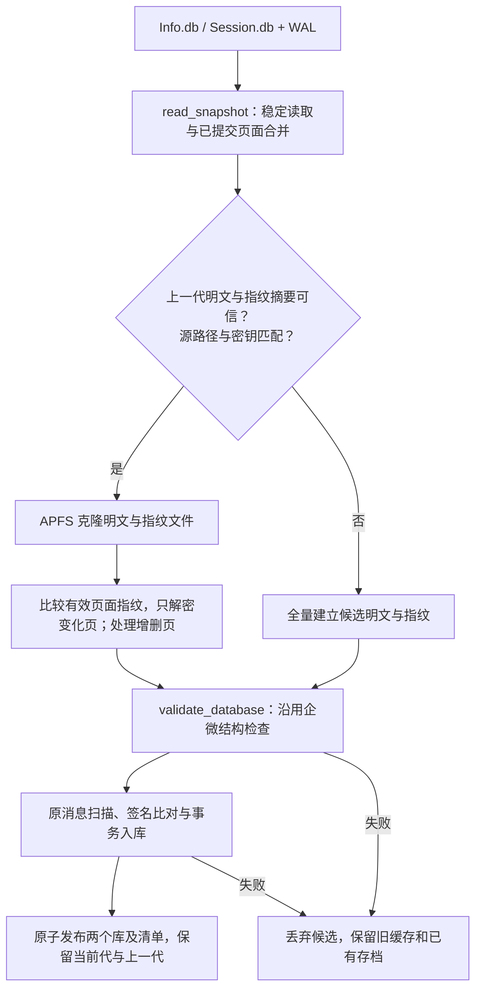

# 企微采集页面复用实测

2026-11-12，本机 macOS/APFS，比较 ChatLab 企微采集器的改造前后。目标是减少重复磁盘写入，保持消息一致；接受仍读取全库及相近的处理耗时。

## 结果与适用范围

旧流程在发现主库、WAL 或密钥文件变化后，每轮重新写出约 57 MiB 的 `Info.db` 和约 1 MiB 的 `Session.db`。新版保存可信明文副本及页面指纹；APFS 上克隆旧文件，再仅解密和覆盖发生变化的有效页面。

同一真实输入的隔离对照包含完整消息扫描、去重入库、指纹落盘、校验摘要和缓存原子发布：

| 场景                                     |  改造前写入 |    新版写入 |  新版耗时 |
| ---------------------------------------- | ----------: | ----------: | --------: |
| 首次建立持久缓存                         | 58.3203 MiB | 58.7578 MiB | 0.9464 秒 |
| 有效页面相同，强制刷新                   | 58.3203 MiB |  0.2070 MiB | 0.6452 秒 |
| 临时副本增加 1 条模拟补录消息，13 页变化 | 58.3633 MiB |  0.4141 MiB | 0.6608 秒 |
| 重建采集器实例，复用已落盘缓存           | 58.3203 MiB |  0.2070 MiB | 0.6501 秒 |
| 同一进程、源文件未变化，直接跳过         |           — |  本次记账 0 | 0.0014 秒 |

变化页样本减少约 99.3% 写入。所有候选明文文件与同输入全量解密结果完全一致；两边 56,326 条消息逐条对照，缺失或变化均为 0，185 个会话名称及类型一致。

本机正式服务已切换到新版。后台首次建立缓存约写入 58.777 MiB；随后一轮手动正常刷新约写入 0.219 MiB。再次重启后台进程后，两个库继续以 `pages` 模式复用，整轮同样约 0.219 MiB，耗时 4.856 秒，`/health` 正常。以上两次复用时没有真实新增消息；它们验证正式服务与重启复用，不代表真实十分钟增量的固定写入量。当前仍保存 185 个会话、56,325 条真实消息，采集间隔保持 600 秒，当前代与上一代共两代缓存，无未完成候选。

“模拟补录消息”只插入私有临时副本，使用较小且未见过的 LID、沿用旧发送时间，验证不依赖最新时间或最大 ID 的补录行为。它没有进入企微源库或正式存档。无变化样本强制执行完整刷新以比较写出成本；原流程在源文件签名完全相同时也会跳过，不能说它空闲时每轮必写 58 MiB。

首次建立仍需一次约 59 MiB 写入。上述是短间隔样本，不是十分钟真实流量或多年磁盘寿命的保证；大批历史补录、缓存重建和其他文件系统可能产生更多写入。所有数值是 macOS 进程记账，不是 SSD NAND 擦写统计。

## 数据路径与失败恢复

缓存位于 `~/.local/share/chatlab-wecom/snapshots/`，目录权限 700、文件 600，与消息存档和企微原始库分离。缓存明文与二进制页指纹作为同一代保存，清单含数据摘要；主库与会话库一起成功后才发布指针。发布前中断留下的候选在下次持有刷新锁时清理；发布后仅限量保留两代。

候选校验或消息入库失败时，旧缓存不变。如果消息事务已成功、缓存发布失败，下次基于旧代重做页面比对；原消息签名去重避免重复增加消息。不同进程共享采集目录的锁，防止手动刷新与后台交错清理候选或发布。

企微 wxSQLite3 没有页面 HMAC；沿用的密钥确认、WAL checksum 与 SQLite 结构校验不提供任意内容篡改的密码学认证。页 SHA-256 和文件摘要用于变化识别与缓存可信性判断，不能扩张为源消息认证。

## 验证与测量方法

- 原有消息回归加缓存回归共 14 项，验证会话隔离、旧时间/较小 ID 补录、分页与去重、HTTP 鉴权、错误回滚、重启复用、坏缓存重建、两个库发布失败保留旧代、源路径与密钥变化、WAL 提交/清空/重建、增长/缩容、并发刷新互斥。
- 底层 WAL 读取器沿用已有的稳定性检查、checksum、未提交尾部处理；此前原型的 17 项边界检查与底层 8 项测试均通过。
- 两条链路使用同一份内存中的已提交镜像，排除采集时真实数据变化导致的对账偏差。原有 WAL 读取/合并仍会执行，隔离对照把这部分放在计时外；此前测得其进程记账写入为 0。正式服务日志测量整个 `refresh()`，含这部分开销。
- SQLite 一致备份准备两套独立测试存档，准备成本不计入刷新；明文文件比较与消息对账在测量区间外。私有数据仅在临时目录内，完成后清理。
- 本次只改 ChatLab 的企微 `bridge.py`，独立问题巡检 `watch.py` 及 QQ/TG 采集不受影响。原十分钟采集与 ChatLab 十分钟拉取配置保持不变。

真实隔离报告保存在采集器私有目录 `performance/page-cache-rollout/full-refresh-comparison.json`，仅含计数与性能统计。常驻服务成功刷新日志增加 `snapshot`、`processWriteMiB` 与 `durationSeconds`，供真实流量下继续核对。
