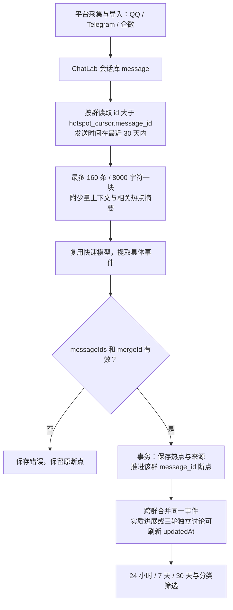
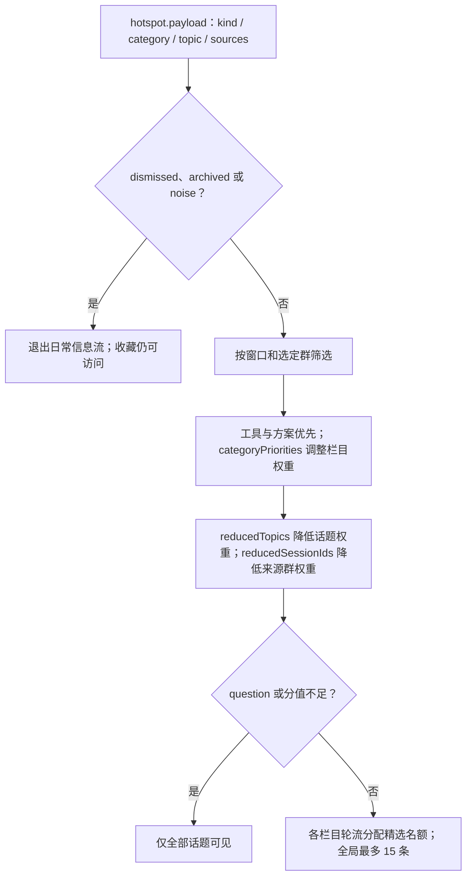
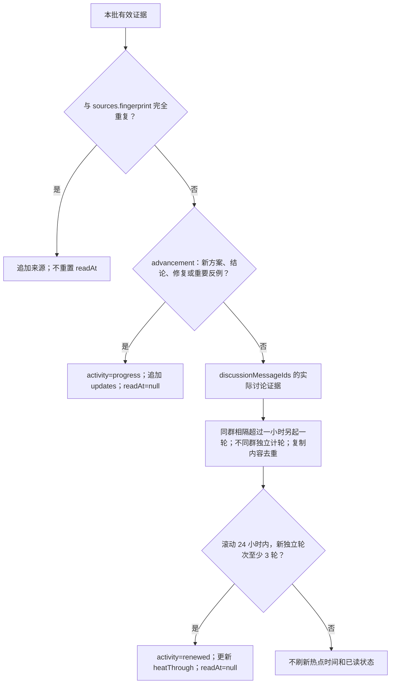
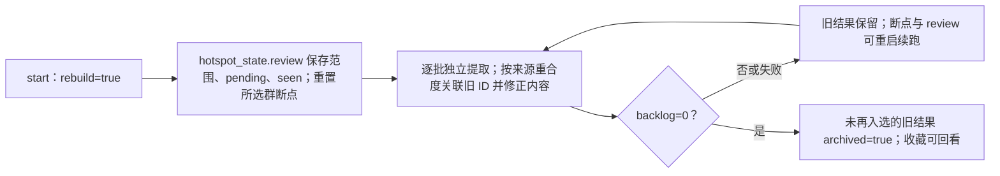
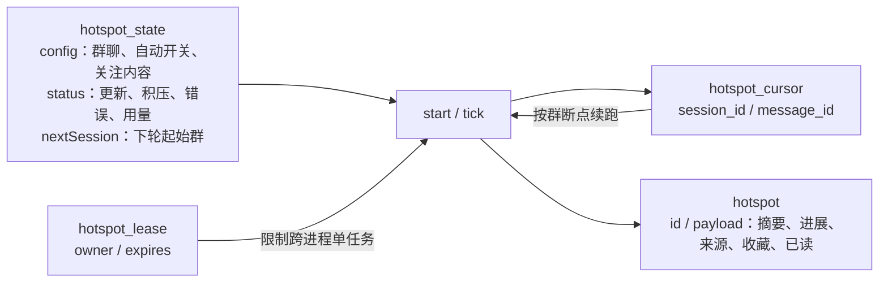
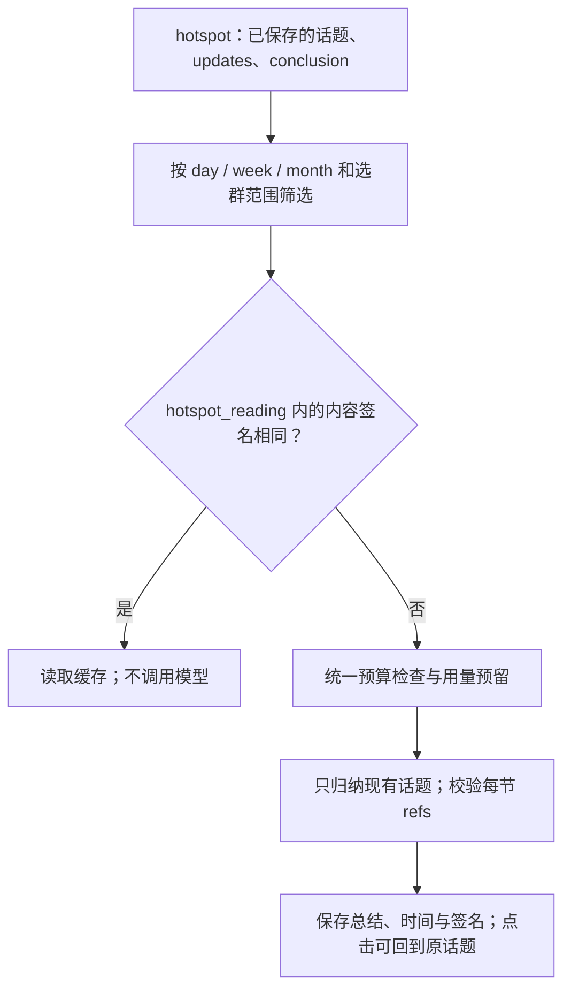
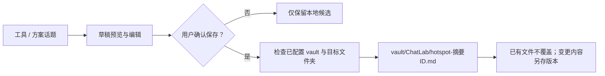
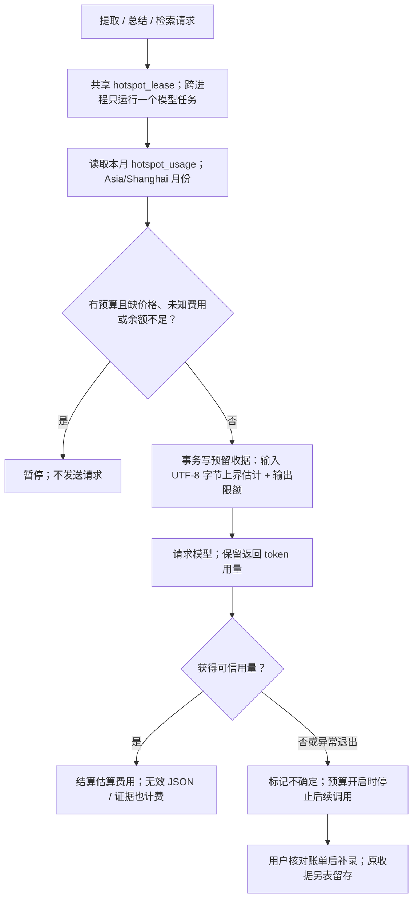

# 群聊热点

独立的跨群信息流，聚合最近 24 小时、7 天和一个月（滚动 30 天）的 AI 动态、科技工具、新闻与八卦趣闻。侧栏入口与页面在 Desktop 和 CLI Web 共用，Web WASM 不执行 Node 分析。

## 使用

打开「群聊热点」→「选择群聊与偏好」，按名称或平台搜索群聊，选择参与分析的群并保存，然后点击「更新热点」。可填写关注内容、开启运行期间每三小时自动分析。复用现有快速模型配置；没有配置模型时明确报错。

24 小时 / 7 天 / 30 天只筛选已保存的热点，不调用模型。「我的收藏」独立展示收藏，不受时间范围限制。默认显示最多 15 条跨群精选，按栏目分配名额，再按工具/方案、新闻、讨论的价值及用户偏好排序；内容不足时不凑数。支持按 AI、科技与工具、新闻、八卦等栏目筛选，或展开全部话题。单条未解答问题进入全部话题，噪音退出日常信息流。

## 消息与增量分析



首次启用仅回溯选定群最近 30 天；后续按本地入库 ID 读取，因此补录的旧时间消息也能被处理。窗口以消息时间计算，不会把分析时间当成事件时间。重复转发增加来源，不把旧热点重新顶到最近 24 小时；实质进展更新摘要、追加进展并重置已读状态。后台同步可能在等待模型时关闭并替换会话连接，因此每批读取前重新获取只读连接，不跨模型等待复用句柄。背景上下文不提供消息 ID，避免被模型误当作本批新证据；所有来源仍必须属于当前块。

跨群去重依赖模型对具体事件的判断。每块提供最多 32 条相关历史热点，优先相同链接和标题关键词；模型使用本批短引用（如 `event-1`），校验后才映射到真实 UUID，避免长 ID 抄写错误；不同发布、版本不能仅因产品名称相同而合并。第一版不提供外部事实核验，群聊传闻保留不确定性，链接仅来自已校验的原消息。

## 精选、证据与反馈

模型返回 `kind`（工具、方案、新闻、讨论、问题、噪音）、稳定的短话题 `topic`、可信度，以及用于计数的 `discussionMessageIds`。问题不能被写成结论；封号、风控和故障反馈必须归因于群友并保留不确定性；意见分歧使用 `disputed`，不能宣称已经核实。工具优先放入 `tech` 栏目。实际语义分类仍依赖模型，证据 ID 校验只能保证引用存在，不能替代事实核验。



少看话题按 `topic` 精确匹配，不等于少看整个栏目；降低来源群权重只在所有选定来源群都被降权时生效。高价值工具和方案仍有机会入选。三个反馈层次互不代替：隐藏单条、少看话题、降低来源群；可在偏好设置中恢复话题和群优先级。偏好写入 `hotspot_state.config`，切换分类、调整偏好、查看收藏不会调用模型。

## 进展与再次热议



`rounds` 使用消息时间，跨批次和重启不重新起轮；后台只保留近两天仍活跃的计数材料。同一波热议触发后，用 `heatThrough` 记录已使用的轮次起点；第 4、5 轮不会再次置顶，要再有至少三轮新的独立讨论才可再次触发。纯分享链接、转发和广告由模型从讨论证据中排除，完全复制内容再由指纹去重。缺省计数字段按空数组处理；计数字段中未同时列为来源的合法消息不会用于计轮；不存在于新消息中的 ID 仍会中断批次。模型把问题误填成 `confidence=question` 时，在解析边界保守归为 `rumor`，不进入精选。

再次热议只增加关注状态，不生成“新结论”；实质进展才追加 `updates`。刷新页面、标记已读不会重算或重置这些判定。

## 用新规则重新整理旧结果

「更新热点」继续按断点做增量分析。「重新整理」回溯最近 30 天并消耗模型用量，适用于筛选规则调整后重新审阅已有结果；API 的 `POST /_web/hotspots/update` 也接受 `rebuild: true` 和 `lookbackDays: 1 | 7 | 30`。



重新整理先隐藏待重审的旧摘要，避免旧标题诱导模型反复保留噪音；新提取的证据与旧条目来源至少一半重合时关联旧 ID。重新整理不把文字修正当成新进展，保留旧 ID 上的收藏、已读和单条隐藏状态。只有完整成功后才归档未入选的旧结果，原聊天数据库始终只读。分析中途更改选群范围会取消未完成的归档计划。升级旧的本地原型时，一次性补齐分类和轮次字段，不清除历史来源、收藏或断点；旧内容需要重新整理才能获得新的语义分类。

已支持质量筛选、分栏偏好、续更判定、旧结果重整、周期总结、自然语言找回、知识候选与确认后写入 Obsidian、范围内群质量推荐，以及金额估算预算和持久用量账本。

## 存储与恢复

派生数据位于 `<userDataDir>/insight/hotspots.db`，原聊天库只读。新文件不改变已有聊天库 schema，旧版本忽略该文件。



每批结果与断点同事务写入；模型失败、输出截断或虚构证据不会推进当前块。共享 SQLite 租约阻止 Desktop 与 CLI Web 同时分析，运行中每 30 秒续约，退出时取消模型请求。进程意外退出后租约最多 180 秒过期，已完成批次保留。

每轮最多 12 次提取模型调用，处理完积压后另按需生成最多三份周期总结；所有调用均计入统一账本和金额估算预算。单个群每轮按群数分配批次额度，并保存下轮起始群，避免靠前的大群耗尽所有预算。页面显示积压，未清空时不更新「全部完成」时间。自动任务每分钟检查是否距上次尝试已满三小时，用户可手动继续；只有所承载的 Desktop / CLI Web 进程运行期间才执行。

每次更新清理超过 30 天无进展且未收藏的派生热点；收藏保留。不会删除原消息或触发平台采集解密。用户取消选中的群后，该群独有的热点退出信息流，断点保留。

## 验证

服务测试使用真实临时 SQLite 与固定模型响应，验证窗口、跨群合并、重复转发与进展、独立讨论计轮与过期、偏好与精选、补录消息、证据校验、重启恢复、旧数据升级、重整失败续跑及收藏保留、并发租约和调用预算；路由测试验证三个窗口、配置与动作校验，以及未配置模型时的错误响应。测试不依赖真实网络或 LLM。

```bash
pnpm test -- packages/node-runtime/src/services/hotspots/service.test.ts packages/http-routes/src/routes/web/hotspots.test.ts
pnpm run type-check:all
```

## 周期总结与按大意找回

24 小时总结关注新动态；七天总结关注进展、方案与结论；月度总结关注重要变化、反复出现的问题和可复用工具。提取完成后根据当前热点内容签名生成，纯阅读和切换窗口不请求模型；也可点击手动生成。每份总结最多输入当前排序靠前的 80 个非提问话题，不声称覆盖全部群聊。摘要条目必须引用本批短话题引用，解析后映射回真实 ID，可点击展开原讨论。



总结缓存按选群范围隔离。话题变化时保留旧总结并标注过期；刷新失败不会冒充新总结。模型提取新增 `outcome`（未解决、待验证方案、讨论内有明确结论、仍有分歧）及 `conclusion`；已解决必须有非空结论，争议不能被归为已解决。这里的“解决”仅指群内讨论，不构成外部事实核验。

「找回话题」按用户的自然语言意图匹配当前选群范围的派生话题，不局限于首页时间窗口，包含保留的旧话题。关键词只用于在超过 200 个话题时初选候选，随后模型按大意匹配最多 10 个结果，必须引用真实候选；页面显示实际扫描数、相关原因、原来源及后续结论，不宣称检索了未覆盖的聊天记录。相同查询及话题内容可复用最近 20 条缓存；已读与收藏变化不触发重复付费，返回状态仍取最新值。

## 待整理知识与 Obsidian

有工具或具体方案的话题自动进入知识候选。点击后在页面显示可编辑 Markdown 草稿，包含用途、待审阅的适用条件、讨论结论、进展、来源群、消息 ID、原文片段及链接。生成草稿不调用模型、不写文件；只有「确认并保存」才写入偏好中显式配置的、含 `.obsidian` 的绝对库路径。



目标目录与文件名由应用确定，不接受模型提供的路径；`ChatLab` 子目录为符号链接时拒绝写入。相同内容重复确认幂等，用户已编辑的文件不被替换。`hotspot_reading` 保存导出路径及内容签名；话题出现实质变化后提示重新审阅，已读或收藏不算知识修订。不会自动整理整个个人知识库或发送通知。

## 范围内群质量推荐

`hotspot_group_batch` 保存本版成功处理批次的消息数及明确标记为噪音的消息数，按群和批次末消息 ID 去重。建议仅针对用户选定范围，结合工具/方案话题占比和识别噪音比例，不按消息数高低排名；展示已分析样本、有效话题、附加来源数等依据。少于 20 条本版分析样本时显示样本不足，旧版分析不会伪造统计；建议不会自动增加分析范围。用户可据此调整来源优先级。

## 金额预算、未知费用与恢复

设置每月金额（空表示不限金额、0 暂停）、币种，以及当前快速模型每百万输入/输出 token 的单价。输入包含缓存读取和写入，统一用用户填写的输入单价估算；这可能高于供应商的缓存优惠价。更换模型后原单价不套到新模型，币种变化也不自动转换旧费用。



这是本模块的估算预算保护，不是供应商账单或供应商强制金额上限：token 计数、缓存价格及供应商计费规则可能不同。余额即使未到 100%，也可能因不足预留下次调用而停止。页面始终标识估算、不确定及未计价部分，未计价不会被解释为免费。

每次调用前写入 `hotspot_usage`，即使网络失败、证据校验失败、输出截断或进程重启，用量收据也保留；失效租约下残留的预留转为不确定。汇总包含本月调用数、输入/输出 token、已计价金额、待结算金额及按来源群的明细；总结与检索没有单一来源群，但仍计入总额。旧版本没有本账本的历史调用不追溯猜测。已知未知费用可由用户核对账单后合计补录，`hotspot_usage_reconciliation` 保存原收据以便审计；这不会自动更改外部账单。

预算不会清除断点或旧热点。提高金额、补充单价或核对费用后可继续；跨月按上海时间自动使用新月额度，不删除上月记录。配置和阅读动作不花模型 token，同一查询或同一总结的有效缓存也可在预算暂停时读取。

新增接口：`POST /digest`、`POST /search`、`GET /recommendations`、`GET /:id/knowledge`、`POST /:id/knowledge` 和 `POST /usage/reconcile`，均位于 `/_web/hotspots` 下。Desktop 与 CLI Web 使用同一服务，不改变原聊天数据库结构。新增派生表为旧版本忽略的独立表；金额保护仅适用于接入本账本的新版热点调用，不覆盖旧程序或其他 AI 功能。
