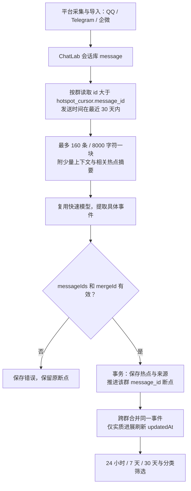
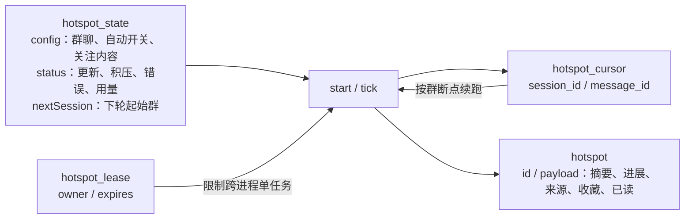

# 群聊热点

独立的跨群信息流，聚合最近 24 小时、7 天和一个月（滚动 30 天）的 AI 动态、科技工具、新闻与八卦趣闻。侧栏入口与页面在 Desktop 和 CLI Web 共用，Web WASM 不执行 Node 分析。

## 使用

打开「群聊热点」→「选择群聊与偏好」，按名称或平台搜索群聊，选择参与分析的群并保存，然后点击「更新热点」。可填写关注内容、开启运行期间每三小时自动分析。复用现有快速模型配置；没有配置模型时明确报错。

24 小时 / 7 天 / 30 天只筛选已保存的热点，不调用模型。「我的收藏」独立展示收藏，不受时间范围限制。分类默认全部、AI 优先，也支持只看 AI。

## 消息与增量分析



首次启用仅回溯选定群最近 30 天；后续按本地入库 ID 读取，因此补录的旧时间消息也能被处理。窗口以消息时间计算，不会把分析时间当成事件时间。重复转发增加来源，不把旧热点重新顶到最近 24 小时；实质进展更新摘要、追加进展并重置已读状态。

跨群去重依赖模型对具体事件的判断。每块提供最多 32 条相关历史热点，优先相同链接和标题关键词；不同发布、版本不能仅因产品名称相同而合并。第一版不提供外部事实核验，群聊传闻保留不确定性，链接仅来自已校验的原消息。

## 存储与恢复

派生数据位于 `<userDataDir>/insight/hotspots.db`，原聊天库只读。新文件不改变已有聊天库 schema，旧版本忽略该文件。



每批结果与断点同事务写入；模型失败、输出截断或虚构证据不会推进当前块。共享 SQLite 租约阻止 Desktop 与 CLI Web 同时分析，运行中每 30 秒续约，退出时取消模型请求。进程意外退出后租约最多 180 秒过期，已完成批次保留。

每轮最多 12 次模型调用，单个群每轮按群数分配批次额度，并保存下轮起始群，避免靠前的大群耗尽所有预算。页面显示积压，未清空时不更新「全部完成」时间。自动任务每分钟检查是否距上次尝试已满三小时，用户可手动继续；只有所承载的 Desktop / CLI Web 进程运行期间才执行。

每次更新清理超过 30 天无进展且未收藏的派生热点；收藏保留。不会删除原消息或触发平台采集解密。用户取消选中的群后，该群独有的热点退出信息流，断点保留。

## 验证

服务测试使用真实临时 SQLite 与固定模型响应，验证窗口、跨群合并、重复转发与进展、补录消息、证据校验、重启恢复、收藏保留、并发租约和调用预算；路由测试验证三个窗口、配置与动作校验，以及未配置模型时的错误响应。测试不依赖真实网络或 LLM。

```bash
pnpm test -- packages/node-runtime/src/services/hotspots/service.test.ts packages/http-routes/src/routes/web/hotspots.test.ts
pnpm run type-check:all
```
