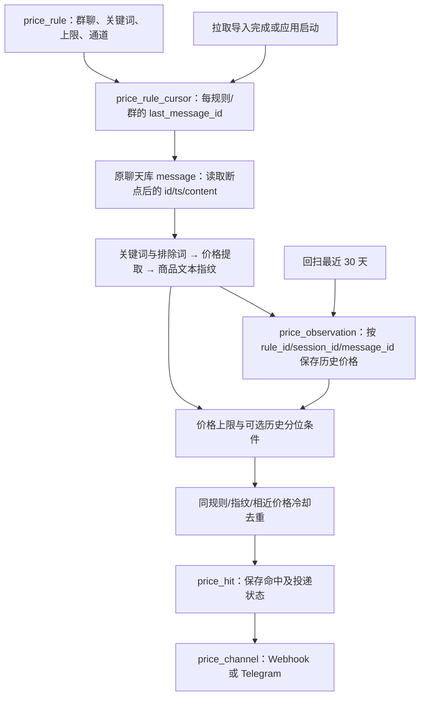

# 好价监控

Desktop 和 CLI Web 共用 `registerPriceWatchRoutes` 与 `createPriceWatchService`；入口为侧栏标签图标，页面路由为 `/price-watch`。Web WASM 不提供此功能。价格由本地规则解析，不调用 LLM。

## 数据流



新规则的游标从当前最大消息 ID 开始，避免历史优惠被当作新消息推送。每轮处理后推进游标；回扫只写历史样本，不创建命中或通知。不同群的同号消息各自保留，多条规则命中的同一原消息只算一份历史样本。

## 匹配与通知

- 关键词按任一命中匹配，命中任一排除词即跳过。价格文本先做 Unicode 与常见谐音规范化；优先识别到手价，过滤分摊单价、红包和优惠券等非商品价格。
- 页面设置绝对价格上限；API 还可指定 `historyPercentile` 和 `minHistorySamples`。样本足够时历史分位条件进一步收紧上限；样本不足时通知会标明不足。未设置任何价格条件的规则不会命中。
- 商品指纹用于同文本商品的历史比较和冷却，不是语义商品识别。带金额标识的价格变化不会改变指纹；商品改写或规格变化仍可能影响匹配。
- 每轮每个群最多处理 5,000 条消息，每批 500 条。更多积压等待后续导入、手动扫描或重启；每轮最多向 5 条命中发送通知，其余保存为 `suppressed`。
- 默认冷却 720 分钟，相同规则和指纹的价格在 ±1% 内合并。投递最多尝试 3 次，每次超时 10 秒；失败记录可手动重投。
- 规则需要应用/服务保持运行并导入新消息；通知不承诺固定延迟。消息正文、群名与价格会发送到用户选择的通道。

## 数据和接口

数据文件为 `<userDataDir>/price-watch/price-watch.db`，不修改会话数据库。首次使用创建独立表：`price_rule`、`price_channel`、`price_rule_cursor`、`price_observation`、`price_hit`。通道中包含 Webhook 地址或 Bot Token，应按本地凭据保护并排除出提交与安装包。

所有接口使用宿主现有的内部 HTTP 认证：

| 路径（前缀 `/_web/price-watch`） | 方法       | 用途                                                           |
| -------------------------------- | ---------- | -------------------------------------------------------------- |
| `/rules`、`/channels`            | GET / POST | 列表与保存；更新用 `?id=...`                                   |
| `/rules/:id`、`/channels/:id`    | DELETE     | 删除规则或通道                                                 |
| `/sessions`                      | GET        | 列出已导入的会话                                               |
| `/hits?limit=...`                | GET        | 最近命中，最多 200 条                                          |
| `/scan/:sessionId`               | POST       | 扫描该群所有启用规则的新增消息                                 |
| `/backfill/:sessionId`           | POST       | 回扫历史基线，body 为 `{ "days": 30 }`，最大 365 天、20,000 条 |
| `/hits/:id/resend`               | POST       | 按规则当前启用通道重投最近命中                                 |

“立即扫描”和“回扫建基线”作用于规则所选群聊，该群的其他启用规则也会参与。回扫不移动增量扫描游标。

## 验证

使用 Node.js 24：

```bash
node scripts/run-tests.mjs packages/node-runtime/src/services/price-watch/parser.test.ts packages/node-runtime/src/services/price-watch/service.test.ts packages/http-routes/src/routes/web/price-watch.test.ts
```

回归覆盖价格语义、上限、冷却、同批去重、跨群存储、历史基线、每轮通知上限，以及真实 HTTP 路由中新规则跳过旧消息、静默回扫和新增消息投递。安装包还需验证侧栏入口和三个页签能加载；真实外部通道由使用者配置后验收。
