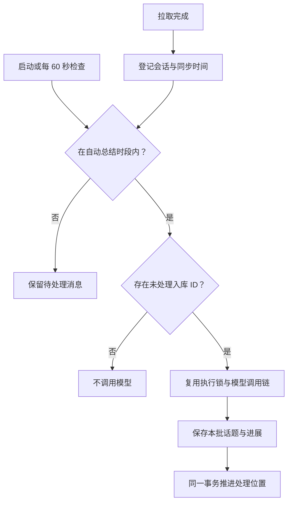
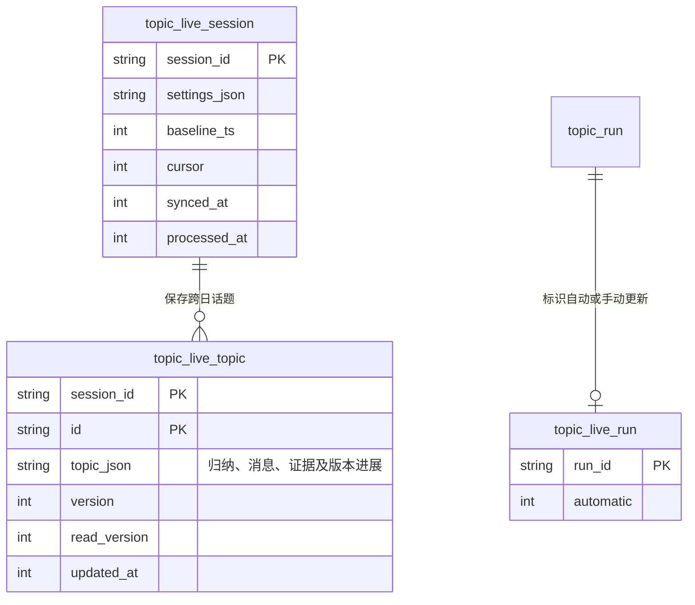

# 自动话题与跨日进展

拉取成功后，通过 `PullEngine.subscribeSessionImported` 通知共享话题 service。Electron 与 CLI Web 使用相同的 HTTP routes、调度与存储逻辑，不依赖话题面板保持打开。

默认自动总结时段为 **Asia/Shanghai 09:30–23:40**，包含开始时刻，不包含结束时刻。每个会话可在话题面板调整时段、时区及开关。时段外保持同步原始消息，暂停 AI 总结；进入时段、应用启动或恢复后，调度器发现待处理数据便合并补齐。应用必须在运行，休眠期间不执行后台任务。

## 整理与恢复

- 自动整理和“立即更新”只处理最近 7 天；待处理消息超过这个滚动范围后不再进入模型。更早历史保留在原消息库，可使用原有批量总结与按日浏览。
- 后续使用消息入库 ID 识别新增记录，近 7 天的新增补录仍会被处理；更早的补录和时间未知的记录不会触发自动整理。重复拉取已由导入链路去重的数据不会产生新模型调用。
- 每个批次保存成功后才推进 cursor。失败时保留未提交批次，自动失败重试至少间隔 5 分钟；应用重启后可继续处理。
- 复用已有全局执行 lease、心跳、交互 AI 抢占与会话删除协调。新增消息在当前批次边界以外时留给下一轮。
- 每次模型调用前检查自动时段。时段外可以通过“立即更新”手动处理，不修改自动时段。
- 手动暂停会阻止自动续跑；手动取消当前任务后，到下一次成功同步才能重新自动启动。

## 归并与依据

`live.ts` 从近期话题及关键词相关的历史话题中选择候选，提供当前消息、旧归纳和有长度上限的代表原文。具体案例可以跨日延续，标题与 ID 保持稳定；模型需区分版本、案例和目标，避免仅因关键词相同而合并。

模型输出完整 `summary` 与本次 `progress`。只有新增话题或带有实质变化的进展才产生新版本；重复讨论只更新消息关联。新增进展必须引用当前批次中的证据，引用 ID 由运行时验证。未读取的图片、附件与转述不能被当成确认结论。

## 存储与阅读

现有按日表保持原结构。自动总结使用新增表，旧版 schema v1/v2/v3 的快照与任务均保留，现有迁移测试继续适用。

“最近更新”展示 `version > read_version` 的话题及未读进展；“全部话题”提供检索与讨论日期筛选；“按日浏览”继续使用原有日快照。用户明确标为已读时，只提交屏幕中已获取的版本，后台并发产生的新版本仍然未读。读取接口本身不会标为已读。

接口位于 `/_web/sessions/:id/topics/`：

| 方法 | 路径          | 行为                                                |
| ---- | ------------- | --------------------------------------------------- |
| GET  | `feed`        | 获取设置、同步/处理时间、待处理数量、话题与最近任务 |
| PUT  | `automation`  | 校验并保存会话的自动总结设置                        |
| POST | `feed/update` | 手动处理待处理消息，可在时段外执行                  |
| POST | `feed/read`   | 按指定话题版本标为已读                              |

`live.test.ts` 使用临时 SQLite 与模拟模型，验证时段边界、夜间积累、空拉取、跨日续接、未读竞争、失败恢复和旧时间消息补录；`ai-chat-topics.test.ts` 与 `pull-engine.test.ts` 验证 HTTP 契约及同步事件。
