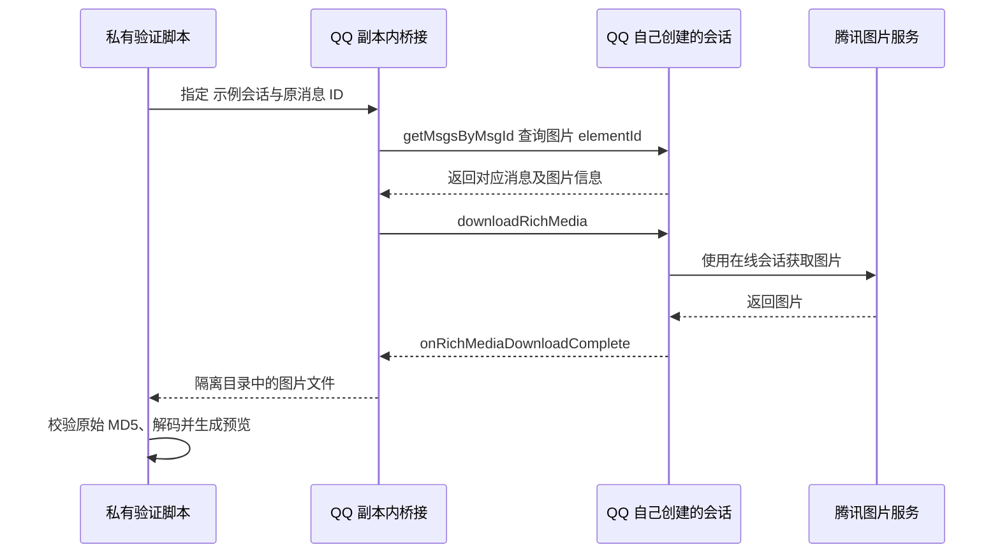

# QQ 历史图片在线补取可行性

研究日期：2026-11-13。范围：本机 macOS、日常原版 QQ 保持使用、ChatLab 当前只读数据库采集；不安装插件、不启动第二个 QQ 登录、不改运行环境。

## 结论

**QQ 在线补图可以做到，且已有真实成功；随后获准进行的独立副本实验也跑通了 QQ 原生下载，恢复了一张旧接口 404 的 示例图片。** 当前 ChatLab 只读缓存的实现尚未接入这些链路。旧接口仅能恢复部分图片，原生桥接也不能承诺所有历史图片，具体实机结果见文末。

新版 `multimedia.nt.qq.com.cn/download` 还需要有效 `rkey`。成熟工具通过已登录的 QQ 协议会话取得、按有效期刷新；当前 ChatLab 的独立数据库读取器没有这项能力。若旧图接口失败，下一阶段应验证复用原版 QQ 同一进程的下载能力。macOS 上直接另启 QCE / NapCat Shell 会与桌面 QQ 冲突，不满足本需求。

## 本机真实验证

以下是主排查任务在本轮执行的结果；这里只记录本地消息 ID、状态和校验结果，不保存 URL、fileid、凭证或图片内容。

| 验证 | 结果 | 能证明什么 |
| --- | --- | --- |
| 示例图片 `sample-A`、`sample-B`：消息中保存的原始 NT 下载相对路径，无 `rkey` | 腾讯 NT 图片接口返回 HTTP 400；错误包含 `rkey` | 不能仅拼接已保存的 `/download?appid=1407&fileid=…&spec=…` 路径完成下载 |
| 示例 `sample-B`：按消息原始 MD5 构造腾讯旧图地址 | HTTP 200、PNG、950,087 字节，内容 MD5 与消息 MD5 严格相等；Sharp 解码 1024×1024、转换 WebP 成功 | 本地没有缓存的图片，仍有可能在线补回；不是只能要求用户手工打开 QQ |
| 同段 8 条缺缓存图片 | `sample-B`、`sample-C` 成功且 MD5 匹配；`sample-D`、`sample-E`、`sample-F`、`sample-G`、`sample-A`、`sample-H` 返回 404 | 该样本恢复 2/8；不能把这个比例外推为所有群、所有时间的成功率 |
| `sample-C` 成功样本 | 41,691 字节、MD5 匹配 | 成功不止单张偶然控制样本 |

腾讯旧图地址形状为 `https://gchat.qpic.cn/gchatpic_new/0/0-0-{消息MD5大写}/0`。本轮只在内存校验图片，不把图片或可识别个人消息的实际下载地址写入仓库。

旧地址返回 404 **不能单独证明图片已在腾讯服务器永久删除**：还可能是该资源不支持旧接口。是否能通过当前 QQ 的正式媒体下载流程恢复，须另测。

## 一手源码证据

### 1. MD5 旧图接口是真实工具已有的回退

NapCat 的可验证源码副本中，`NTQQFileApi.getImageUrlFromMd5()` 按 MD5 构造上述 `gchatpic_new` 地址；NT V2 图片则经 `getRkeyData()` 生成 `multimedia.nt.qq.com.cn` 下载地址。[NapCat fork，固定提交 `98d781d`](https://github.com/escyezi/napcatqq/blob/98d781d19815d1625b24d717ce280ecf0a4f6d0c/packages/napcat-core/apis/file.ts#L315)

LuckyLilliaBot 的 `getImageUrl()` 也区分 NT 下载链接、旧 `/offpic_new/` 链接和无 URL 场景，并在相应分支构造 MD5 旧图地址。[LuckyLilliaBot，固定提交 `de602971`](https://github.com/LLOneBot/LuckyLilliaBot/blob/de602971f850c3965a9b348e7d1f3e723eb1eba7/src/ntqqapi/api/file.ts#L121)

这些源码证明回退方案有实际实现依据；本机下载与 MD5 校验进一步证明其中两张资源当前确实可用。源码中能构造 URL，不等于所有 URL 都可下载。

### 2. `rkey` 是需要取得并续期的下载凭据

NapCat 的 `getRkeyData()` 优先调用已登录协议层的 `FetchRkey()`，依据返回时间与 TTL 决定刷新。协议请求由 `0x9067`、子命令 `202` 构造。源码同时保留远程社区服务与静态回退，不能将这些回退当成长期可靠的产品依赖。[取得与刷新](https://github.com/escyezi/napcatqq/blob/98d781d19815d1625b24d717ce280ecf0a4f6d0c/packages/napcat-core/apis/file.ts#L336)，[协议请求](https://github.com/escyezi/napcatqq/blob/98d781d19815d1625b24d717ce280ecf0a4f6d0c/packages/napcat-core/packet/transformer/system/FetchRkey.ts#L6)

LuckyLilliaBot 同样首先调用自身协议实现 `getRKey()`，按 `createTime + ttlSec` 保存过期时间，再在失败时尝试远程服务。[刷新管理](https://github.com/LLOneBot/LuckyLilliaBot/blob/de602971f850c3965a9b348e7d1f3e723eb1eba7/src/ntqqapi/helper/rkey.ts#L39)，[有效期来源](https://github.com/LLOneBot/LuckyLilliaBot/blob/de602971f850c3965a9b348e7d1f3e723eb1eba7/src/ntqqapi/api/file.ts#L749)

Lagrange 的群图片下载服务使用已登录 `BotContext` 发起 `0x11c4_200`，将响应的 domain、path 和 `RKeyParam` 合成 URL。这是另一份独立实现，支持“完整下载链路需要协议会话”的判断。[群图片下载服务](https://github.com/LagrangeDev/Lagrange.Core/blob/fe789c4a23796fbc82fa09e70a9c44c8a5cf2948/Lagrange.Core/Internal/Services/Message/NTV2RichMediaDownloadService.cs#L31)

### 3. `get_image` 不是通用的“传 MD5 即可刷新所有图片”接口

NapCat 的 `GetImage` 继承 `GetFileBase`。其消息文件分支先解码包含 peer、msgId、elementId 的文件标记，再调用原生下载和消息查询；另有按文件名搜索的分支。数据库里只有 MD5 / 相对 URL，不等于已经具备这个运行时消息上下文。[GetImage](https://github.com/escyezi/napcatqq/blob/98d781d19815d1625b24d717ce280ecf0a4f6d0c/packages/napcat-onebot/action/file/GetImage.ts#L6)，[GetFileBase](https://github.com/escyezi/napcatqq/blob/98d781d19815d1625b24d717ce280ecf0a4f6d0c/packages/napcat-onebot/action/file/GetFile.ts#L34)

真正下载调用 `NodeIKernelMsgService/downloadRichMedia`，包含 msgId、chatType、peerUid、elementId，并等待 `onRichMediaDownloadComplete`。[下载调用](https://github.com/escyezi/napcatqq/blob/98d781d19815d1625b24d717ce280ecf0a4f6d0c/packages/napcat-core/apis/file.ts#L242)

QCE 的 Rust 服务也把这些上下文经 bridge 传给 `FileApi.downloadMedia`，没有只靠读取数据库就自动获得在线会话能力。[QCE bridge 参数](https://github.com/shuakami/qq-chat-exporter/blob/07113d8ebb2be829db9b9c58865a43629cad1a57/qq-chat-export-server/src/napcat/client.rs#L297)

### 4. 复用原版 QQ 同一进程有源码路径，本机 macOS 尚未验证

NapCat Framework 的启动代码拦截 `wrapper.node`，捕获由 QQ 自己创建的 `NodeIQQNTWrapperSession`，把 Session 传给框架初始化。这证明可设计“在同一客户端会话内桥接下载”，并非必然另登录第二个 QQ；但不证明当前 macOS QQ 版本可直接使用该框架，仍需验证加载、签名、接口兼容和稳定性。[同进程 Session 捕获](https://github.com/escyezi/napcatqq/blob/98d781d19815d1625b24d717ce280ecf0a4f6d0c/packages/napcat-framework/napcat.cjs#L93)

LiteLoader 也确实在 QQNT 内加载插件，但当前安装文档涉及修改客户端入口和文件校验处理，不能把它描述为无需改动客户端的独立 HTTP 接口。[LiteLoader 定位与安装](https://github.com/LiteLoaderQQNT/LiteLoaderQQNT/blob/1a8c9707c3673e0491445a1d6d7a86f0a1aa8000/README.md)

QCE 当前 macOS Shell 文档明确要求退出桌面 QQ，专用运行副本占用同一个电脑端登录名额；重新打开桌面 QQ 会把副本顶下线。因此它适合另行导出，不适合直接作为本需求的日常并行取图方案。[QCE macOS 部署约束](https://github.com/shuakami/qq-chat-exporter/blob/07113d8ebb2be829db9b9c58865a43629cad1a57/docs/macos-deploy.md)

### 5. 上游维护状态

截至本次研究，`NapNeko/NapCatQQ` 的 main 固定提交 `105f38e3` 只剩 README，内容宣布结束；因此本报告使用带固定提交的可验证 fork 源码说明技术路径，**不声称原上游仍持续提供上述源码或维护保证**。[原上游当前 README](https://github.com/NapNeko/NapCatQQ/blob/105f38e3ecb1428c147e0f9165f65f854233d988/README.md)

## 建议的最小落地顺序

1. 本地缓存未命中后，按原消息 MD5 尝试腾讯旧图接口；只接受真实可解码图片及匹配原始 MD5 的结果，复用现有鉴权代理、超时、体积限制和 5 GiB 缓存。不要把图片下载链接或任何凭据暴露到前端。
2. 为 DBX 上述两条已成功样本验证端到端显示，并覆盖 404、非图片响应、MD5 不符及重复请求；仍失败的图片保留明确状态。这个步骤不需要第二次 QQ 登录。
3. 旧图接口的实际覆盖率用分时段小样本再测。若覆盖不足，再独立验证同进程 QQ 下载桥接；先证明当前 Mac 能下载一张旧接口 404、原 QQ 仍可打开的图片，然后再决定长期接入。
4. 社区 rkey 服务和硬编码 rkey 只作为理解现有工具行为的证据，不作为默认产品方案。刷新凭据也不等于恢复腾讯已经删除或账号无权访问的资源。

当前仍未验证：本机原版 QQ 同进程桥接、自动取得当前账号 rkey、每张失败图片的服务器保留状态，以及大规模历史图片覆盖率。本轮未安装或运行 NapCat、LiteLoader、Lagrange，没有修改 QQ 登录、客户端或个人配置。

## 第一次本机运行验证：不改原版 QQ 的方式尚未跑通

本节是后续实际运行实验，替代上文对“尚未进行本机桥接验证”的时间状态描述，不改变旧图片接口的 2/8 成功结果。

- 原版安装包显示 6.9.89，但启动器实际加载账号容器中的热更新资源 **7.0.1-52892**。因此仅分析安装目录里的旧版资源不足以判断当前接口兼容性。
- REA 检查 QQNT 引擎的 arm64 fuse，观察到 Node Inspector 参数、NodeOptions、RunAsNode 开关为 enabled；这只是引擎能力，不证明 QQ 启动器会开放它们。证据：`ev_d4d4500c804f7745d22ca00cb1d427d57898b6c907386f5bc8299026b8858458`。
- 分别使用 `--inspect=127.0.0.1:19229` 和 Chromium `--remote-debugging-port=19222` 启动同一原版 QQ，实际均未出现可访问的调试端点。不能将 fuse enabled 直接等同于调试可用。
- `ELECTRON_RUN_AS_NODE` 探测未进入普通 Node 执行模式，探测启动器已停止；不能用这个方式直接运行 QQ 内部 JavaScript。
- 进一步以临时 `NODE_OPTIONS=--require=...` 引导仅本机 Inspector，标记文件未生成，端点仍不可访问。临时引导文件已移除，未修改 QQ 应用文件。
- LLDB 对当前 QQ 进程的附加被 macOS 拒绝，返回 `Not allowed to attach to process`；未获取 QQ 会话对象，也未调用媒体下载服务。
- 对实际热更新 ASAR 的定向静态分析确认 `app_launcher/index.js` 是非 UTF-8 数据；这条路径无法直接按普通 JavaScript 源码分析。证据父记录：`ev_69b73181afdb364aff75f021cf8aeb062f02e28f68f2a5d5460dfd18eebef5f6`。所选文件之外的调用关系仍未知。
- 实验结束已恢复 `/Applications/QQ.app` 无调试参数启动，核对只存在一个主进程，界面正常显示现有账号及会话列表。没有安装插件、修改签名或启动独立 QQ 登录副本。

**结论边界：已否定本轮尝试的几种“不改 QQ 文件即可直接接入”方式，尚未证明所有桥接方式都不可行。** 下载验收目标尚未达到：没有通过程序调用原版 QQ 下载旧接口 404 的图片。继续验证需要研究客户端内加载桥接的方式或隔离副本实验；须单独处理签名、账号数据路径、同一登录名额和回退，不能直接当成已可部署功能。

另外，共用图片缓存已调整为 **5 GiB**，并完成本机 ChatLab 桌面包构建、安装和新实例核对；此调整不会新增在线下载能力。

## 独立副本实验：QQ 原生图片下载已跑通

用户随后明确授权在可回退的实验副本内验证插件加载，要求保留原版、避免两个实例同时登录。本节更新前一阶段“原生桥接尚未跑通”的结论；没有将实验代码安装到日常 QQ，也没有接入 ChatLab 产品。

### 实验边界与实现

1. 在仓库外私有目录制作 `QQ-Bridge-Trial.app`，使用原版启动器、当前实际运行的 **QQ 7.0.1-52892 资源及 QQNT 40.0.0 引擎**。仅副本调整入口并自签名，主程序与嵌套 Helper 使用实验 entitlement；原版程序与签名保留。
2. 退出原版 QQ 后，对约 8.7 GiB 的账号数据制作独立副本，41,812 个文件使用 APFS clone，另有 2 个普通复制；原始数据库不供实验进程写入。实验时检查到原始 QQ 数据库句柄 0 个、隔离数据句柄 91 个。
3. 在副本 `package.json` 中指定临时 CommonJS 入口，启动前拦截 `wrapper.node` 的加载及 `NodeIQQNTWrapperSession.getNTWrapperSession()` 返回值。会话仍由 QQ 创建并正常初始化，桥接只保存它的引用。
4. 运行观察确认入口执行、wrapper 和 Session 均已捕获，实验 QQ 界面及新消息接收正常。Inspector 依然不可用，因此使用实验私有目录下的文件邮箱发出验证指令；没有开放额外网络控制接口。
5. 使用原消息的群标识和 64 位消息 ID 调用 `getMsgService().getMsgsByMsgId()`，4 个样本均返回 `result=0`，且返回消息 ID 与请求一致。取得对应图片 `elementId` 后调用 `downloadRichMedia()`，等待 `onRichMediaDownloadComplete`，再校验文件内容。

### 真实结果

| 脱敏样本编号 | 对照条件                       | QQ 原生下载 | 文件大小     | 解码结果       | 原始 MD5 校验 |
| ------------ | ------------------------------ | ----------- | ------------ | -------------- | ------------- |
| `sample-A`   | 原本无本地缓存，腾讯旧接口 404 | 成功        | 1,995 字节   | JPEG，120×114  | 一致          |
| `sample-B`   | 原本无本地缓存，旧接口可取回   | 成功        | 950,087 字节 | PNG，1024×1024 | 一致          |
| `sample-C`   | 原本无本地缓存，旧接口可取回   | 成功        | 41,691 字节  | PNG，646×417   | 一致          |
| `19780`      | 最近图片，对照样本             | 成功        | 162,806 字节 | PNG，1920×1050 | 一致          |

4 张图片均收到完成事件、内容 MD5 与原消息一致，并通过 Sharp 解码及 WebP 预览转换。**消息 `sample-A` 达成验收目标：通过程序调用 QQ 下载了一张本地缺失、旧接口失败的图片。** 这不是全量历史图片覆盖率测试，也不证明腾讯已删除、账号无权访问的图片可恢复。

实验实际链路：

### 回退与交付状态

- 实验副本已退出，临时运行数据链接已移除，原版 `/Applications/QQ.app` 已恢复正常启动；核对只存在一个原版主进程，实验主进程为 0。
- 对原版程序入口与可执行文件检查哈希一致；实验前后的 42 个原始数据库文件大小、修改时间和前段哈希全部一致。恢复后通过界面确认原版账号及会话列表正常。
- 实验代码、图片、账号副本与明细结果保存在本机私有目录 `~/.local/share/chatlab-qq/performance/bridge-plugin-trial-20261113/`，不进入 Git。公开报告只保留脱敏样本代号和校验结论。
- **技术可行性已验证，产品接入尚未完成。** 若落地为日常能力，应把临时文件邮箱替换为仅提供取图操作的本机鉴权接口，定义客户端版本适配和更新/回退流程，再验证与 ChatLab 的会话映射、缓存、退出及失败处理。
