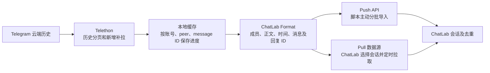

# Telegram 消息导入 ChatLab：方案调研

调研日期：2026-11-12。核对官方文档、公开源码及本机 CLI 能力；没有登录 Telegram、抓取私人聊天或执行实际导入。

## 结论

**导入已有历史，优先用 Telegram 官方 JSON 导出，ChatLab 已有原生解析器，无需开发转换器。持续自动同步，再考虑独立的 Telegram 数据源桥接。**

Agent Reach 和 OpenCLI 适合辅助检索与读取资料。目前二者的本机能力列表均没有 Telegram 专用导出入口，不能直接构成“TG → ChatLab”链路。OpenCLI 作者的独立项目 `tg-cli` 值得复用，但存在历史截断和字段缺失，不能原样作为完整迁移方案。

| 方案 | 历史消息 | 后续增量 | 与 ChatLab 的衔接 | 建议 |
| --- | --- | --- | --- | --- |
| 官方客户端 JSON 导出 | 导出所选范围内、账号可见的聊天历史 | 定期重新导出，再增量导入 | 原生支持 | 一次性迁移首选 |
| `tg-cli` | 默认只缓存最近一部分；可显式提高拉取数量 | 有 refresh / listen，但有缺口风险 | 需转换；缓存缺回复和完整媒体信息 | 小规模文本同步候选 |
| `tdl` | 可按时间、ID、主题或回复导出 | 用 ID / 时间窗口自行调度 | 默认 JSON 缺发送者；需 raw 数据、成员解析及转换 | 已用 tdl 或重视媒体下载时考虑 |
| Telethon → ChatLab Push / Pull | 可自行实现完整分页、断点及核验 | 可按消息 ID 补拉，结合事件监听 | 转为 ChatLab Format，接已有协议 | 长期自动同步首选开发方向 |
| TDLib → ChatLab | 官方客户端库，可分页读取历史 | 可处理客户端更新 | 仍需实现桥接和转换 | 已有 TDLib 基础时考虑 |
| Bot API | 不能回溯账号完整聊天历史 | 只接收机器人有权收到的更新 | 可以转换新增消息 | 不适合本次历史迁移 |

以上“全量”仅指账号实际可读取、所选范围内的云端历史；不能恢复已删除或无权访问的消息，也不包含其他设备上的 Secret Chat。[Telegram Secret Chat FAQ](https://telegram.org/faq#q-how-are-secret-chats-different)、[Takeout API](https://core.telegram.org/api/takeout)

## 1. 最少操作：官方 JSON → ChatLab


Telegram Desktop 支持两类入口：单聊天菜单的 Export chat history，以及 Settings → Advanced → Export Telegram data。导出选 JSON，将主文件 `result.json` 导入 ChatLab；只分析文字时可先不下载大体积媒体。[Telegram 官方介绍](https://telegram.org/blog/export-and-more)、[ChatLab 导出指南](https://docs.chatlab.fun/usage/how-to-export#telegram)、[导入指南](https://docs.chatlab.fun/usage/how-to-import)

新登录的 Desktop 可能需要等待 24 小时，也可在另一台已登录设备上确认导出请求。[Telegram 官方导出提示](https://bugs.telegram.org/c/60)

### macOS 客户端的实际情况

本机 `/Applications/Telegram.app` 是 `ru.keepcoder.Telegram`、版本 13.2.0，即原生 macOS 客户端。**不能再笼统地说原生 macOS 版没有 JSON 导出**：当前官方源码已经提供全账户 HTML / JSON / Both 选项，并生成 `result.json` 和 `chats.list`。但本次未检查已安装版本的实际菜单，不能把源码能力等同于本机已可用；若找不到 JSON 入口，跨平台 [Telegram Desktop](https://desktop.telegram.org/) 是官方文档明确支持的路径。

源码证据：官方 macOS 提交 `ec221d8560ca693cb921b4e8c576da9b87dff9ef` 的 [格式选项](https://github.com/TelegramMessenger/telegram-macos/blob/ec221d8560ca693cb921b4e8c576da9b87dff9ef/packages/ChatExportUI/Sources/ChatExportUI/ChatExportController.swift#L1459)、[JSON writer](https://github.com/TelegramMessenger/telegram-macos/blob/ec221d8560ca693cb921b4e8c576da9b87dff9ef/packages/ChatExportUI/Sources/ChatExportUI/ExportJsonWriter.swift)。单聊天运行类默认 HTML，因此操作时仍需确认最终格式。[ChatExportManager](https://github.com/TelegramMessenger/telegram-macos/blob/ec221d8560ca693cb921b4e8c576da9b87dff9ef/packages/ChatExportUI/Sources/ChatExportUI/ChatExportManager.swift#L191)

### ChatLab 当前保留什么

本机仓库版本 0.37.7，提交 `c9271089`，已存在：

- 单聊天：`packages/parser/src/formats/telegram-native-single.ts`，读取根节点 `name/type/id/messages`。
- 全账户：`packages/parser/src/formats/telegram-native.ts`，读取 `chats.list[]`，支持通过 `chatIndex` 选择聊天。
- 浏览器运行时：`packages/parser/src/browser/telegram.ts`，有单聊天和全账户解析。
- 共享字段处理：`packages/parser/src/formats/utils/telegram-utils.ts`。

发送者、秒级时间戳、正文、平台消息 ID、回复目标 ID 均有映射。富文本转为纯文本；图片、视频、语音、贴纸等保留类型及文字占位/说明，不能把它当作完整媒体档案、可播放备份或反应/话题等全部元数据的无损迁移。

安装 ChatLab CLI 后，单聊天文件可按如下流程预览和导入。本机当前没有 `clb` 命令，以下仅为已核实源码的使用示例，本次没有安装或执行：

```bash
clb import "/absolute/path/to/result.json" --dry-run --json
clb import "/absolute/path/to/result.json" --json
```

若要追加到明确的已有会话，两条命令都加 `--session-id <id>`。全账户多聊天文件优先走 UI 选择器；本机 CLI 公开命令未提供 `--chat-index` 选项，不能直接承诺一条命令导入全部会话。证据：`apps/cli/src/import/command.ts`。

## 2. OpenCLI 与 Agent Reach 的实际位置

本次实际执行：

```bash
opencli --version
opencli list telegram -f json
agent-reach channels
agent-reach github search 'telegram chatlab' --limit 8
agent-reach github read iyear/tdl
opencli web read --url https://docs.chatlab.fun/usage/how-to-export --stdout --download-images false
```

本机 OpenCLI 2.0.3 的 Telegram 查询返回 `commands: []`；Agent Reach 当前渠道表也没有 Telegram。OpenCLI 的通用网页读取成功获取了 ChatLab 官方导出说明，Agent Reach 用于 GitHub 检索、项目 README 和网页补读。它们在此次任务中是资料获取工具。

可以开发 Telegram Web 的 OpenCLI 适配器，但网页虚拟列表、滚动加载、分页和字段恢复仍需单独解决；“读取了页面”无法证明“导出了完整历史”。相比已有原生导出及 MTProto 接口，这条路线当前不优先。此为工程判断。[OpenCLI 适配器目录](https://opencli.info/docs/adapters/)、[Agent Reach](https://github.com/Panniantong/Agent-Reach)

## 3. 同作者独立项目 tg-cli：方便，但不能默认全量

[`jackwener/tg-cli`](https://github.com/jackwener/tg-cli) 使用个人账号走 Telethon / MTProto，将消息同步到本地 SQLite，再搜索或导出。它不是 OpenCLI 的 Telegram 子命令，导出的 JSON 也不是 Telegram Desktop 或 ChatLab 标准格式。

核对提交 `b54a14da62a5e03cbd6d65d4b8dc95932194d2d0` 后发现：

| 行为 | 当前实现 | 导入影响 |
| --- | --- | --- |
| `refresh` / `sync-all` 首轮 | 每聊天最近 500 条 | 更老历史不会自动补齐 |
| 后续同步 | 基于本地最大 ID，只获取更新消息，单轮有限额 | 积压超过限额时可能跳过中间消息 |
| `tg sync CHAT -n N` | 默认 5000，已有缓存后仅向新同步 | 提高 N 不等于回补已有缓存之前的历史 |
| `tg history CHAT -n N` | 默认 1000，可显式增加 N，从最新向旧抓取 | 可用于首轮，但必须核对范围；没有文档化无限模式 |
| `tg export` | 查询硬编码最多 100000 条 | 超过十万条需要改造或分段另取 |
| 缓存字段 | 正文、发送者、时间、消息 ID 等 | 没有完整回复、entities 和附件结构 |

源码：[client.py](https://github.com/jackwener/tg-cli/blob/b54a14da62a5e03cbd6d65d4b8dc95932194d2d0/src/tg_cli/client.py)、[history 命令](https://github.com/jackwener/tg-cli/blob/b54a14da62a5e03cbd6d65d4b8dc95932194d2d0/src/tg_cli/cli/tg.py)、[sync 命令](https://github.com/jackwener/tg-cli/blob/b54a14da62a5e03cbd6d65d4b8dc95932194d2d0/src/tg_cli/cli/_sync.py)、[export 命令](https://github.com/jackwener/tg-cli/blob/b54a14da62a5e03cbd6d65d4b8dc95932194d2d0/src/tg_cli/cli/data.py)。

适合：规模受控、主要关注文本、接受自行转换及核对的 CLI 工作流。若目标是可靠全量迁移和完整回复关系，直接用 Telethon 构建小型桥接通常更清楚。`tg listen --persist` 只监听新增消息，不能据此承诺同步编辑和删除。

## 4. tdl：现成导出 CLI，但要检查字段

`tdl` 支持时间范围、ID 范围、最近 N 条、论坛主题及帖子回复导出。[官方导出文档](https://docs.iyear.me/tdl/guide/tools/export-messages/)

拟用于后续适配时，至少需要类似以下命令；这是方案示例，本次未安装或运行：

```bash
tdl chat export -c CHAT --all --with-content --raw -o telegram-raw.json
```

三个参数各有用途：`--all` 包含非媒体消息，`--with-content` 包含正文和时间，`--raw` 附带 MTProto 原始消息。默认输出只有 `id/type/file` 等简化信息，加正文后仍没有顶层发送者信息，无法直接满足 ChatLab 按成员分析的要求；需要从 raw 提取发送者和回复信息，并另行解析成员名称。

源码的 `Message` 结构及导出循环明确体现上述行为，而且程序提示其默认输出偏向下载用途。它只处理普通 `tg.Message`，不能据此承诺所有 service 事件都完整保留。[export.go，提交 70c561c0](https://github.com/iyear/tdl/blob/70c561c0a6d44d8d7fffdea14988fc4104bc56d2/app/chat/export.go)

因此，tdl 更适合已有该工具、还需下载媒体的场景；如果只是把历史导入 ChatLab，官方 JSON 更省步骤。

## 5. 长期方案：Telethon 数据源桥接



Telethon 的 `iter_messages(limit=None)` 可以遍历账号可见历史；增量使用 `min_id` 等参数。Telegram 的 `messages.getHistory` 仅供用户账号使用，不能换成 Bot API 来获取同样历史。[Telethon 文档](https://docs.telethon.dev/en/stable/modules/client.html#telethon.client.messages.MessageMethods.iter_messages)、[Telegram getHistory](https://core.telegram.org/method/messages.getHistory)

建议分两步：先做“单个聊天 → 标准文件 → 预览 → 导入”的可核验闭环，再补全量分页、断点和增量。桥接独立于 ChatLab 主仓库，复用现有协议即可，无需直接写 ChatLab SQLite。

### Push：个人脚本起步更直接

分批调用 `POST /api/v1/imports/:sessionId`，首次创建、后续追加；接口使用 Bearer Token。固定 sessionId，同一会话内保留稳定的 `platformMessageId`，重试时使用稳定的 `Idempotency-Key`。官方 JSON 请求体上限 50MB。[Push 协议](https://docs.chatlab.fun/standard/chatlab-import)

若从官方文件导入切换到 API 推送，必须先查询并复用目标 ChatLab sessionId，不能另造 ID 而产生第二份会话。多账号情况下，应在桥接内部明确账号和 peer 类型，避免裸数字 ID 混淆。此为接入建议。

### Pull：要在 ChatLab 内管理同步时更合适

桥接暴露 `GET /sessions` 和 `GET /sessions/:id/messages`，返回 ChatLab Format 与 `sync.hasMore / sync.nextSince`；ChatLab 负责选择会话、续拉和定时同步。ChatLab 官方把 Pull 作为推荐的第三方长期集成方式。[Pull 协议](https://docs.chatlab.fun/standard/chatlab-pull)

TG 采集端按消息 ID 维护断点，ChatLab Pull 协议则用秒级 since；二者不能直接混作同一种游标。实现时需覆盖同秒消息跨页和时间边界的无遗漏验证，允许重叠回放再去重；若暂时做不好这层映射，先用 Push 分批跑通更直接。此为工程建议，未实现验证。

### 当前不能承诺的能力

- 现有 Push 写入器遇到重复消息跳过，不是按同 ID 更新正文。因此“新增消息同步”不等于“编辑、删除双向镜像”。证据：`packages/node-runtime/src/services/push-importer.ts` 的重复判断与增量插入循环。
- 附件在 ChatLab 协议中仍是预留字段，官方不承诺完整落库及渲染；不要把下载了媒体和 ChatLab 能播放媒体混为一谈。[Push 附件约定](https://docs.chatlab.fun/standard/chatlab-import)
- 全量结束后应核对首末时间、消息数、分页完整性、回复目标和重跑去重；本次只是调研，尚无真实账号的端到端结果。

## 6. 为什么不优先 Bot API / TDLib

Bot API 的 `getUpdates` 是接收机器人更新，不是账号聊天历史接口；未消费更新最多保留 24 小时，无法用于回溯完整旧聊天。[Bot API](https://core.telegram.org/bots/api#getting-updates)

TDLib 是可行的官方客户端库；`getChatHistory` 每次最多返回 100 条，可能少于请求数量，仍需继续分页。已有 TDLib 应用时可复用，当前需求若从零起步，Telethon 更容易做小范围桥接。[TDLib getChatHistory](https://core.telegram.org/tdlib/docs/classtd_1_1td__api_1_1get_chat_history.html)

## 本次验证边界

已完成：官方资料和源码核查、Agent Reach 实际检索、OpenCLI 实际读页与能力查询、本地 ChatLab 解析器和导入协议核查。本次没有更改应用代码、安装工具、操作登录、访问聊天记录、导入数据库或配置定时任务。

建议落地顺序：**先导入一份官方 JSON；明确需要自动同步后，再做 Telethon → Push，若要从 ChatLab UI 统一管理多个聊天，则接 Pull。**
